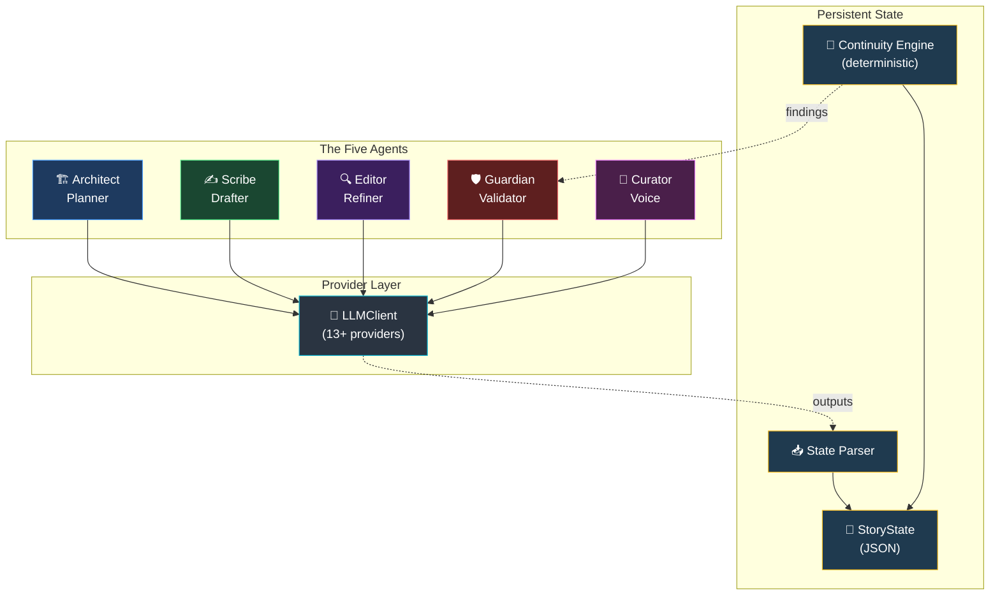
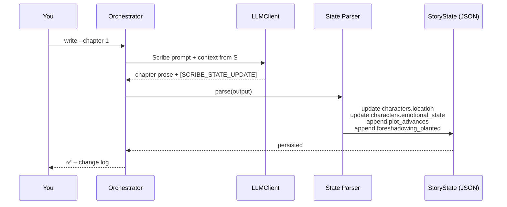
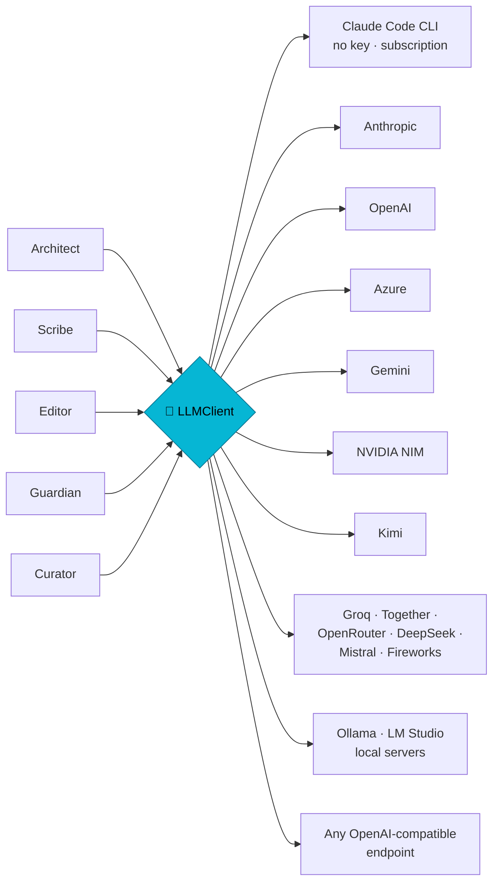

<div align="center">
  
</div>

<div align="center">
<h3>A Writing Studio with a Story Model That Knows When an Edit Breaks the Book</h3>

<p><em>Scrivener's structure, Word's editing surface, and an agent pipeline that remembers chapter 3.</em></p>

<br/>

[](https://python.org)
[](LICENSE)
[]()
[]()
[]()
[]()

<br/>

```
╔══════════════════════════════════════════════════════════════════╗
║                                                                  ║
║   "The difference between an amateur and a professional          ║
║    writer is a systematic process."                              ║
║                                                                  ║
║                              Novel OS Philosophy               ║
╚══════════════════════════════════════════════════════════════════╝
```

</div>

---

## 🌟 What is Novel OS?

**Novel OS** is a complete **editorial infrastructure** for producing professional-quality novels using multiple specialized AI agents working in concert with any LLM you choose (Claude, GPT, Gemini, Llama, Kimi, local models, anything OpenAI-compatible).

Traditional AI writing generates one response and forgets everything. Novel OS is different:

- 🧠 **Persistent memory** agent outputs are parsed and merged into a central state file. Characters, locations, plot threads, foreshadowing, and quality scores accumulate chapter by chapter.
- 🤝 **Agents collaborate** Architect → Scribe → Editor → Guardian → Curator, each handing off to the next with full context.
- 🛡️ **Deterministic + LLM validation** a free local continuity engine catches dormant threads, unresolved foreshadowing, and timeline drift *before* the LLM Guardian runs.
- 🔌 **Provider-agnostic** Anthropic, OpenAI, Azure, Gemini, NVIDIA NIM, Kimi, Groq, Together, OpenRouter, DeepSeek, Mistral, Fireworks, Ollama, LM Studio, or any OpenAI-compatible endpoint.

> Think of it as hiring a **full-time editorial team** story architect, prose craftsman, line editor, fact-checker, voice coach all working on your novel around the clock, on infrastructure that actually remembers what happened in chapter 3.

<p align="center"></p>

---

## 🖼️ The Studio

Novel OS is a **writing studio**, not just a CLI. The engine still runs headless the command line is a first-class way to use it but the day-to-day surface is a browser app with a real manuscript editor.

### Three modes, not four stages

Writers move between **planning, writing and revising** constantly, and rarely in order. The mode switch (`⌘1` `⌘2` `⌘3`) re-lays out the whole studio around whichever one you're in. The pipeline's four stages still exist, but as *provenance* where a paragraph came from rather than as a workflow you're supposed to march through.

<p align="center"></p>

**Plan** leads with structure the shape-of-the-book strip, the outliner, the Codex and the relationship chart.

### Write mode gets out of the way

<p align="center"></p>

Both rails collapse, continuity runs silently, and **nothing volunteers itself** no ghost text, no hovering suggestions, no token meter. Select a passage and a single bar appears with the only four things worth doing to it. That's the whole AI surface while you're drafting.

### Revise shows you the book as it is

<p align="center"></p>

The Inspector opens on continuity with real findings and here's the part that matters **"This is intentional."** A checker can't tell an unreliable narrator from a mistake, so every finding can be dismissed with a reason that persists into `story_state.json`. The Guardian reads those exemptions too, so the AI never re-litigates a call you've already made.

<p align="center"></p>

Compile lives here too: named styles drive the export, so you change what "Block Quote" means once and the whole book follows.

---

## 🏛️ Architecture



---

## 🎭 The Five Agents

| # | Agent | Role | Outputs |
|---|---|---|---|
| 1 | 🏗️ **Architect** | Story planner designs 3-act structure, character arcs, beats | `outline.json`, expanded `chapter_NNN_outline.md` |
| 2 | ✍️ **Scribe** | Prose drafter writes the chapter in deep POV | `chapter_NNN_draft.md` + `[SCRIBE_STATE_UPDATE]` block |
| 3 | 🔍 **Editor** | Line surgeon 5 modes: line / developmental / pacing / dialogue / tension | `chapter_NNN_revised.md` + `[EDITOR_STATE_UPDATE]` with before/after scores |
| 4 | 🛡️ **Guardian** | Forensic fact-checker character, timeline, world, plot continuity | `chapter_NNN_continuity_report.md` with `Status: PASS/WARNING/FAIL` |
| 5 | 🎨 **Curator** | Voice stylist locks tone, prose rhythm, genre conventions | `[STYLE_STATE_UPDATE]` with consistency / genre / voice scores |

Every agent prompt now includes a strict **OUTPUT CONTRACT** that forces the LLM to emit machine-parseable update blocks verified working with frontier models (Claude, GPT) and open-weight models (Llama 3.3 70B).

---

## 🔄 The Chapter Workflow


**Quality gates** a chapter cannot be approved while `Status: FAIL` is on file. Resolve the issue and re-validate.

<p align="center"></p>

---

## 🧠 Persistent Memory How State Actually Lives

The defining feature: **every agent's structured output is parsed and merged into a central JSON state**, so subsequent agents see what came before.



Captured per chapter: character locations, emotional states, last-appearance index, key events, foreshadowing planted/resolved, new information revealed, editor quality scores (before/after), continuity status & issues, style scores.

---

## 🔬 The Continuity Engine

Deterministic, free, instant runs before the LLM Guardian on every `validate`, and on demand via `check`.

| Check | Severity | Catches |
|---|---|---|
| `dormant_thread` | warning | Active plot threads idle >3 chapters |
| `overdue_thread` | **critical** | Threads past their `target_resolution_chapter` still active |
| `unresolved_foreshadowing` | warning | Planted seeds with no matching `resolved` entry |
| `absent_character` | warning | Main characters silent >5 chapters |
| `never_appeared` | warning | Protagonists/antagonists who never showed up |
| `dead_character_state` | warning | Flagged-dead characters with active state |
| `missing_chapter_file` | **critical** | Chapter marked complete but no manuscript file |
| `status_drift` | info | Draft exists but status still `planned` |
| `thin_character` | info | Main characters with no `internal_desire` set |
| `relationship_orphan` | warning | A bond pointing at someone who isn't in the cast |
| `hostile_pair_co_present` | warning | Enemies sharing a scene with no acknowledgement |
| `relationship_since_anachronism` | warning | A bond that starts before the people meet |
| `contradictory_relationship` | warning | Two bonds that can't both be true |
| `dead_bonded_co_presence` | **critical** | A dead character still turning up in scenes |
| `stalled_middle` | warning | See below the one nobody else checks for |

```bash
python core/orchestrator.py check                 # check whole project
python core/orchestrator.py check --chapter 12    # check as-of a specific chapter
```

Findings are also injected into the LLM Guardian's prompt as context the Guardian gets a head start instead of rediscovering obvious issues, and you don't spend tokens on them.

### Every finding can be wrong and you can say so

A checker cannot tell an unreliable narrator, deliberate foreshadowing, or a character who *lies* from a genuine mistake. So each finding carries **"This is intentional"**, with a reason, persisted into `story_state.json` and keyed to the *fact* rather than the wording so a dismissal survives rewordings and re-sightings. The filter lives in the engine, which means the panel, the CLI and the Guardian all agree.

Without that, a continuity panel re-raises the same non-error every run until you stop reading it and a check you ignore is worth less than no check at all.

### The sagging middle, measured

Middles are where books die, and the failure has a shape: **the protagonist goes reactive** things happen *to* them and they stop pursuing anything. That sounds subjective, but it decomposes into things the state already records per chapter plot advances, character development, emotional beats, new information, threads touched.

A chapter that changes none of them didn't move the story. Three consecutive such chapters are the sag. Entirely deterministic **no model is asked whether your book drags** and shown as a shape-of-the-book strip, one bar per chapter, with sagging runs named in plain language.

---

## 🔌 Provider-Agnostic LLM Layer

Pick any of these auto-detected from whichever API key is present:

| Provider | `NOVEL_OS_LLM_PROVIDER` | Key env var |
|---|---|---|
| **Claude Code CLI (no API key free with your subscription)** | `claude_cli` | (just `claude login`) |
| Anthropic Claude | `anthropic` | `ANTHROPIC_API_KEY` |
| OpenAI | `openai` | `OPENAI_API_KEY` |
| Azure OpenAI | `azure` | `AZURE_OPENAI_API_KEY` + `AZURE_OPENAI_ENDPOINT` |
| Google Gemini | `gemini` | `GEMINI_API_KEY` |
| NVIDIA NIM | `nvidia` | `NVIDIA_API_KEY` |
| Kimi / Moonshot | `kimi` | `KIMI_API_KEY` |
| Groq | `groq` | `GROQ_API_KEY` |
| Together AI | `together` | `TOGETHER_API_KEY` |
| OpenRouter | `openrouter` | `OPENROUTER_API_KEY` |
| DeepSeek | `deepseek` | `DEEPSEEK_API_KEY` |
| Mistral | `mistral` | `MISTRAL_API_KEY` |
| Fireworks | `fireworks` | `FIREWORKS_API_KEY` |
| Ollama (local) | `ollama` | |
| LM Studio (local) | `lmstudio` | |
| **Any OpenAI-compatible endpoint** | `openai_compatible` | `NOVEL_OS_API_KEY` + `NOVEL_OS_BASE_URL` |



---

## 🚀 Quick Start

```bash
git clone https://github.com/mrigankad/Novel-OS.git
cd Novel-OS
pip install -r requirements.txt   # install only the SDKs you need
```

### 0 Configure model providers

Open **Studio Settings -> Models & providers** to add Codex, OpenAI,
OpenAI-compatible, Anthropic, OpenRouter, DeepSeek, or Ollama connections.
Assign a default text route, optional agent-specific overrides, an independent
vision-review connection, and a cover image model. One connection can provide
both text and image generation; API keys are stored separately from normal
Studio metadata and are never returned by the API.

DeepSeek does not provide image generation. Add it as a **text** connection, choose one of the model
IDs returned by its `/models` endpoint (currently `deepseek-flash` and
`deepseek-v4-pro`), and keep image generation on a
Codex/OpenAI/OpenAI-compatible image profile. Its thinking effort uses
`low`/`high`/`max` (default `high`) and is exposed per route from the model
metadata. Thinking tokens count toward `max_tokens`, so Studio reserves a
larger output budget for `high`/`max` effort; without that reserve a long
reasoning pass can consume the whole budget and return empty content. Cover semantic review, blind reads
and poster advice use the separate **vision review** route on the Image tab;
it must point to a connection that accepts image input. If no vision connection
is configured, cover review degrades to human review and poster advice is marked
unavailable; image bytes are never sent to a text-only provider.

With Codex installed and `codex login` completed, the Codex connection uses the
existing login for text generation, its image tool, and visual review
without copying credentials into Novel OS.

For headless setup, the existing wizard and environment variables remain
available:

Let the setup wizard detect what you already have the Claude Code CLI, any API
key, or a local model server test the connection, and write your `.env` for you:

```bash
python core/orchestrator.py setup        # or: python -m core.setup_wizard
```

> **No API key?** If you have the [Claude Code CLI](https://docs.claude.com/claude-code)
> installed and `claude login` done, Novel OS runs entirely on your subscription —
> the wizard picks it automatically, and there are zero per-token API charges.

Prefer to configure by hand? `cp .env.example .env` and set your key(s). If you run a
writing command with nothing configured, Novel OS offers the wizard automatically.

For an OpenAI-compatible gateway:

```bash
NOVEL_OS_LLM_PROVIDER=openai_compatible
NOVEL_OS_BASE_URL=https://your-provider.example/v1
NOVEL_OS_API_KEY=your-key
NOVEL_OS_MODEL=your-model-id
```

To generate commercial covers through an Images API and `gpt-image-2`, either reuse the
same endpoint and key or set an independent cover credential in the ignored
`.env` file:

```dotenv
NOVEL_OS_COVER_BASE_URL=https://your-provider.example/v1
NOVEL_OS_COVER_API_KEY=your-key
NOVEL_OS_COVER_MODEL=gpt-image-2
NOVEL_OS_COVER_SIZE=2048x3072
NOVEL_OS_COVER_QUALITY=high
NOVEL_OS_COVER_FORMAT=jpeg
NOVEL_OS_COVER_COUNT=4
```

If the cover URL or key is empty, Novel OS falls back to `NOVEL_OS_BASE_URL`
and `NOVEL_OS_API_KEY`. Credentials are never written to prompts, candidate
manifests, packages, API responses, or job metadata.

### One prompt to a complete book

The full-book runner preserves the source prompt, creates a structured story
foundation, writes chapters sequentially, checkpoints every stage, and compiles
only approved Final artifacts:

```bash
python core/orchestrator.py run \
  --project ./projects/the-life-she-kept \
  --prompt ./prompt/master-prompt.md \
  --chapters 24 \
  --words 80000 \
  --approval auto \
  --output markdown epub
```

`--chapters` and `--words` are optional. When omitted, the runner infers them
from the prompt (including chapter ranges and words-per-chapter ranges).

Omit `--approval auto` to review each `chapter_NNN_candidate_final.md`. Approve
one waiting chapter and continue with:

```bash
python core/orchestrator.py resume \
  --project ./projects/the-life-she-kept \
  --run-id RUN_ID \
  --approve-chapter 1
```

Use `run-status` to inspect a run and `retry` for its current failed or blocked
stage. Checkpoints live under `outputs/runs/<run-id>/`; compiled files are placed
under `outputs/deliverables/`.

### 1 Initialize

```bash
python core/orchestrator.py init --title "The Last Signal" --genre "Sci-Fi Thriller"
```

### 2 Cast

```bash
python core/orchestrator.py character add --name "Lena Vasquez" --role protagonist
python core/orchestrator.py character add --name "Director Malk" --role antagonist
```

### 3 Plan

```bash
python core/orchestrator.py plan outline --chapters 32
python core/orchestrator.py plan chapter --number 1 --pov "Lena Vasquez"
```

### 4 Write, edit, validate

```bash
python core/orchestrator.py write --chapter 1                     # Scribe drafts
python core/orchestrator.py edit  --chapter 1 --mode line         # Editor polishes
python core/orchestrator.py check --chapter 1                     # free pre-check
python core/orchestrator.py validate --chapter 1                  # Guardian validates
python core/orchestrator.py approve  --chapter 1                  # gates on FAIL
```

Every phase command also accepts `--dry-run` to emit the prompt without calling the LLM useful for hand-running in a chat UI.

### 5 Track & export

```bash
python core/orchestrator.py status
python core/orchestrator.py export --format markdown
```

---

## 🖥️ Running the Studio

Two processes the API and the React app:

```bash
# 1. Backend (from repo root)
pip install -r requirements.txt
export NOVEL_OS_PROJECTS_DIR=./projects   # folder of project dirs
export NOVEL_OS_MEDIA_DIR=./media         # uploaded images (default ./media)
uvicorn api.main:app --reload --port 8000

# 2. Frontend (in another terminal)
cd web && npm install && npm run dev      # http://localhost:5173
```

Each project is a folder under `NOVEL_OS_PROJECTS_DIR` containing
`outputs/state/story_state.json` created by `python core/orchestrator.py init …`,
or by **New Manuscript** in the app. There's a sample project on first run if you
just want to look around.

| Env var | Purpose |
|---|---|
| `NOVEL_OS_PROJECTS_DIR` | Where projects live (default `./projects`) |
| `NOVEL_OS_MEDIA_DIR` | Uploaded images (default `./media`) |
| `NOVEL_OS_DB` | SQLite by default; Postgres by changing the URL |
| `NOVEL_OS_CORS_ORIGINS` | Comma-separated browser origins (default: Vite's 5173 and 5174) |

### Docker deployment

Docker Compose builds the React app, serves it through Nginx, and proxies
`/api` to the FastAPI container. The Studio is exposed on port `5174` and all
runtime data is persisted under the gitignored `docker-data/` directory. Set
`NOVEL_OS_DATA_DIR` when the data directory should live elsewhere; the launcher
passes the same absolute path to Compose and its run/status commands.

```bash
./deploy.sh up       # build, start, and wait for both health checks
./deploy.sh logs     # follow frontend and backend logs
./deploy.sh status   # show container health and the local URL
./deploy.sh down     # stop containers without deleting manuscripts
```

To keep data outside the repository, configure it in `.env` so every launcher
command uses the same directory. Relative paths are based on the repository root.

```dotenv
NOVEL_OS_DATA_DIR=/srv/novel-os-data
NOVEL_OS_WEB_PORT=5174
```

The current Compose configuration mounts both `~/.codex/auth.json` and
`~/.codex/config.toml`, even when an API-key provider is selected. Both must
exist as files before starting; missing paths fail instead of becoming empty
directories. Use the host's Codex login for `auth.json`; if no custom Codex
configuration is needed, `config.toml` can be an empty file. Set
`NOVEL_OS_CODEX_AUTH_FILE` and `NOVEL_OS_CODEX_CONFIG_FILE` in `.env` when these
files live elsewhere. Auth remains writable for token refresh; config is read-only.

Start a complete novel through the interactive launcher. It lists the Markdown
files under `prompt/`, infers chapter and word targets by default, and hides all
container paths and stable pipeline options:

```bash
./deploy.sh novel          # choose a prompt and confirm the run interactively
./deploy.sh novel --help   # show every available command and option
./deploy.sh novel-status   # inspect the most recently updated run
./deploy.sh novel-resume   # continue the most recently updated run
./deploy.sh novel-retry    # retry its current failed or blocked stage
```

The novel commands reuse the healthy backend container, never recreate an
existing service, and do not manage the frontend. Use `./deploy.sh restart`
explicitly after changing application code or deployment configuration.

Inspect the cover commands without restarting healthy services:

```bash
./deploy.sh novel-cover --help
./deploy.sh novel-cover list 'my-novel'
```

For new cover work, use the complete-skeleton workflow in
[Cover Studio](#cover-studio故事驱动的封面设计系统): inspect the source, analyze it,
plan 3–5 directions, approve exact recipes and image-call allowances, then generate.
An existing skeleton does not need a `COVER_HANDOFF` block to enter this workflow.
The legacy `deploy.sh novel-cover` shortcut does not route the new
`inspect-source`, `analyze`, `plan` or `approve` subcommands; use the Studio or
native CLI shown below. Its existing commands reuse a healthy backend and never
run `up`, `restart` or `down` on their behalf.

To skip prompt selection, pass the file directly:

```bash
./deploy.sh novel './prompt/master-prompt.md'
```

Provider credentials are loaded from the existing `.env` file. When an
OpenAI-compatible provider runs on the Docker host, use
`http://host.docker.internal:PORT/v1` instead of `http://127.0.0.1:PORT/v1`.
Set `NOVEL_OS_WEB_PORT` before running the script to override port `5174`.

### Cover Studio：故事驱动的封面设计系统

Cover Studio 从完整小说骨架设计电影海报式封面，把来源分析、艺术指导、配方批准、
图片生成、实际图像审核和明确选中分别记录。当前流程使用 `cover-profiles.v10` 与
`cover-compiler.v17`，支持 **3–5 个候选**；默认配置为4个，也可按本次任务选择3或5个。
候选数量、人物人数、题材、市场与年龄定位是每本书的输入，不是通用模板。


#### 完整来源、分析与缓存

项目默认读取 `outputs/input/prompt.md`；讨论封面使用所选 Workshop 的当前、已准备或
归档骨架。快照保存完整原文、明确声明的来源附件、所有者、修订和内容摘要，证据引用
绑定原文字节范围。完整正文、foundation、序言或出版文案不会无声替代默认骨架来源。

`COVER_HANDOFF` schema-v2 是可选的事实投影；存在时保留其中薄的 `cover_constraints`，
包括已确认事实、禁止内容、剧透上限与有来源支持的展示要求。头脑风暴负责故事事实与
作者边界，封面工作台负责场景、动作、构图、光线、视觉钩子与标题。旧骨架不需要为了
出封面重写成另一套封面设计合同。

`cover-segments.v2` 在字节预算内合并同文档连续小段；旧 v1 分析按原版本读取与恢复，
不重写其证据或批准。只有完成全源提取、综合与来源核验的分析可进入新导演。相同
owner、来源 bundle、政策与配置可复用完整缓存，切换方向或复评图片不重分析整本骨架。
部分、失败或受到来源质疑的分析不能退回压缩 handoff 绕过审核。

方向声明 `require_current_head` 或 `pinned_snapshot`：前者在使用批准前复核当前来源，
后者明确固定所选历史快照。来源或分析身份变化不能沿用不匹配的批准。若独立复核发现
已完成分析仍误读原文，使用 [独立来源复核入口](docs/cover-analysis-review.md)，提交
原文引用、父分析摘要与被质疑字段；父分析保留，修订分析重新接受来源审核。

#### 来源事实与封面设计的边界

| 组件 | 职责 |
| --- | --- |
| `novel-brainstorm-workshop` | 完成故事骨架，记录作者限制和已确认事实；不重复设计封面场景 |
| `novel-cover-studio` | 在 Codex 中组织来源检查、方向、审批、出图、审核和选择；不替代后端实现 |
| Cover Director v10 | 基于完整分析、证据和冻结原文设计本书视觉语言、冲突契约及方向组合 |
| `cover-compiler.v17` | 将已验证方向编译为不可变图片配方，保护故事边界、人物、表演与视觉执行要求 |
| `gpt-image-2` | 按已批准配方生成图片；实际结果仍须审核 |
| 两阶段多模态审核 | 先独立观察实际画面，再对照事实与设计检查；记录未知、缺陷和修复类别 |

默认采用自然、生动的真人电影摄影：保留故事年龄、身份、真实皮肤和物理关系。
发型、服装、普通布景、视线与持物姿态等未规定细节，可以明确作为封面视觉推演，
不能写回小说正典。人物亲缘、关键同场、知识、事件时间地点和实质因果必须有来源；
不能从英文、发行市场或读者群体推断族裔，也不能因骨架没有描述每根手指而拒绝普通表演。

设计、修复及语义审核都接收经过快照校验的完整来源上下文。当前超过请求预算会明确
失败，尚无自动截取相关段落的长文选择器；不能截断尾部事实后声称已经全源核查。

#### 3–5 个方向如何形成有故事的组合

每组都有本书视觉语言和核心冲突契约。每个方向明确可见原因、主角回应、阅读路径和
悬念，组合至少有一张直接呈现完整因果关系、至少一张表现具体的主角选择。差异应来自
读者关心的问题、关系组织和画面结构，不能只换衣服、道具、色调或镜头远近。

压力可以来自人物、自然、制度、内在冲突或有意义的缺席。演员数量按来源和画面论点
决定，不设置固定多人配额；共同主角可以分担动作与回应。如果原文有可画且重要的核心
人物相遇，整组不能全部回避它、只剩孤立肖像或静物。

- `scene`：一个连续时刻与地点；互动双方及动作物件须在相应画面中可见。
- `campaign_composite`：每层声明来源、时间、地点、作用及层间关系；可以跨时跨地，
  不能暗示原文未发生的共同在场，也不能把头像或象征物当作事件因果证明。

确定性验证检查证据 ID、图层、cast、epoch、因果端点和摘要；独立语义审核检查原文
是否真正支持设计。有限的设计修复发生在出图前。结构合规不代表创意、摄影或缩略图
已经达标，最终需要检查真实图片。

#### 标题、尺寸与图片提示词

默认 `composed`：图片模型生成无文字原画，再用固定字体字节和已批准布局本地排入
完整标题。方向阶段使用实际配置尺寸和同一排版器预检，编译后再批准。布局包含准确
换行、字号范围、颜色、间距和区域；`safe_zones` 保护人物与动作，不是标题区域。
当前排版器跨行使用统一字体、字号和颜色，不承诺逐词放大、变色或下划线。

`native` 是明确的替代模式，图片模型直接绘制标题；盲读需要有效的标题遮罩，且必须
注明遮罩隐藏画面带来的局限。无有效独立输入时报告 unavailable，不能伪称完整盲读。
两种模式都需检查完整标题、字序、字形、实际遮挡和手机缩略图；不要添加作者行、宣传语、
副标题、logo 或水印。

`cover-compiler.v17` 的图片提示词总上限为 12,000 Unicode code points；先保护故事
边界、人物与执行要求，再压缩辅助理由。受保护内容超限会报错，不静默删除事实。
竖版比例为 `2:3`，保留供应商原生尺寸与 PNG/JPEG 文件；`2048x3072 / high` 是默认
请求配置，实际部署可以不同。输出须记录真实尺寸，不用放大图冒充原生高分辨率。

#### 批准、图片预算与两阶段审核

批准绑定来源、分析、brief、direction、冻结 recipe、字体/标题布局及图片额度。
初始批次每个候选一次 `gpt-image-2`、`n=1` 图片调用；额外次数默认
`extra_image_attempts=0`，非零额度需要明确批准。失败与手动重试也计入累计额度，
不能因画面不好自动追加一张。分析、设计与图像审核的文本/多模态调用另行记录，
“3张图”不等于总共3次模型请求。

每张先检查格式、内容类型、SHA-256、实际尺寸与比例，再进行独立审核：

1. **Stage A 盲读**：读取无标题 artwork 和缩略图，不提供梗概、预期 hook 或设计解释。
   保存实际可见的人物、动作、压力、异常、疑问、未知和文字污染情况；结果先落盘。
2. **Stage B 事实与成品审核**：读取冻结 A、最终图片、故事事实和作者约束，检查故事
   忠实度、因果、人物表演、物理关系、标题与视觉层次；不能反写 A。

结果分为 `recommended_for_human_review`、`human_review_required` 和 `blocked`。
缺失、不完整或不可用的审核不补造分数。模型也可能漏报，仍需检查实际全尺寸图片和
缩略图；推荐不自动变成最终选中。未达推荐门槛的绑定候选若被接受，须记录当前图片的
人工接受理由，不能沿用旧图片的接受记录。

| 修复类别 | 当前处理 |
| --- | --- |
| 来源 / 设计语义 | 来源错误走有据分析修订；画面设计错误回导演并重新批准，不沿用原提示盲目重绘 |
| 评估 | 复评保留图片，重新记录 A/B；不调用图片模型 |
| 排版 | 可从保留原画重新执行原批准布局；需要改变布局时使用独立排版修订 |
| 渲染 | 仅在明确批准且尚有余额时重试相同配方，失败也占用额度 |

[本地排版修订](docs/cover-typography-amendments.md) 通过
`propose-typography` → 查看精确预览 → `approve-typography` → `apply-typography`
执行。`overlay` 只改标题；`contain_panel` 将完整原画等比放入实色画布，零裁剪、零补绘。
原配方与历史 attempts 不变，图片调用增量为0；应用仍运行新 A/B，不能沿用旧人工接受，
也不能替换已选中候选。当前使用 CLI 或项目/Workshop API，尚无网页拖拽排版编辑器。
v1 不支持跨 owner 迁移排版批准；已导入候选和已修订 Workshop 历史的转移限制见该文档。

#### Studio、CLI 与审计产物

在 `http://localhost:5174/projects/PROJECT/covers` 查看来源与分析进度，完成骨架分析后
创建方向、审查并批准，再生成候选。讨论封面也可在 Workshop 内先完成，不创建虚假的
项目交付目录。候选生成、质量推荐、明确选中与交付包更新是不同状态；未选中本轮候选时
保留旧选择。明确选择后核对 selected cover、`cover-set.json`、manifest 和 ZIP 的实际摘要。

原生 CLI 的同一流程如下；在与服务一致的数据库、媒体、设置和字体环境中运行，
`WORKSPACE_ID`、`PROJECT_PATH` 和各阶段 ID/hash 使用实际返回值。`--count` 可选3–5：

```bash
PYTHONPATH=core ./venv/bin/python core/orchestrator.py cover --workspace-id "$WORKSPACE_ID" inspect-source --project "$PROJECT_PATH"
PYTHONPATH=core ./venv/bin/python core/orchestrator.py cover --workspace-id "$WORKSPACE_ID" analyze --project "$PROJECT_PATH"
PYTHONPATH=core ./venv/bin/python core/orchestrator.py cover --workspace-id "$WORKSPACE_ID" plan --project "$PROJECT_PATH" --analysis-id "$ANALYSIS_ID" --count 3
PYTHONPATH=core ./venv/bin/python core/orchestrator.py cover --workspace-id "$WORKSPACE_ID" approve --project "$PROJECT_PATH" \
  --direction-id "$DIRECTION_ID" --approved-direction-sha256 "$DIRECTION_SHA256" \
  --expected-brief-sha256 "$BRIEF_SHA256" --confirm-source --extra-image-attempts 0
PYTHONPATH=core ./venv/bin/python core/orchestrator.py cover --workspace-id "$WORKSPACE_ID" generate --project "$PROJECT_PATH" \
  --direction-id "$DIRECTION_ID" --approved-direction-sha256 "$DIRECTION_SHA256"
```

不要把这些子命令交给旧 `deploy.sh novel-cover` 快捷路由当作 Prompt 文件执行。
`analyze`、`plan` 和审核会调用配置的模型；`inspect-source` 仅检查输入。不同 digest 的
来源、配方或排版不能共享批准。历史方向和图片按原合同保留，不由后台自动升级或重绘。

项目中的主要记录：

```text
outputs/covers/
|-- sources/snapshot-*/manifest.json + documents/
|-- analyses/analysis-*/analysis.json + attempts/
|-- analysis-reviews/analysis-*.json
|-- directions/direction-*.json + direction-*.brief.json
|-- approvals/direction-*.json
|-- artwork/<SHA>.png
|-- evaluations/evaluation-*/blind-read.json + report.json
|-- typography-amendments/typography-*/
|-- sets/cover-*.json
`-- index.json
```

图片实际扩展名和路径以候选记录为准；Workshop 的对应记录位于其自身 `covers/`。
新项目候选投影按 cover-set 隔离，历史图片以内容寻址媒体和 attempt 摘要定位。
工程与跨小说 fixture 回归验证合同，不能替代各题材的实际出图质量验收。
本轮修复与真实验收分别见 [审查记录](docs/reports/2026-10-10-cover-chain-review.md) 和
[接管交付文档](docs/design/2026-10-10-cover-studio-takeover.md)。

#### 封面模型配置

Web 用户可以在 **Studio Settings → Models & providers** 中分别配置图片模型、
`cover_director` 文本路由和「视觉审阅」连接。`cover_director` 只负责封面/海报的
文本策划；封面语义评审、独立盲读与海报建议使用独立的视觉审阅路由，连接必须
支持图像输入。封面方向的推理强度独立于其他写作 Agent；Codex 作为 Cover
Director 时默认使用 `medium`，也可选择 `low`、`high`、`xhigh`、`max` 或
`ultra`。

DeepSeek 不提供图像生成；其默认文本模型也不接收图片。使用 DeepSeek 写作时，
图像出图与视觉审阅保持 Codex/OpenAI 连接即可，二者互不影响。费用估算页提供
DeepSeek 两档参考价预设，载入后仍可编辑。

无界面及旧配置可使用以下环境变量；已保存的 Studio 路由/图片配置按现有配置优先级
生效，操作前应核对实际解析结果，不以示例值推定部署尺寸或供应商：

```dotenv
# 图片渲染
NOVEL_OS_COVER_BASE_URL=https://YOUR_IMAGE_ENDPOINT/v1
NOVEL_OS_COVER_API_KEY=YOUR_IMAGE_KEY
NOVEL_OS_COVER_MODEL=gpt-image-2
NOVEL_OS_COVER_SIZE=2048x3072
NOVEL_OS_COVER_QUALITY=high
NOVEL_OS_COVER_FORMAT=jpeg
# 可选 3–5；已批准方向使用其实际方向数
NOVEL_OS_COVER_COUNT=4

# 方向规划与多模态视觉复核；未设置时继承默认写作连接
NOVEL_OS_COVER_DIRECTOR_PROVIDER=codex
NOVEL_OS_COVER_DIRECTOR_MODEL=gpt-5.6-sol
NOVEL_OS_COVER_DIRECTOR_TIMEOUT_SECONDS=600
NOVEL_OS_COVER_DIRECTOR_REASONING_EFFORT=medium
```

`NOVEL_OS_COVER_DIRECTOR_BASE_URL` 和 `NOVEL_OS_COVER_DIRECTOR_API_KEY` 可用于给
Cover Director 单独配置服务。模型名称必须是该设备和供应商实际支持的值；上面的
值只展示字段关系。图片生成会产生供应商调用，重新规划方向只调用文本规划模型。

#### 常见封面问题

| 现象 | 含义与处理 |
| --- | --- |
| 分析或创建方向超时 | 检查 `cover_director` 路由、推理强度、timeout 和已保存进度；不是图片服务故障，不重新生成整本小说 |
| 分析 partial / failed | 检查对应 attempt 与来源审核错误，使用既有恢复入口；不能拿不完整分析继续出图 |
| `missing_visual_identity` / `missing_core_conflict_contract` | 方向缺少必要结构；修复设计，不直接生成半成品方案 |
| `portfolio_conflict_undercoverage` / `protagonist_action_undercoverage` | 按该方向的版本合同补足可见因果与主角选择；v10 没有固定“四张中三张多人”的配额 |
| 提示词或完整来源超过预算 | 保留错误与冻结来源，明确处理预算；不得截断保护事实或伪称完整审核 |
| 只生成部分候选 | 已成功候选保留；依据 repair decision 与剩余批准额度恢复，不能自动补充图片调用 |
| 方向 `stale` / 来源复核阻断 | 检查所选来源政策、当前骨架和分析；更新来源后重新分析、设计并批准 |
| 核心冲突或主动行为不清 | 回设计/来源处理；单纯换标题不能消除故事阻塞 |
| 标题遮挡、拼写或字形错误 | `composed` 检查固定字体和本地布局，必要时走独立排版修订；`native` 仍须人工核对模型绘字，重绘需要额度 |
| 评估 unavailable / incomplete | 配置兼容图片输入的审核模型并复评保留图片，不能把未知当作通过 |

### 迁移到新环境（不迁移小说产物）

以下步骤用于在另一台电脑上重新部署 Novel OS 和 Codex Skill，只迁移源码，
不迁移已有小说、运行记录、数据库或导出文件。命令以 macOS、Linux 或 WSL
的 shell 环境为例。

#### 迁移范围

| 内容 | 处理方式 |
|---|---|
| Git 仓库源码 | 从远端重新拉取 |
| `.env` | 在新设备上根据 `.env.example` 重新创建，不提交或传输密钥 |
| `skills/` | 随源码和后端镜像分发；`up` / `restart` 自动同步到 `${CODEX_HOME:-$HOME/.codex}/skills/` |
| `docker-data/` | 不迁移；新部署会创建空目录 |
| `projects/`、`outputs/`、`novel_os.db` | 不迁移；它们属于本地运行数据 |
| `prompt/` | 可选；只复制仍需使用的作者提示词 |

仓库已经通过 `.gitignore` 排除上述本地数据。正常的 `git clone` 不会带上
原设备的小说内容。

#### 1. 准备新设备

安装并启动：

- Git；
- Docker Desktop，或 Docker Engine 与 Docker Compose v2；
- Codex App/CLI（当前 Compose 默认挂载其登录文件；部署前确认
  `~/.codex/auth.json` 和 `~/.codex/config.toml` 都是文件。没有自定义配置时，
  `config.toml` 可为空文件）。

确认 Docker 可用：

```bash
docker info >/dev/null
docker compose version
```

#### 2. 拉取源码

```bash
git clone https://github.com/maxliu9403/novel-os.git
cd novel-os
```

如果部署内容还在功能分支，检出包含 `deploy.sh` 的分支：

```bash
git checkout feat/novel-quality-closure
```

合并到默认分支后可以省略这一步。确认部署文件存在：

```bash
test -x ./deploy.sh
test -f ./compose.yaml
```

如果文件系统没有保留可执行权限：

```bash
chmod +x ./deploy.sh
```

#### 3. 配置模型提供商

推荐在 **Studio Settings -> Models & providers** 中新增 Codex、OpenAI、
OpenAI-compatible、Anthropic、OpenRouter、DeepSeek 或 Ollama 连接，然后分别
设置文本路由、视觉审阅与封面图片模型。同一个连接可以同时承担文本和图片生成，
API Key 与普通配置分开保存且不会通过 API 返回。Codex 连接直接复用
`codex login`，无需把登录凭据复制给 Novel OS。

DeepSeek 不提供图像生成：把 DeepSeek 连接设为默认写作路由，模型 ID 以
`/models` 返回结果为准（当前为 `deepseek-flash`、`deepseek-v4-pro`），推理等级
按模型元数据提供 `low`/`high`/`max`（默认 `high`）。封面出图仍使用
Codex/OpenAI 图像连接；封面评审与海报建议在「图像生成 → 视觉审阅」中单独选择
支持图像输入的连接。未配置视觉审阅时，封面评审降级为人工审核，海报建议明确
标记不可用，不会把图片发给纯文本模型。

在新设备上创建独立配置：

```bash
cp .env.example .env
```

编辑 `.env`，至少配置一个可用的模型提供商。OpenAI-compatible 服务示例：

```dotenv
NOVEL_OS_LLM_PROVIDER=openai_compatible
NOVEL_OS_BASE_URL=https://YOUR_ENDPOINT/v1
NOVEL_OS_API_KEY=YOUR_API_KEY
NOVEL_OS_MODEL=YOUR_MODEL
```

封面可以复用上面的连接；以下环境变量保留给无界面运行和旧配置：

```dotenv
NOVEL_OS_COVER_BASE_URL=https://YOUR_ENDPOINT/v1
NOVEL_OS_COVER_API_KEY=YOUR_API_KEY
NOVEL_OS_COVER_MODEL=gpt-image-2
NOVEL_OS_COVER_SIZE=2048x3072
NOVEL_OS_COVER_QUALITY=high
NOVEL_OS_COVER_FORMAT=jpeg
NOVEL_OS_COVER_COUNT=4
```

`.env` 包含凭据并已被 Git 忽略，不要提交。如果模型服务运行在 Docker
宿主机上，容器访问地址应使用：

```dotenv
NOVEL_OS_BASE_URL=http://host.docker.internal:PORT/v1
```

端口 `5174` 被占用时，可以把新的固定端口写入 `.env`：

```dotenv
NOVEL_OS_WEB_PORT=5175
```

#### 4. 安装与更新小说策划 Skill

Skill 的发布源是仓库目录：

```text
skills/novel-brainstorm-workshop/
skills/high-retention-web-novel/
skills/novel-cover-studio/
```

小说创作由两个 Skill 衔接：`novel-brainstorm-workshop` 负责素材用途分流、
需求补齐、多轮修订与全书规划，`high-retention-web-novel` 负责章节写作、修订和质量审查。
完整阶段、通过条件和返工路径见
[创作路径](skills/novel-brainstorm-workshop/references/creation-path.md)。
作者为当前新书提供的框架作为 `author_brief` 保留和完善；明确供参考的外部作品
作为 `reference_only`，只提炼创作机制；明确指定的当前项目正文作为续写 canon。
不把作者自己的框架默认降为参考素材。字数是允许合理浮动的创作目标，严格要求的是
工作流程、必要内容和已确认设定的一致性。

后端镜像包含完整的 `/app/skills/`。首次部署和升级项目时，`./deploy.sh up`
与 `./deploy.sh restart` 会自动把上面三个 Skill 同步到宿主机的
`${CODEX_HOME:-$HOME/.codex}/skills/`，无需额外安装命令或更新参数：

```bash
# 更新源码后，正常升级项目即可同步 Skill
./deploy.sh restart
```

同步以当前检出的仓库为准。内容未变化时跳过；已有副本发生变化时，先完整备份到
`${CODEX_HOME:-$HOME/.codex}/skill-backups/` 下的独立目录，再替换为仓库版本。
仓库已删除的旧文件也会从安装副本移除，个人修改保留在备份中，其他 Skill 不受影响。
同步失败时命令报错并停止，不会继续重启当前服务。需要安装到其他 Codex 目录时，
使用已有的 `CODEX_HOME` 环境变量即可。

`build` 只更新镜像，`novel`、`novel-resume` 等小说命令继续复用健康服务，
不会更新宿主 Skill 或重启服务。Skill 同步不修改小说生成引擎或已有小说内容。

安装或更新后重新打开 Codex，或开始一个新对话。调用方式：

```text
$novel-brainstorm-workshop
$high-retention-web-novel
$novel-cover-studio
```

策划 Skill 会区分作者硬限制、已确认决定和可拓展草纲。面对开放构想，通常主动提出
三个因果走线不同的故事方向并推荐；选定后继续发展人物选择、对手反应、代价与后续剧情。
可以说“继续”“中段不够精彩”让模型推进故事，或说“只改这一段”“收敛定稿”限定范围。
先贯通全书主线、转折、伏笔与结局，再分配章节；只补问影响当前走线的关键问题，
具体对白、道具外观和语言润色留给正文。探索回复可以只展示新剧情与当前走线，
保留已保存的完整骨架，正式交付时再输出完整 17 节及引擎合同。
它使用调用方选择的 LLM，不改动正文生成模型配置，允许无限次修订。
Web 的“新建作品 → 头脑风暴完善”会读取镜像内同一份 Skill，可反复讨论、预览和
下载完整骨架，确认后生成启动命令或一键启动现有全书流水线。原来的普通创建入口保留。
普通发送持续输出阶段性提案、取舍与修订，保留完整对话和基础设定；选择方向或回答问题
不会自动交付骨架，已有骨架也不会因讨论被替换。作者认为方案成熟后点击“生成完整骨架”
或“更新完整骨架”，当前尚未发送的补充会一并提交，无二次确认或最低对话轮数。
接口 `/turns` 使用 `intent: discuss | deliver`，缺省为 discuss；通过 API 交付需显式使用 deliver。
新骨架交付直接进入“全局故事设计 → 完整章节规划 → 骨架交付整合”，首个设计响应选择并
冻结故事组织形式，不额外调用模型决定是否交付。前两阶段保存完整创作成果，整合阶段再附
模板、合同与当前组织形式的引擎示例。已有骨架的局部修订和前次失败候选的合同修复在显式
交付时仍直接加载交付资料。阶段交付总预算为单次超时的三倍，每次调用仍受单次超时限制，
最多两次格式修复共享总预算。普通讨论保留原单轮预算；模型越界交付最多更正一次，仍未正确
返回则说明未完成并保留上下文，不会追加骨架设计调用。
基础设定可随时返回预览，空闲且尚未启动创作时可修改。保存后保留原始设定、讨论历史和
上一版骨架，按新设定重新推导；旧命令和书名确认失效，需要再次确认。
初始书名可留空。骨架确认后，模型单独推荐多个候选书名及理由；作者可选择、手动修改、
沿用暂定名或反复输入命名要求。最终确认会同步骨架标题、封面交接、项目参数与完整启动命令，
保留系列总名、分卷名与章节名。命名请求和结果也按会话持久保存，失败可重试。
对话支持逐条或全部折叠、展开全文和查看 Markdown 原文；模型回复按 Markdown 排版。
多本构想可从“已有头脑风暴”列表按书名或任务 ID 搜索并精确恢复，同名会话也彼此独立。
进入讨论后可通过“切换讨论”选择其他任务；列表显示更新时间、状态、版本和任务 ID。
关闭窗口不会取消已提交的模型任务，已发送的设定、回复、每轮问题和骨架版本保存在服务器。
未发送的输入仅在当前窗口按任务分别保留；刷新页面后不保证恢复。服务器重启会中断
尚未完成的模型调用，已有内容保留，可回到对应任务重试。
在“设置 → 模型路由”中单独配置“头脑风暴”路由，可使用与正文写作不同的模型。
文本模型下拉列表按服务连接从接口获取，可手动刷新；Codex 使用自身的模型目录。
接口未列出的模型仍可手动输入，刷新列表不会替换已保存的模型选择。
讨论按后台任务执行，会话与骨架版本保存在数据目录的 `workshop_v2/` 下；失败时保留
上一版完整骨架，窗口中的讨论日志和 `./deploy.sh logs backend` 可查看进度与失败原因。
模型诊断明细另存于 `workshop_v2/<完整讨论 ID>/diagnostics/<版本>-brainstorm.jsonl`，
书名请求使用 `<版本>-titles.jsonl`，随数据卷持久保存。每条记录包含讨论、任务、轮次、
尝试次数和请求编号；记录模型及推理配置、输入大小、开始与结束、格式重试。
Codex 还记录进程启动、完整输入交付、首个输出及 CLI 事件、最后活动、空闲时长、
重连次数、可识别的 HTTP 错误类别，以及超时/暂停时最终消息文件是否存在和大小。
无新事件时每 30 秒记录一次存活检查；CLI 事件不等于模型首个正文 token，也不能证明
模型始终在思考。其他提供商目前记录请求边界与校验事件，不提供 Codex 级进程细节。
CLI 输入通过匿名临时文件一次性交付，避免 Python 3.11 短轮询丢失剩余管道输入；
`stdin_sent` 表示完整输入与 EOF 已可供子进程读取，不表示模型已经接收或处理。
诊断采用字段白名单，不保存提示词、原始 stdout/stderr、认证信息或模型思考正文；
单文件上限 5 MiB，优先保留结束记录。日志写入失败不会中断模型调用。
可在数据目录中用 `tail -f` 跟踪对应 JSONL 文件；界面讨论日志继续展示简明状态。
运行卡通过现有轮询展示真实阶段，将后台检查、CLI 事件、上游活动与实际模型内容分开。
计时使用已保存的开始时间，刷新或切换讨论不会重置；轻量进度保存在同目录的
`<版本>-<操作>.progress.json`，即使详细日志达到容量上限也继续更新。
Codex 诊断还会为单次调用启动仅绑定容器回环地址的临时 OTel 接收器，区分模型目录请求、
WebSocket 请求和上游事件，只保留状态、耗时与 token 计数。调用结束或暂停即关闭，
不修改全局 Codex 配置，收集不可用不会中断生成。上游事件不等于模型持续思考。
有诊断回调的原生调用还启用独立 metrics 接收；只给本次子进程设置 5 秒导出间隔。
界面区分最近观测到的公开推理摘要、正文增量和连接消息。时间表示指标批次到达时间，
计数不是 token 或字符数；后台心跳、预热完成和模型目录查询不算内容进展。当前请求
长时间没有内容时只提示等待较久，不会断言模型已停止或自动重试。该监控仍使用原生
`codex exec`，没有改为 API 中转或切换模型，也不显示私有推理内容。
界面明确区分配置预算与生效预算：当前 Codex CLI 没有应用本项目的 `max_tokens`，
因此显示“未生效”；不会把配置的 8192 当作实际限制。本轮等待卡提供状态观测，
未返回的正文不会模拟成逐字输出。
新增诊断从下一次调用开始记录，无法补回此前已清理的超时输出。
头脑风暴模型调用默认上限为 15 分钟，可在“设置 → 文本模型路由 → 头脑风暴”中
按分钟调整，新设置从下一轮调用生效。尚未在页面设置时，兼容
`NOVEL_OS_WORKSHOP_TIMEOUT_SECONDS` 环境变量（秒）。此设置不改变正文创作模型的超时。
新骨架的阶段成果另存于 `workshop_v2/<完整讨论 ID>/delivery/<交付 ID>.json`，可在界面
展开查看。超时或暂停且已有保存阶段时，点击“从已保存阶段继续”，会保留完整作者上下文，
复用已完成阶段，仅重新请求尚未完成的内容。如果完整整合已保存但发布中断，点击“完成骨架保存”
只做本地校验与发布，不再调用模型。最终完整校验通过前，不会以局部成果替换正式骨架。
恢复必须匹配输入、Skill版本及阶段完整性；新发讨论或修改基础设定不会混用旧阶段。
没有可复用阶段的旧任务重试，仍会重新发送已保存的原始设定、完整对话、每轮问题和最新完整骨架。
当前适配器每轮重新调用模型，并未连接提供商的原生会话续跑；超时前尚未返回的生成
内容不会成为下一轮的已保存上下文。
推导及书名推荐进行中可点击“暂停推导／暂停推荐”，已保存的对话、要求和完整骨架均保留。
暂停状态可在关闭窗口、刷新或切换讨论后恢复；点击“继续推导／继续推荐”会从保存的上下文
重新请求未完成的本轮，不重复添加用户消息。CLI 调用会中止本地进程；远程 API 会停止本地
等待并尽力关闭连接，服务商侧是否终止生成取决于其接口。暂停前未返回的模型内部进度无法续接，
迟到结果不会覆盖后续修改。此控制仅用于头脑风暴，已启动的全书创作流程不变。
同一讨论的恢复调用会等待旧的原生子进程退出，等待也消耗本轮期限；不同讨论互不阻塞。

可从仓库根目录独立校验交付稿并生成启动命令：

```bash
python3 skills/novel-brainstorm-workshop/scripts/handoff.py validate './prompt/book.md' --repo .
python3 skills/novel-brainstorm-workshop/scripts/handoff.py command './prompt/book.md' --repo . --project book
```

若已选择关闭只读写作评审，可为 helper 增加 `--method-mode off`，生成的命令会通过
`NOVEL_OS_METHOD_MODE` 透传现有引擎选项；`advisory` 则开启评审。Web 会保留创建时的选择。

命令默认选择 `markdown html docx epub pdf` 五种正文格式，ZIP 沿用现有交付流程；
生成命令不会自动执行小说创作或封面生成。单本分卷配置写在 MD 内，多本系列交付总纲、
每册 MD 和每册启动命令，不增加整系列自动调度参数。实际启动仍在含有 `deploy.sh`
的仓库中执行；镜像内附带 Skill 文件不等于具备宿主部署脚本。

#### 5. 部署并验证服务

首次部署：

```bash
./deploy.sh up
```

不带参数的 `./deploy.sh` 也默认执行 `up`。该命令会构建前端和后端镜像、
启动容器，并等待两个健康检查通过。验证状态：

```bash
./deploy.sh status
curl -fsS http://localhost:5174/api/health
```

浏览器访问：

```text
http://localhost:5174
```

如果在 `.env` 设置了 `NOVEL_OS_WEB_PORT`，使用对应端口。

#### 6. 使用 Novel OS

查看所有交互命令：

```bash
./deploy.sh novel --help
```

把新的 Markdown 提示词放入 `prompt/`，然后通过菜单启动：

```bash
mkdir -p prompt
./deploy.sh novel
```

也可以直接指定提示词和输出格式：

```bash
NOVEL_OS_OUTPUT='markdown epub' \
  ./deploy.sh novel './prompt/my-novel.md'
```

从旧版 Skill 迁移时，将原先直接传给 `orchestrator.py` 的参数映射为
`deploy.sh novel` 环境变量。下面的命令保持原命令的标题、题材、章节数、字数、
编辑模式、质量策略和 Markdown 输出不变：

```bash
NOVEL_OS_NONINTERACTIVE=1 \
NOVEL_OS_PROJECT_NAME='PROJECT_SLUG' \
NOVEL_OS_TITLE='TITLE' \
NOVEL_OS_GENRE='GENRE' \
NOVEL_OS_CHAPTERS='CHAPTERS' \
NOVEL_OS_WORDS='WORDS' \
NOVEL_OS_EDIT_MODE='developmental' \
NOVEL_OS_APPROVAL='auto' \
NOVEL_OS_QUALITY_POLICY='evidence_v1' \
NOVEL_OS_MAX_RETRIES='5' \
NOVEL_OS_MAX_QUALITY_REPAIRS='2' \
NOVEL_OS_OUTPUT='markdown' \
./deploy.sh novel './prompt/TITLE.md'
```

`NOVEL_OS_TITLE`、`NOVEL_OS_GENRE` 和 `NOVEL_OS_EDIT_MODE` 用于保留旧命令中
显式覆盖的参数；不设置时分别从 Prompt 推断标题、题材，并使用 `line` 编辑模式。

完整骨架确认后，在 `http://localhost:5174/projects/PROJECT_SLUG/covers` 分析来源、
创建并批准方向与图片预算，再生成3–5个候选；原生CLI步骤见上面的 Cover Studio 说明。

```bash
./deploy.sh novel-cover list 'PROJECT_SLUG'
```

查看原画、标题成品及实际审核，按修复类别与剩余额度处理失败候选。明确选择后才替换
选中封面并重建 `book-package.zip`；创建方向或生成失败不重新启动正文 run。

运行管理命令：

```bash
./deploy.sh novel-status                         # 查看最近一次运行
./deploy.sh novel-resume                         # 从持久化检查点继续
./deploy.sh novel-retry                          # 重试当前阻塞阶段
./deploy.sh novel-status RUN_ID                  # 按唯一 RUN_ID 查看指定运行
./deploy.sh novel-resume RUN_ID                  # 按唯一 RUN_ID 恢复指定运行
./deploy.sh novel-retry RUN_ID                   # 按唯一 RUN_ID 重试指定运行
```

`RUN_ID` 默认由 UUID 生成，可跨项目检索，因此状态、恢复和重试命令不再需要
`PROJECT`。脚本会检查匹配数量；如果历史数据出现重复 RUN_ID，会停止并列出匹配项，
此时可临时使用兼容格式 `./deploy.sh novel-status PROJECT RUN_ID` 明确目标。

续跑会先校验保存的检查点，并显示正在校验的阶段、复用的已完成章节和后续
模型调用。全书审查与出版文案也有阶段提示；`paused` 表示质量门禁尚未通过，
可用 `novel-status RUN_ID` 查看具体原因。

生成内容保存在新设备本地：

```text
docker-data/projects/PROJECT/outputs/
```

其中最终导出文件位于：

```text
docker-data/projects/PROJECT/outputs/deliverables/
```

交付目录同时包含常用书稿格式、待选封面、已选封面和确定性 ZIP：

```text
outputs/deliverables/
|-- book.md / book.epub / book.pdf / book.docx
|-- meta/novel-classification.json
|-- meta/novel-serialization.json
|-- meta/h5-import.json
|-- covers/pending/<cover-set-id>/cover-01.png ... cover-N.png
|-- covers/selected-cover.jpg
|-- covers/cover-set.json
|-- package-manifest.json
`-- book-package.zip
```

`package-manifest.json` 为每个文件记录路径、媒体类型、大小、SHA-256、角色和
封面选择状态。候选与小说导出都不存在时对应文件自然缺席；不要把 ZIP 本身再次
打包。选择历史封面版本时，系统按候选 SHA-256 从内容寻址媒体恢复原图。H5 导入
ZIP 时应通过 `package-manifest.json.classification.path`（或 `files[].role ==
"novel_classification"`）定位每本书的分类数据，而不是依赖固定文件名；封面重新生成、
选择或替换后，打包器会继续携带当前分类数据。

EPUB、JSON 和常用封面/书稿格式的 MIME 由打包器固定输出，不依赖宿主机或
Docker 系统类型库；EPUB 始终为 `application/epub+zip`。旧包出现
`application/octet-stream` 时，更新后端代码后使用原项目产物重新打包即可，
无需重写正文或生成封面。包摘要会重新计算，书籍和章节身份保留。
注意：下载 ZIP 接口只返回现存归档，不触发重建；仅刷新页面或重新下载旧包
不会修正已有字段。完整类型表和摘要规则见 [H5 交接文档](docs/h5-import-handoff.md)。

#### 创作方法增强（P0 / P1，仅评审）

新建作品可选择只读英文评审，针对已批准的免费章节窗口检查功能性表达、人物选择、回报归属和阅读期待。全书流水线保存独立报告，不改写正文、封面或 H5 数据格式；章节页的“写作评审 · 只读”可查看精确版本、历史原稿高亮、调用记录和显式重评。

- `run --method-mode advisory` / `run --method-mode off`；省略时继承项目默认值。
- 模型沿用 Judge 路由，需显式模型名；开启时可能增加调用费用。
- 报告失败不阻断原有正文流程；主观文风建议不是发布审批。
- Docker 构建包含 `resources/narrative-methods/`，仅同步 skills 不会更新引擎实现。
- 本阶段没有自动改稿、长篇知识视图或旧书迁移。

具体配置、恢复、重评、接口和 H5 验收边界见 [P0/P1 使用说明](docs/implementation/2026-09-12-narrative-methods-p1.md)。

##### P2 前的独立验证工具

- `scripts/method_experiment.py`：冻结 A/B 计划、显式限额执行、完整盲评包和双编辑汇总；不启用生产自动改稿。默认英文示例为 18 份多章样本、最多 54 次逻辑调用，真实运行需明确确认预算。
- `scripts/h5_acceptance.py`：只读预检 ZIP、生成验收计划、检查 H5 团队返回的实测回执；不修改或代替 H5 导入器。
- [16 个技术交付用例](docs/examples/method-validation/README.md)：短篇免费 3/4 章、48 章/4 卷、80 章基准、独立更新和错误包。`invalid-*` 为故意损坏样本，不能用于发布。
- 用法、冻结与恢复规则、H5 回执字段及验收边界见 [验证工具说明](docs/implementation/2026-09-12-method-validation-tools.md)。

#### 小说类型契约与 H5 读取

Novel OS 使用 `novel-classification.v1` 将主类型、辅助类型、故事模型、情绪、
背景、受众和篇幅拆分为稳定字段。新 Prompt 可以通过唯一的
`[NOVEL_CLASSIFICATION_JSON]` 块锁定分类；旧项目在读取或重新编译时由引擎从
原有 `genre`、简介、受众和标签确定性映射。模型产生的目录外类型不会进入发布
产物。

篇幅和系列结构由独立的 `narrative-format.v1` 管理。策划 Skill 会先让客户选择
短篇、单本长篇、单本多卷或多本系列；AI 的长篇适配评分只用于推荐。客户明确给出
章节数时视为主动选择，推荐方案经过客户确认后才写入生产 Prompt。新 Prompt 使用
唯一的 `[NARRATIVE_FORMAT_JSON]` 块保存这一决定。

H5 正文继续使用 EPUB，所有 MD 正文均忽略。交付 Manifest V4 新增
`meta/h5-import.json`，记录稳定书籍身份、每章 EPUB item ID/href、序言识别及
独立的正文/封面/分类版本。旧 PublicationPackage V3 作为证据投影保留。
H5 导入字段分工：

```text
meta/novel-classification.json
  -> primary_genre_id / filter_type_ids / story_type_ids
  -> tone_ids / setting_ids / audience / length
meta/novel-serialization.json
  -> format.mode / format.volume_count / volumes[]
meta/h5-import.json
  -> book_id / versions / import_revision_sha256
  -> chapters[].chapter_id / chapters[].number / chapters[].epub
  -> chapters[].volume_id
  -> chapters[].chapter_in_volume
  -> chapters[].volume_role
  -> chapters[].series_id
  -> chapters[].series_book_number
```

现有合并式“小说类型”筛选直接索引 `classification.filter_type_ids`；分面筛选再按
各自数组建索引。完整字段、兼容策略和 TypeScript 读取示例见
[`docs/novel-classification.md`](docs/novel-classification.md)。Novel OS 同时提供只读
目录接口 `GET /api/novel-classification/catalog`。长短篇决策、分卷质量门和 H5
章节映射见 [`docs/narrative-format.md`](docs/narrative-format.md)，格式目录接口为
`GET /api/narrative-format/catalog`。

完整交接、哈希口径、重复导入和异常处理见
[`docs/h5-import-handoff.md`](docs/h5-import-handoff.md)。
实际联调包与完整 JSON 见 [`docs/examples/h5-import/`](docs/examples/h5-import/)。
先导入 01（Introduction + 80 章/4 卷），再导入 02（同一本书仅换封面），验证
第 1 章定位、跨卷收费和已解锁权益。书籍身份使用 `book_id`，结构摘要允许多本书共享。

#### 7. 更新、停止和故障排查

更新源码后需要重建容器，才能加载新的 Python、前端或 Compose 代码：

```bash
git pull --ff-only
./deploy.sh restart
```

要让一台已有部署同时获得最新的 Novel OS、小说策划 Skill 和封面 Skill，先更新源码，
确认小说生成任务不处于运行状态后重建；Skill 会在升级过程中自动备份与同步：

```bash
cd /path/to/novel-os

# 先更新当前部署分支；必要时先切换到团队约定的发布分支
git pull --ff-only
git status -sb
git log -1 --oneline

./deploy.sh restart
./deploy.sh status
curl -fsS http://localhost:${NOVEL_OS_WEB_PORT:-5174}/api/health
```

仓库是 Skill 的发布源；容器内 `/app/skills/` 随镜像重建更新，宿主安装副本由
`up` / `restart` 自动备份与同步。只执行 `git pull` 不会更新安装副本。升级完成后
重新打开 Codex 或开始新对话。

如果电脑当前位于自有开发分支，不要只看分支名判断是否最新。先用
`git fetch REMOTE` 获取远端状态，再通过团队采用的 merge、rebase 或发布分支流程
纳入更新；最后比较 `git rev-parse HEAD` 与目标远端提交。部署时只会安装当前工作树里的 Skill 版本。

`novel`、`novel-resume` 和 `novel-retry` 会复用健康的 backend 容器，
不会自动加载刚修改的镜像内容。小说正在生成时不要执行 `restart`；等待运行
结束或进入可恢复的暂停状态后再重建。

常用诊断命令：

```bash
./deploy.sh status
./deploy.sh logs backend
./deploy.sh logs frontend
./deploy.sh config
```

`./deploy.sh config` 会打印解析后的 Compose 配置，其中可能包含来自 `.env`
的凭据；只在本机诊断使用，不要把完整输出粘贴到公开问题或日志中。

停止服务但保留新设备上的本地数据：

```bash
./deploy.sh down
```

常见问题：

- `docker compose` 不存在：安装 Compose v2，而不是旧的 `docker-compose`；
- Docker socket 权限错误：启动 Docker Desktop，或修复当前用户的 Docker 权限；
- 页面端口冲突：在 `.env` 设置新的 `NOVEL_OS_WEB_PORT` 后执行 `restart`；
- 小说调用提示缺少模型配置：检查 `.env` 中 provider、endpoint、key 和 model；
- 修改代码后行为仍旧：执行 `./deploy.sh restart`，不要只运行 `novel-retry`；
- Codex 找不到 Skill：确认 `$CODEX_HOME/skills/novel-brainstorm-workshop/SKILL.md`
  和 `$CODEX_HOME/skills/novel-cover-studio/SKILL.md` 存在，然后重新打开 Codex
  或开始新对话；
- 封面生成按钮不可用：检查模型配置、完整分析、方向批准及图片额度；
- 封面只失败一张：按 repair decision 恢复；图片重试须有已批准余额，评估/排版修复不隐式重绘；
- 标题拼写或遮挡：`composed` 检查本地布局与字体，必要时独立批准排版修订；`native` 检查模型绘字。

Codex 出现 `401 Unauthorized` / `Missing bearer` 时，先分别检查宿主机和容器：

```bash
codex login status
docker compose exec -T backend codex login status
```

如果宿主机已登录，但容器报告认证文件 JSON 不完整或未登录，可能是
`~/.codex/auth.json` 单文件挂载仍指向旧文件。后端健康检查只验证 API 服务，
不会验证 Codex 登录。确认没有生成任务正在运行后，重新创建后端以刷新挂载：

```bash
docker compose up --detach --no-deps --force-recreate --wait backend
docker compose exec -T backend codex login status
./deploy.sh novel-resume RUN_ID
```

如果宿主机本身未登录，先在宿主机执行 `codex login`，再重新创建后端。
重建后端保留 `docker-data/` 中的章节和检查点。流水线遇到明确的认证错误会
停止当前阶段，修复登录后可恢复同一个运行；超时、限流和服务端临时错误仍会重试。

### What's in the studio

| | |
|---|---|
| ✍️ **Rich-text manuscript** | ProseMirror surface with inline images, anchored comments, and a markdown projection the agents read |
| 📝 **Track changes** | Suggest mode turns typing into proposals and deletion into struck text; accept/reject per change or in bulk |
| 🗂️ **Binder · Corkboard · Outliner** | Scrivener-shaped structure, with AI-computed tension/emotion/pace columns |
| 🧭 **Codex** | Typed world entries characters, locations, worldbuilding, items with portraits and a relationship chart |
| ✨ **Auto-extract** | Import a finished manuscript and the cast is *proposed* to you, not re-typed by you |
| 📐 **Shape of the book** | Per-chapter movement, with sagging runs flagged |
| ↯ **Consequence preview** | Rewrite a passage and see what it breaks *before* accepting |
| 📤 **Compile** | DOCX · EPUB · PDF · HTML · Markdown, driven by named styles |
| 🎨 **Cover Studio** | Story-derived portrait candidates, native-resolution review, explicit selection, and delivery ZIP |
| ⌨️ **Keyboard-first** | `⌘K` palette · `⌘1/2/3` modes · `⌘.` quick note without leaving the page |

---

## 🗂️ CLI Reference

| Command | Purpose |
|---|---|
| `init --title --genre [--author]` | Bootstrap a new project |
| `character add --name --role` | Add a character (`protagonist`/`antagonist`/`supporting`/`minor`) |
| `character list` | List all characters with arc state |
| `plot add --name --description [--type --priority]` | Register a plot thread |
| `plot list` | List threads by priority and status |
| `plan outline --chapters --words` | Architect generates a full blueprint and structured foundation |
| `plan chapter --number [--pov --summary] [--dry-run]` | Architect expands the chapter |
| `write --chapter [--draft-file --dry-run]` | Scribe drafts (or accept a file) |
| `edit --chapter --mode [--dry-run]` | Editor revises in one of 5 modes |
| `validate --chapter [--dry-run]` | Pre-check + LLM Guardian validates |
| `curate --chapter [--dry-run]` | Style Curator produces a candidate-final chapter |
| `check [--chapter N]` | Deterministic engine only (no LLM) |
| `approve --chapter` | Mark complete (blocked while `Status: FAIL`) |
| `status` | Project dashboard |
| `export --format markdown` | Compile approved chapters |
| `run --project --prompt [--chapters --words --approval --output]` | Run the complete prompt-to-book pipeline |
| `resume --project --run-id [--approve-chapter N \| --approval auto]` | Continue from durable checkpoints |
| `run-status --project --run-id` | Inspect the current run, phase, chapter, and error |
| `retry --project --run-id --phase [--chapter]` | Retry the named failed or blocked stage |

---

## 📁 Project Structure

```
novel-os/
├── 📄 README.md                       ← you are here
├── 📄 AGENTS.md                       ← full agent specs
├── 📄 SYSTEM_OVERVIEW.md              ← architecture deep-dive
├── 📄 requirements.txt
├── 📄 .env.example                    ← provider configuration
│
├── 🐍 core/                           ← the engine (file-based, no web deps)
│   ├── orchestrator.py                ← CLI + workflow
│   ├── state_manager.py               ← persistent JSON state
│   ├── llm_client.py                  ← 13+ provider abstraction
│   ├── state_parser.py                ← agent output → state mutations
│   ├── continuity_engine.py           ← 12 deterministic checks
│   ├── stall_detector.py              ← sagging-middle detection
│   ├── codex_extract.py               ← propose Codex entries from prose
│   ├── context_pack.py                ← ranked, budgeted agent context
│   ├── consequence.py                 ← ripple of a proposed rewrite
│   ├── document_tree.py               ← binder (parts / chapters / scenes)
│   ├── styles.py                      ← named compile styles
│   ├── cover_director.py              ← evidence-led art direction and v5 portfolio planning
│   ├── cover_models_v2.py             ← visual identity, conflict, scene and review schemas
│   ├── cover_validator.py             ← deterministic story, cast, conflict and diversity gates
│   ├── cover_prompt_compiler.py       ← approved direction → Image2 prompt
│   ├── cover_quality.py               ← binary, full-image and thumbnail visual review
│   ├── cover_store.py                 ← directions, revisions, attempts and active selection
│   ├── image_client.py                ← gpt-image-2 generation boundary
│   ├── compile_book.py                ← gather → render
│   ├── compile_docx.py                ← OOXML, no dependency
│   ├── compile_epub.py                ← EPUB 3, no dependency
│   └── compile_pdf.py                 ← PDF 1.4 + CJK font, no dependency
│
├── ⚡ api/                            ← FastAPI: the studio's backend
│   ├── routes.py · services.py        ← HTTP → ProjectService → engine
│   ├── db.py                          ← SQLModel (SQLite / Postgres)
│   ├── richtext.py                    ← ProseMirror ⇄ markdown
│   ├── media.py                       ← content-addressed image store
│   └── jobs.py                        ← agents never run inside a request
│
├── ⚛️ web/                            ← React 19 · Vite · Tailwind v4 · TipTap
│   └── src/{routes,components,lib,hooks}
│
├── 🤖 agents/                         ← each has prompt.md with OUTPUT CONTRACT
│   ├── architect/
│   ├── scribe/
│   ├── editor/
│   ├── continuity_guardian/
│   └── style_curator/
│
├── 📋 templates/                      ← story bible / character / outline starters
├── 🧩 skills/
│   ├── novel-brainstorm-workshop/     ← Codex story-design and Prompt workshop
│   ├── high-retention-web-novel/      ← original chapter craft and quality review
│   └── novel-cover-studio/            ← story-derived commercial cover workflow
├── 📚 docs/                           ← WORKFLOWS.md, API.md
├── 🎬 examples/                       ← demo project + recent smoke run
├── 🎨 assets/                         ← mascot + optional generated imagery
│
└── 📤 outputs/                        ← (per project, gitignored)
    ├── state/story_state.json
    ├── manuscript/
    ├── covers/{design,directions,sets}/
    ├── deliverables/covers/
    └── feedback/
```

---

## 💡 Why Novel OS Works

Great novels are not written they are **engineered**. Professional authors use editors, fact-checkers, and style guides. They maintain character bibles, plot trackers, and timelines. Novel OS gives every writer that infrastructure, automated and systematic, **with state that actually accumulates** rather than dissolving between sessions.

| ❌ Without Novel OS | ✅ With Novel OS |
|---|---|
| Characters forget their backstory | Persistent character database with location, emotion, knowledge |
| Plot holes emerge 200 pages in | Continuity engine catches dormant threads & overdue resolutions |
| Style drifts between chapters | Curator scores and flags voice drift per chapter |
| Foreshadowing dropped silently | Planted/resolved tracked; orphans surfaced |
| Tension collapses in act two | Architect beats + Editor tension mode enforce escalation |
| Vendor lock-in to one LLM | 13+ providers, swap with one env var |

---

## 📖 Documentation

| Document | What's inside |
|---|---|
| [PLAN.md](PLAN.md) | The phase board what's shipped, what's next, and the competitive reasoning |
| [AGENTS.md](AGENTS.md) | Full system prompts and OUTPUT CONTRACT for each of 5 agents |
| [SYSTEM_OVERVIEW.md](SYSTEM_OVERVIEW.md) | Architecture deep-dive and design rationale |
| [docs/ARCHITECTURE.md](docs/ARCHITECTURE.md) | Layers, the two stores, and the ingest bridge between them |
| [docs/WORKFLOWS.md](docs/WORKFLOWS.md) | Step-by-step writing workflows |
| [docs/API.md](docs/API.md) | Programmatic API for custom integrations |
| [skills/novel-cover-studio/SKILL.md](skills/novel-cover-studio/SKILL.md) | Codex-facing cover workflow, approval boundary, retry and delivery behavior |
| [Cover handoff reference](skills/novel-cover-studio/references/cover-handoff.md) | Structured story facts, visual evidence, v5 direction fields and validation rules |
| [Commercial cover direction](skills/novel-cover-studio/references/commercial-direction.md) | Mobile-first composition, relationship geometry, market finish and typography guidance |

### Design notes

Longer-form reasoning behind the product decisions:

| Note | What it argues |
|---|---|
| [Author's workflow & UX flow](docs/superpowers/specs/2026-08-08-authors-workflow-and-ux-flow.md) | The 35 jobs writing a novel involves, where writers actually stall, and the interaction design that follows including the uncomfortable finding that authors use AI for research and editing far more than for drafting prose |
| [Full-stack architecture](docs/superpowers/plans/2026-08-08-full-stack-architecture-and-buildout.md) | Where every byte lives, and an explicit list of what deliberately **does not** belong in the system |

---

<div align="center">

**Novel OS** *Write novels like a professional author, with an entire editorial team at your command.*

*Deterministic continuity · pipeline provenance · consequence preview · MIT License*

</div>
