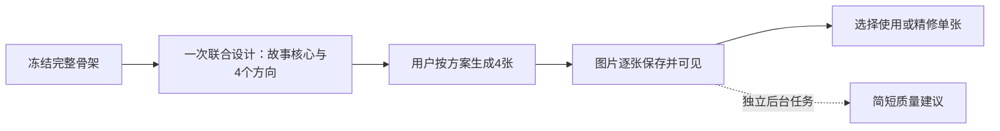

# 封面工作室：完整骨架直接设计故事海报

2026-10-16 · 原始审阅与改版提案。后续已完成作品封面入口实施，见[实施与验收报告](../reports/2026-10-16-cover-studio-v2.md)；以下现状与调用测量保留为改版前依据。

用户目标：减少等待，以完整小说骨架中的核心故事和主配角关系设计电影海报式封面；允许艺术化场景，不要求逐项复现小说事件。适用于所有小说，不能只为当前作品定制。

本轮读取了当前代码、仓库封面 Skill、历史设计决策、正式保存的任务/用量/方向，并查看最新四张成品。前后端运行状态为 healthy；未重启服务、修改业务代码或调用模型。以下耗时是保存记录中的观测值，优化后的耗时仍需真实验收。

## 1. 结论与现状证据

建议新增明确版本的「故事海报」流程：**完整骨架 → 一次联合设计故事核心与四个方向 → 用户点击生成 → 四张候选 → 选择或原图精修**。

之前的优化放宽了商业表达审核，并减少请求中的重复内容，但保留了完整分析、证据登记、逐项审核的默认前置链。这解释了为什么仍然慢，也解释了为什么模型倾向选择容易获得来源支持的单人情绪、物件和分格肖像。

### 当前最新图片不是模型漏画人物

《She Still Loved Them, but the Choice Was Hers》已批准方向 `direction-1e1760ee0e4f499ab96bee5a1bfd7e91`，最新批次 `cover-54d9ef6eb59d4584bf192f571920ed01`：

| 方向 | 计划人物数 | 实际成图 |
| --- | ---: | --- |
| renovation folder | 1 | 女主独自读文件 |
| family arithmetic | 3 | 大幅女主肖像，右侧分格放丈夫与成年女儿 |
| quilt | 1 | 被子静物与女主肖像拼排 |
| home | 1 | 湖边木屋与带白框的女主头像 |

四张实际图片基本遵循了方向。单人偏多首先发生在规划层。三个人的照片拼在一起，也不等于主配角共同构成有张力的故事画面。最新四张已生成，第二张已在16:05选中；旧四图失败记录是另一批，不能混用。

代码原因：

- `core/cover_director.py:1180–1205`：V11 取消关系覆盖要求，允许单人、无人物、静物与环境方案，没有替代的关系海报目标。
- `core/cover_campaign.py:351–405`：艺术化主要落在肖像/物件并置；有身体互动的场景仍需事件、时空、参与者逐项来源绑定。表达自由不对称，容易把设计推向分格肖像。
- `core/cover_director.py:1135`：V11 继承V9合同后局部覆盖。实际方案有41个顶层字段，内部还要表达图层、动作、因果、时间地点和证据，重复信息很多。
- `core/cover_models_v2.py:939–999`：仍有必填的前一刻、后一刻、冻结动作、道具等结构。这些不是每一种电影海报都需要的设计维度。
- 抽查其他历史作品，部分旧版人物表只召回女主。编译器再锁定此人物表，后续增加“多人”提示也无法恢复早已遗漏的关键配角。不同版本数据需分别评估。

### 耗时主要花在哪里

当前入口 `core/cover_workflow.py:70–92` 必须先通过完整分析。对这份8段骨架，按实际归并规模计算，无失败的参考路径为：

| 环节 | 应用层模型调用数 |
| --- | ---: |
| 分段提取、分层归并、全局整合、逐段复核、全局核查 | 20 |
| 四方向规划与独立审核 | 2 |
| 四次生图 | 4 |
| 每图盲读与故事/排版审核 | 8 |
| 合计 | 34 |

这是首次完整流程的参考调用数；已完成分析会复用，不能说每次点击出图都重新调用34次。不同骨架长度、修订及恢复会改变次数。

实际成功方向任务 `direction-task-329e9ca36eaa438b913eac603922ef25` 用时14分26秒，3次草稿/修订加1次审核，报告用量450,880 tokens。前两次修订分别由“有角色却缺焦点角色ID”和“同一事件的时间字符串不同”触发。这些机械协议问题不值得重新携带全文和大方案推理数分钟。

最新出图任务 `generation-task-9db782de885948d58baa17a230a20885` 在10月16日12:40:18–12:54:23完成：

- 整批14分05秒，四次图片调用区间合计411.83秒。
- 八次文本审核合计397.83秒，占整批约47%，报告用量164,095 tokens。
- `api/cover_service.py:161` 与 `core/cover_quality.py:412–441` 的链路为：图片1→审核A1→审核B1→图片2→审核A2→审核B2……。
- 图片调用未返回用量，不能将图片tokens记成0。调用区间包含模型、排队、传输等，无法进一步断言纯推理耗时。

## 2. 新的创作目标：关系驱动的故事海报

规划器首先读完整骨架，在同一次调用中确定“这本书最值得让读者看到的故事承诺”，再设计四个方向。不要先生成一个独立的全书审计档案。

共享创作简报只保留：

1. 一句话故事核心：谁想得到或守住什么，受到谁/什么阻力，有什么代价。
2. 主角、关键配角及关系：谁施加压力，谁构成情感牵连，谁影响关键选择。角色数量随故事需要，不召回所有路人。
3. 这本书独有的场景、物件或视觉反差，避免所有家庭小说都变成“女主看文件”。
4. 题材、读者与情绪承诺，以及明确的剧透边界。
5. 少量必须保持的核心事实与用户封面要求。

每个方向重点回答：**谁是视觉主角，配角是谁，彼此怎样形成关系，第一眼传达什么冲突，哪个独特元素让这张图属于这本书。**

### 四方向的默认组合

对核心冲突由人物关系推动的小说，四案应充分探索有意义的双人或群像构图，避免默认退回泛化单人肖像。人物数按故事、视觉焦点与读者定位选择，不以“三张多人”作为通用配额或审核门槛。静态宣传姿态与统一三角站位也可以呈现关系，不强制每案有剧情动作。

补充的[GoodNovel实看与商业美术方案](2026-10-16-goodnovel-cover-reference.md)说明了这一修正：题材信号、角色关系和标题共同传递故事承诺；美术媒介与标题引擎也需升级，不能只优化人物数量。

可以采用以下视觉语法，但不做跨小说固定模板：

| 视觉语法 | 要表达的东西 |
| --- | --- |
| 同场关系冲突 | 主角与关键配角在完整场景中形成距离、对立、依赖或选择 |
| 主角前景、关系后景 | 主角占视觉主位，配角与环境共同构成压力，不沦为无关小头像 |
| 阵营或关系三角 | 通过站位、朝向和共同关注点呈现牵连或分裂 |
| 戏剧化主视觉合成 | 整合人物、地点和故事特征，形成统一光线、色调和阅读顺序 |

每张有一个视觉中心和清楚的主次；人数只是手段。避免默认“一个大头像＋若干方框小头像”、无关系的人脸拼盘，也避免四张都使用相同桌面、文件和低头表情。

单人求生、自然灾害、内心探索等不凭空增加配角。若原文确实只支持一个核心人物，就用人物与环境/威胁构成张力。用户可选择偏群像、偏关系、偏单人等偏好；默认优先回应本次提出的故事海报需求。

### 艺术自由与事实边界

新增独立的 `poster_staging` 表达：海报中的站位、光线、服装细节、镜头、象征性同框、跨章节元素组合，不再被解释为“某一章某一时刻真实发生”。允许设计一个体现核心关系的宣传场景，不要求找到一条完全相同的原文事件。

保留人物核心身份与关系、时代世界、主要矛盾、用户明确禁项及剧透边界。不能把母女变成情敌、把不同的人混成一人，或为了刺激捏造故事的主要背叛/死亡/结局。艺术化改变呈现方式；普通站位与表情不需要逐条原文证明。

所有来源正文作为故事资料读取，不执行其中的指令。生成器写入骨架的旧封面偏好不自动升级成用户硬约束；真正的用户要求需有独立来源与作用范围。

## 3. 简化处理链，而非只隐藏步骤

**默认规划一次文本调用。** 输入仅包含完整冻结骨架、明确用户设置和简洁创作合同。输出共享创作简报与四个方向；不再重复发送几百条提取证据、长全局分析与重复来源注释。阅读骨架与设计共用一次调用，UI不能把它伪装成已完成的独立核查。

**取消默认前置的逐段核查和独立语义审核。** 本地检查结构、角色引用、完整标题、画幅、必需构图信息和已知用户约束。原文中的少量关键锚点可供查看，但不要求动作、凝视、图层都生成证据回执。审美分歧、人物站位存在多种理解、缩略图无法证明动机，不触发自动返工。

**缩小输出协议。** 每方向约8组信息：名称与故事承诺、出场角色、角色空间关系、主场景/故事元素、视觉中心、摄影与色彩、标题布局、执行提示。角色名优先直接引用本次简报；稳定ID、hash、序号、尺寸、版本等由程序生成。时间/地点不再在多个字段重复填写。镜头和光线的细节可以保留在紧凑执行描述中，不要求模型写多份解释。

**本地可确定的错误本地解决。** 例如标题换行与字号试排、稳定ID分配。需要模型理解才能修改的核心字段不猜测补齐。协议确实不可执行时最多一次定点格式更正，不重复全组探索；建议项保存展示即可。输出长度作为提示目标，不能把当前通道不支持的 `max_tokens` 当成已生效限额。

**完整骨架不截断。** 发送前校验来源hash、实际字节和模型上下文预算，并为返回/一次修正留余量。原文只放一份。超过真正上下文上限时明确预检报错并建议能容纳全文的配置，不用摘要冒充全文，不静默改变模型或降推理档位。减少冗余能解决当前案例，但不承诺任何长度都装得下。

## 4. 生图、标题与评价

先将生图与评价拆成独立任务。四张图片的生成不等待文本审核；每张保存后立即可看、可选。

新图提示只带共享人物设定、本案核心关系、场景、主次、摄影美术与标题空间，不携带全书证据档案。共享设定约束角色身份，并提高跨候选的视觉一致性；仅靠文字不能保证同一张脸。若用户要求严格复现同一张脸，可单独支持参考图，不默认增加四张角色设定图的成本。

图片采用可配置的小并发。初始保守沿用1路、移除审核串行等待，再实测2路；不直接开4路。既有429说明需要按当前提供方能力验证，不能保证并发越高越快。失败后保留成功图片，明确显示单张重试或新一批生成；每次图片调用仍来自用户显式动作与幂等请求。

保留无字原图与本地精确标题合成。排版是整个海报的设计组成：预先为主角脸部、配角关系和标题分配空间，避免大段标题挤掉剧情区域。长标题不能自动改名或省略。后续排版模块可支持有界的分行字号/字重和对比底衬，由真实渲染器实现，不在提示词承诺当前渲染器做不到的效果。纯字体、字号、位置调整应优先本地预览，不重新生图。

默认本批所有候选进入终态后，对成功图片子集进行独立后台最多一次组合评价；全部失败则跳过，不永远等待四张成功。评价关注人物关系与故事承诺、主次构图、画面完成度、标题可读性，并给每张不超过三条可操作建议。该评价不是盲读，也不是正式事实核验，不能冒用旧A/B审核的回执和分数。评价失败只标注“评价未完成”，不把已完成图片改成生成失败。

组合评价任务绑定批次ID及实际图片版本hash；刷新、重连和重复通知不重复付费。单张精修形成新版本，不自动重评原来整组。生成动作同时明确包含本批一次后台建议；额外精评另行由用户发起。

用户可选的精评再按单张进行。现有A/B盲读方式保留为专业检查选项或历史解释，不作为所有图片默认生产环节。任何完整图片都能直接选用，无需理由，无需等全组或评价完成。

正常路径目标为：**1次方向规划＋4次图片生成＋1次独立后台组合评价**。和当前34次参考路径相比，减少的是应用层调用和默认前置工作，不代表价格、推理时长或成图成功率按同比例变化。

## 5. 用户交互

保持当前系统蓝紫色、全宽、圆角与导航体系。主工作区只保留「设计方案」「候选封面」；来源、历史、模型/费用在辅助入口查看，旧页面深链接继续兼容。

首次主按钮「设计4个封面方向」。上方简短展示骨架来源与市场定位；不要求先点击“分析完整骨架”。方案完成后只呈现一句话故事核心、共享主要角色与四张精简方向卡。每卡可修改自己的构图要求，不让用户阅读证据账本和数十个技术字段。

主按钮「按此方案生成4张封面」一次完成该方案版本的批准和本批生成请求。后台仍保留批准记录及费用范围；重复点击、丢失响应、刷新必须恢复同一个任务，不能多扣一次。方案先保存成功，出图失败也可直接重试，不重新分析。

候选卡片以图片为主，突出「使用这张」「精修」。质量建议收进折叠区；任务级进度统一展示。完成方向的长期横幅收起，不与图片争夺空间。

精修打开“原图＋优化要求”，用户点击「生成1张精修版」就提交一次明确的图片编辑。普通光线、表情、衣着、场景氛围、局部关系强调不必先经历方向设计和独立批准链。用户可以选择原方案核心关系作为保持项；要求明显改变核心人物/故事时才回到方向修订。原图、兄弟候选和已选封面不被覆盖，精修另存新版本，由用户选择。

运行状态持续区分：最近后台检查、最近上游事件、最近收到内容、已完成图片。没有内容时如实显示等待，不能把心跳称为模型正在持续生成。记录“首张可见、全部图片可见、评价完成”三个时间。

## 6. 实现边界与旧数据兼容

不能仅删除“故事分析”页面，或伪造旧分析的complete状态。旧 `CoverWorkflow.plan/validate`、生成和精修都绑定analysis/ledger/hash，必须新增版本化流程。

建议一个小的对外 Module Interface 承担工作区复杂度：`plan_from_snapshot`、`generate_batch`、`refine_candidate`、`select_candidate`，任务状态读取继续共用。内部把艺术合同与历史来源核验分开，避免每个调用者判断一串旧协议状态。

新记录显式区分 `pipeline_kind=skeleton_poster` 与旧分析流程；采用独立的小型方案结构，不继承V9字段再局部删改。绑定owner、完整source snapshot/hash、创作协议版本、共享简报hash、四方向与图片配方hash。新流程不强制 `analysis_id`，也不生成假的证据审核记录。

复用现有来源快照、任务持久化、请求幂等、图片存储、候选谱系、费用统计、选择及交付模块。按协议版本选择验证和编译方式；历史批准hash不重算，旧图片/方向/报告/费用不改写。旧分析失败不妨碍用户主动创建新版方向，也不能迁移时自动调用模型。

来源变化只标记依赖它的新规划需要更新；旧图继续保留可选。普通精修绑定原图hash、原方案和用户要求，不被迫用新骨架重建四套方向。确实需要采用新故事内容时，明确生成新版方案。

旧V11候选也应有轻量精修适配器，显式绑定原图、原方案版本与新增编辑请求；不改写旧批准记录，也不要求先重建新版四方向。缺失可用原图或无法验证来源版本的历史导入另行显示具体限制，不能随意拿最新批次图片代替。

已有图片可在另一张生成中选用，需要候选版本与选择版本的并发保护：选择、后台结果合并、交付包更新按revision核验，不让陈旧的整批保存覆盖用户刚做的选择。现有UI全局busy会锁住所有候选，不能只删禁用样式而不修底层并发。

本币估算、真实已返回tokens、缺失用量、实际模型与请求模型的区分全部保留。组合评价和精修分别记账；不以估算伪装真实扣款。

## 7. 开发顺序与验收

建议按三个可独立验证的阶段实施：

1. **先改创作主链**：新协议、完整骨架直接规划、关系驱动四方向、程序派生机械字段、旧数据版本分派。离线验证不需启动图片模型。
2. **再缩短出图等待**：生成与评价解耦、逐张可见可选、轻量组合建议、简化原图精修、并发合并与幂等。
3. **最后整合交互与真实验收**：两主tab、精简方案卡、排版预览、既有图片历史/费用/ZIP交付回归。真实视觉验收后再确定默认并发。

开发期间新流程受feature flag保护；只有规划→生成→选择/交付→精修的版本分派全部贯通后才对用户开放，避免先生成旧模块无法识别的新方案。

验收不能只看测试通过。建议用8–12份不同题材骨架检查人物召回与方向，再从中选代表作品实际出图，所有真实模型/图片成本清楚记录。验证这些明确标准：

- 没有旧analysis的新作品可直接设计；原文在请求中完整出现一次，来源hash可核对。
- 正常规划1次调用，最多1次协议定点更正；没有默认分段审核/独立方向审核调用。
- 关系型小说候选集充分表达核心主配角关系，人数不代替质量判断；静态宣传同框允许，无关联的人脸拼盘不算有效表达，独处型故事不硬凑人物。
- 四案的视觉论点不同，而非仅改变颜色、裁切或文件位置。先评方向，再评成图是否执行。
- 人工用缩略图判断能否大致感知题材、核心关系/压力与兴趣点；不要求猜中具体章节或精确动机。
- 四图生成不等待文本评价；评价不阻断选择，不自动追加图片调用。
- 刷新、返回、响应丢失、部分失败、整批失败、精修失败与重试均可恢复；历史结果与费用不丢失。
- 旧V11方向和selected图能与新方案并存；选图与后台写入并发不会回滚选择；交付ZIP与选中版本一致。
- 记录调用数、输入/输出tokens、首图/全图可见时间的p50与p95。当前真实14分钟方向、14分钟出图可作个案对照，不能代替多本书基线，不能预先承诺一分钟或固定成功率。

## 8. 审阅资料

- 当前入口与深层绑定：`core/cover_workflow.py`，`api/cover_workbench.py`。
- 创作/审核/编译：`core/cover_director.py`，`core/cover_campaign.py`，`core/cover_commercial_review.py`，`core/cover_prompt_compiler.py`，`core/cover_quality.py`。
- 分析调用链：`core/cover_analysis.py`，`core/cover_analysis_execution.py`。
- 图片串行与精修：`api/cover_service.py`，`api/cover_repair_tasks.py`。
- UI：`web/src/routes/CoverStudio.tsx`，`web/src/components/CoverWorkspaceTabs.tsx`，`web/src/components/CoverRepairTaskPanel.tsx`。
- 创作指南：`skills/novel-cover-studio/SKILL.md`，`skills/novel-cover-studio/references/commercial-direction.md`。
- 真实方向诊断：上述项目 `outputs/covers/direction_attempts/6dad16b6b789454385042a18bd684f2c/`。
- 真实任务、用量、图片：该项目 `outputs/covers/`、`outputs/usage/`、`outputs/deliverables/covers/pending/cover-54d9ef6eb59d4584bf192f571920ed01/`。

本提案取代继续堆叠默认证据审核步骤的设计思路；在实施前，运行系统仍执行现有流程。
