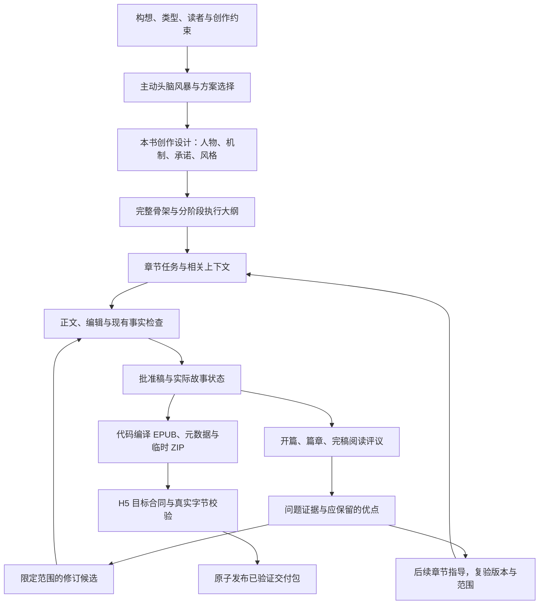

# Novel OS 小说质量优化总体方案

版本：v1.7，2026-11-01（Asia/Shanghai）。基于已确认的 v1.1，v1.2 补充 M1.1「作品类型维护」页面与数据协议设计；v1.3 按用户反馈新增婚姻背叛、出轨等女频主题及分组筛选。v1.4 记录 M1.1 生产代码本地验证；v1.5 补充 M2 采用设计到正文的执行接入；v1.6 记录 M3 阅读评议本地工程闭环。尚未部署。

状态：用户已同意并启动开发。M0 的 H5 交付门首批工程已实现并完成本地契约验证，见[实施报告](../reports/2026-10-31-h5-contract-gate-implementation.md)；M1 题材资料、主动方案记录和作者决定工程已实现，见[M1 报告](../reports/2026-10-31-m1-genre-workshop.md)。M2 执行接入已实现，见[M2 报告](../reports/2026-11-01-m2-creative-execution.md)。M3 阅读评议工程已实现，见[M3 报告](../reports/2026-11-01-m3-reader-experience.md)。M0 创作基线/业务验收、M1/M2/M3 真实对照与报告校准、M4–M5 待继续。已完成基线提交、合并并切出优化分支；2026-11-01 已部署至 5174 并通过工程验收，见[部署记录](../reports/2026-11-01-m03-deployment-5174.md)。未进行真实模型实验，不表示文学质量收益已获证明。

M1.1 维护库、动态选择、冻结版本及实际请求投影已实现，详见[实施报告](../reports/2026-11-01-m11-creative-type-maintenance.md)。

新增设计：[作品类型维护与模型数据协议](2026-11-01-creative-type-maintenance.md)、[可交互页面原型](prototypes/creative-type-maintenance/index.html)、[结构 Schema](contracts/creative-type-profile.v1.schema.json)。原型仅使用浏览器本地演示资料，不连接生产服务或模型。

M1.2 补充：统一「新建小说 → 一起把故事想完整」，先选 H5 分类再选创作方向；维护页简化为三项常用标签加版本预览，默认精修三套资料，既有用户记录和讨论快照保留。分类代码绑定与多样性标准见[完整补充](2026-11-01-guided-creation-standard.md)。

## 1. 目标、范围和交付原则

目标是让小说的类型特色参与故事因果，让人物值得在意、剧情可信、正文具体、有情绪积累与阶段回报，并在完整作品中保持这些表现。

| 目标 | 可观察的表现 | 不能替代该目标的指标 |
| --- | --- | --- |
| 类型鲜明 | 世界/关系/权力规则改变主要人物选择与转折 | 类型关键词频次、分类字段存在 |
| 人物投入 | 读者理解人物在意什么，选择有依据，关系变化有过程 | 人设标签多、受伤/受辱次数多 |
| 因果可信 | 行动改变局势，对手会应对，代价持续生效 | 事件多、大纲长、JSON完整 |
| 正文好读 | 关键时刻可感知，视角稳定，声音有区别，信息负担适当 | 形容词多、字数达标、句子都华丽 |
| 持续吸引 | 已提供阅读价值，并产生具体期待；安静场景也有意义 | 每章强行反转、长期只挖不填 |
| 全书成立 | 中段持续发展，重要承诺得到回应，结局有依据和余波 | 各章独立评分平均值、编译成功 |

范围包括新的创作设计、已有创作流程的增强、只读评议与可选择的定点修订。沿用封面工作室、作品工作台视觉、分类字典与发布协议；封面本轮只接收更明确的故事设计资料，不重做出图流程。

质量保障通过设计、正文执行、可追溯检查和真实阅读反馈共同建立。文学判断存在受众与偏好差异，不能承诺每本书都受欢迎或用模型分数预测市场表现。

## 2. 研究依据与现状

### 已完成的研究

- [GitHub机制调研](../research/2026-10-31-genre-fiction-github-research.md)：题材模板、世界规则与代价、分层大纲、正文事件兑现、人机共创、局部改写。
- [LongStoryEval原始来源核查](../research/2026-10-31-longstoryeval-source-audit.md)：评价的适用范围、公开源码、抽样、恢复、评分尺度与许可边界。
- [阅读体验评议子方案](2026-10-31-reader-experience-quality-plan.md)：正文快照、八维评议、异步恢复、原文证据、调用预算、盲评与修订接入。
- [H5 交付产物强制验收补充](2026-10-31-h5-export-contract-gate.md)：与实际 H5 校验代码核对的格式、容量、身份、摘要、确定性编译和验收要求；属于开发硬约束。

这些研究提供方法依据，不证明本地改造一定改善作品。以自行实现适配机制为主；不直接搬入外部完整应用、小说语料、模型权重或未核实许可的代码。

### 当前系统可以复用的能力

当前 `dev` 工作树已经包含分类设计要求、多轮讨论与明确的骨架交付意图、分阶段大纲、章节写作/编辑/连续性/风格处理、商业和结局检查、不可变正文版本、证据校验、有限修订、模型路由、费用与进度机制。

本轮源码核查确认：狼人类型不是完全没有传给创作模型；但所见专属规则较概括。尚未沿某部狼人作品的完整请求、骨架和正文追踪，因此不能断言该作品具体在哪一阶段失效。

目前值得补强的连接是：

> 已选类型 → 本书具体机制 → 人物困境与选择 → 关键情节 → 章内场景 → 正文实际变化 → 阅读体验 → 有证据的修订。

现有合同或里程碑检查继续承担原有职责；新增阅读体验判断不会把它们的通过结果解释为文学质量通过。

## 3. 总体流程与信息权威

图中的修订回路有明确次数和预算限制，不能无限循环。阅读评议初期旁路运行，失败不使已保存小说失去阅读资格，也不额外阻断符合交付合同的导出；H5 产物校验是独立且不可跳过的确定性门。

必须保持四类资料的区别：

1. **作者已确认设计**：希望写成什么；未经确认的讨论选项不能进入正式骨架。
2. **执行规划**：准备如何把设计写出来；不能提前算作已发生事件。
3. **实际正文与状态**：经过既有流程确认，具有确切版本与来源。
4. **评议意见**：基于某版本和某阅读范围的判断，不具有自动修改事实或提升稿件的权限。

阶段转换保留来源和版本绑定；避免同一份“故事总表”同时容纳事实、计划和模型看法，最后相互覆盖。

## 4. 作品类型：通用能力加可扩展题材资料

### 4.1 理解类型组合

当前选择项混合了世界类型、情节主题、人物身份、基调和受众。保留现有 canonical 分类 ID、上限与导出协议，在创作层增加其职责解释。

以“狼人＋复仇＋女性成长”为例：

| 选择 | 对这本书的作用 |
| --- | --- |
| 狼人 | 提供族群、身体、身份或羁绊规则，影响行动的可行性与代价 |
| 复仇 | 决定外部目标、策略变化和对手回应 |
| 女性成长 | 决定主角逐步重估的价值、边界及终局选择 |

主次根据用户意图及本书方案确定，不能直接由勾选顺序永久决定，也不能悄悄丢掉用户选择的类型。混合题材产生矛盾时，讨论具体取舍；只在会改变故事身份的关键选择上提问。

### 4.2 题材资料结构

采用“通用创作原则＋题材专用资料＋本书选择”的组合。每份题材资料包含：

- 常见但非强制的阅读期待与不同细分方向。
- 可选择的冲突来源、世界规则、关系或权力结构。
- 每种机制的触发条件、作用范围、限制、例外与代价。
- 机制如何产生人物选择和不同阶段的回报。
- 容易造成模板化、设定装饰化和重复情节的失败模式。
- 与其他类型组合的可行方式、冲突与待确认项。
- 适用读者、语言、篇幅、资料版本与验证状态。

资料提供选项与检查方法，不固定人物原型、桥段顺序、章数、反转次数。未知类型使用明确标记的通用设计流程，不能假称已经过该类型的专项验证。

### 4.3 本书具体化与反事实检查

从类型资料中为本书选出少量真正产生后果的机制，并绑定实际人物。例如：何时变身、谁能获得族群庇护、某种感知有什么盲点、拒绝羁绊会失去什么。只有本书采用并确认的规则才进入后续写作。

主要转折进行检查：去掉或替换所选类型的核心机制，人物选择与高潮是否仍几乎原样成立？这是一项设计诊断，不要求每章都展示类型符号。

先以狼人、当代家庭情感和悬疑三组差异明显的方向验证通用结构，再扩展其余类型。三组不是产品支持范围上限；其余资料标明覆盖成熟度，不能以“全类型支持”掩盖尚未专项测试。

### 4.4 用户维护资料，而不是继续扩充硬编码

新增一级导航「作品类型」和全宽维护页。用户通过表单维护核心体验、故事机制、人物与文风、检查与融合；模型预览与版本为第五个标签。支持新建、编辑、复制、停用、保存草稿、保存并启用和历史版本恢复。内置说明只作初始资料，新增题材不要求新增 Python 分支或重新部署。

用户补充的女频主题已加入设计：新增「婚姻与亲密关系」「家庭与代际」「成长与自我实现」三个归类维度，以及婚姻背叛、出轨与双面生活、离婚重建、关系修复、熟龄爱情、母女关系、单亲育儿、职场成长等 21 份可编辑起点，原型共 26 类。每份具有具体机制和检查问题；不只是加标签，不预设所有故事必须出轨、离婚或复合。完整清单见[补充方案 §3.5](2026-11-01-creative-type-maintenance.md#35-女频主题扩充2026-11-01-用户补充)。

头脑风暴的类型选择读取用户资料库的启用版本，保留多选和本书作用。草稿不进入调用；新讨论冻结完整来源与版本，已存在的讨论不随资料库热更新。显式「采用最新说明」先展示差异，在安全的下一轮边界生效，不自动推理或重写骨架。实际讨论可查真实发送的快照；维护页的草稿预览不能冒充已发送内容。

创作类型稳定 ID 与 H5 分类 ID 分离。自定义「赛博修仙」可以用于设计，但必须在正式发布前选择目标字典中的合法分类。资料内的映射是候选，不是最终作品分类；不修改版本字符串伪装兼容，不让模型生成分类 ID、摘要或放行决定。M0 强制交付门不变。

### 4.5 三层结构与确定性模型输入

- `creative-type-profile.v1`：可维护资料。含读者期待、规则的触发/范围/限制/例外/代价/选择/回报、人物动力、文风、失败模式、检查和组合说明；条目带重要性与适用阶段。
- `book-type-selection.v1`：本书选择。绑定稳定 ID、版本、内容 SHA-256 与作者指定的主辅作用；不按勾选顺序强加主次。
- `genre-context.v1`：某次请求的阶段投影。代码校验、锁版本、筛选适用条目、计算预算和哈希，只送已选类型；不重复塞入整个资料库、不调用模型做资料摘要、不静默截断。

类型资料属于创作指导，不能覆盖作者已确认事实，也不能修改工具、输出协议和预算。常见机制必须进一步落实为本书人物的选择，复用 M1 的提案与作者决定；不得另外建立第二套互相冲突的采用记录。文学诊断保持建议性质，结构有效不能证明小说好看。

完整交互、字段、版本语义、兼容策略、字节预算建议及验收矩阵以[补充方案](2026-11-01-creative-type-maintenance.md)为准。

## 5. 头脑风暴：主动引导与明确的决定记录

目标是帮助用户逐步做出创作选择，保留讨论的自由度。沿用 `discuss` 与 `deliver` 的意图区分；讨论不会因模型认为“足够完整”而自动生成或替换正式骨架。

### 建议的推进内容

| 讨论关注点 | 模型主动提供什么 | 用户能决定什么 |
| --- | --- | --- |
| 类型与阅读体验 | 有实质差异的两到三个方向，说明各自主要矛盾和读者获得的体验 | 更希望读到哪种故事，哪些方向不要 |
| 人物与关系 | 目标、能力、弱点、依赖关系、双方利益与分歧 | 谁值得关注，人物边界和关系走向 |
| 规则与冲突 | 关键限制、可行策略、代价和对手如何回应 | 哪些世界机制和困境成立 |
| 重大转折与结尾 | 因果明确的走线，解释各自情绪效果与代价 | 高潮、结局方向和不能改变的内容 |
| 执行准备 | 已确认、尚未决定、存在冲突的事项，以及下一步建议 | 继续讨论，或主动生成/更新完整骨架 |

这些是可回访的关注点，不是五个必须依次审批的新页面，也不规定最低对话轮数。每轮针对当前最重要的一个或两个选择给建议，避免反复抛出泛泛问题。

### 每轮应保存的内容

- 本轮提出的方案及区别。
- 用户明确接受、拒绝、修订、暂缓的决定。
- 模型建议与假设，不能混入已确认项。
- 尚未解决但会影响故事身份的冲突。
- 下一轮建议讨论什么及原因。

用户回到基础设定时先编辑；保存后展示改变影响。只有用户明确重新推导或更新骨架才使相关旧推导失效，历史记录与费用保留。不能因点击“编辑”立即发起模型请求。

## 6. 本书创作设计：把好看落实到可执行内容

在现有骨架和全局设计阶段组织以下内容。已有字段能表达的直接复用，避免要求模型重复抄写既有合同。

| 内容 | 必须回答的问题 |
| --- | --- |
| 阅读承诺 | 谁是目标读者？主要期待的体验是什么？本书的独特困境是什么？ |
| 外部目标 | 谁要得到什么，为什么现在必须行动，失败失去什么？ |
| 人物动力 | 人物有何能力、依赖、弱点和底线？什么会迫使他调整策略或认识？ |
| 对手与压力 | 对手有什么合理目标、筹码和限制？如何根据主角行动调整？ |
| 关系张力 | 双方分别需要什么、害怕什么？利益、理解与信任如何变化？ |
| 具体规则 | 已采用机制如何帮助或限制行动，代价什么时候生效？ |
| 长线发展 | 前一次选择如何造成下一次困境？中段如何换策略、关系或代价？ |
| 期待与回报 | 哪些问题近期回答，哪些在篇章/结局兑现？回答怎样改变局势？ |
| 结局方向 | 主要冲突如何解决，人物承担什么代价，哪些后果需要余波？ |
| 表达基准 | 视角、时态、人物声音、情绪距离、感官和对白方式适合什么体验？ |

人物深度由具体欲望、能力、矛盾和行为形成；不要用创伤清单或“坚强、聪明”形容词代替。对手可以明确恶意，但其行动要有利益、能力和限制。

题材机制、人物动力和关系利益需共同作用。例如主角取得资源可能改变信任，揭露真相可能失去庇护；持续升级不能仅增加受辱、伤害或敌人数量。

### 原创示意：同一题材如何产生故事

以下为方案说明，不属于任何现有项目事实：

> 本书规定失控变身者依赖族群共同庇护。女主发现首领牺牲弱小成员换取安全，揭露他将失去自己的庇护。她开始寻找替代方案，却发现帮助她的盟友也有必须保护的人。她的每一步既改变安全条件，也改变别人愿意承担的风险。

类型提供限制，人物决定如何行动，关系使选择更困难，后果推动故事继续。此例不得成为所有狼人作品的固定路线。

## 7. 骨架与执行大纲：规划因果和阅读体验

继续使用完整骨架与分阶段执行大纲。全局设计、章节批次和整体核查各自保存检查点，避免失败后重新请求整本。

章节规划应能够表达：

- 本章视角、主要功能、进入时的局势与情绪。
- 人物行动/观察及回应，实际阻力与选择依据。
- 适用时的代价、信息揭示、关系变化和后续影响。
- 本章给读者的收益，结尾的完成感、期待或余韵。
- 相关的类型规则、承诺、伏笔和不能提前发生的事项。

行动章可以用目标—阻碍—选择—反馈审视；静场、余波和观察章按理解、信任、情绪或主题体验判断，不强迫加入事故或反转。

整体设计核查重点是主要转折、人物变化、信息顺序、类型机制和结局。只对明确冲突、缺失必要约束、无法执行的依赖等采用原有严格处理。对“张力不足”等审美意见解释原因并提出定点建议，不把所有意见转成硬失败。

全局核查不能仅确认章节表有字段；需要指出哪个前因支持哪个后果。与此同时，大纲优秀不表示未来正文已通过质量检查。

## 8. 正文生成与编辑：从复述大纲到经历场景

### 8.1 精确提供本章上下文

统一构建上下文：已确认本书设计＋本章/相邻章规划＋实际前文与当前状态＋本章相关规则与待兑现事项。不同角色和阶段按职责读取，避免每次塞入全部历史。

上下文选择和压缩要有覆盖记录。完整采用骨架在规划阶段按既有策略读取；正文阶段使用绑定完整设计的相关投影，不能把任意截取前若干字符当作完整理解。

“准备发生”“已经发生”“人物知道”“作者知道”分别表示。未经正文兑现的设计不能提高角色状态，未来高潮不得提前当背景事实使用。

### 8.2 建立本书的表达基准

从本书开篇或已有获准正文提炼少量可执行特征：叙述距离、角色关注什么、如何试探或回避、句法节奏、与生活经验相符的比喻习惯。必要时在开篇写作内校准，不额外要求用户批准练笔。

允许不同情绪、场景和POV有节奏变化；基准用于保持辨识度，不逐句套写，也不模仿特定在世作者的独特风格。

### 8.3 编辑顺序

1. 检查关键场景是否真正展开、因果是否成立、人物选择是否有依据。
2. 检查关系和情绪转变是否有触发、抵抗、行为与余波。
3. 压缩没有新增价值的重复说明、同义争吵和无功能段落。
4. 再改善对白、潜台词、视角、节奏和具体表达。

优先利用现有 Editor/Style 阶段，统一提示规则来源。清理重复或冲突指令，例如将固定感官数量视为质检指标、要求所有章同一种章末钩子等；调整前需要确认调用者和回归影响，不盲目删除现有检查。

普通章节保留既有写作—编辑—核查流程。重点升级其输入和修订能力，不为每章默认追加一批独立评审模型。

### 8.4 篇章阅读

在开篇小弧、重要关系/调查阶段和结局处检查连续正文：是否反复同一次觉醒、换角色重复争吵、胜负没有余波、人物突然信任或所有章节同速同声。节点由作品结构决定，不固定每三章一次。

## 9. 阅读体验评议：具体采用已有子方案

详细算法、数据模型、API与恢复设计以[阅读体验评议子方案](2026-10-31-reader-experience-quality-plan.md)为准，本总体方案不另立第二套实现。

采用正文快照 → 分段事实摘要/阅读观察 → 全局综合 → 必要原文回看。评价包含八个方面，但一次调用可同时组织多个适用维度，不按维度拆成八个agent。

三种结果分别展示：

| 结果 | 处理方式 |
| --- | --- |
| 原有规则下有明确证据的事实/连续性/约束错误 | 进入已有检查与修复路径，保留证据 |
| 阅读体验建议、解释空间或审美分歧 | 显示影响、位置、建议和保留项；默认不阻断 |
| 材料不全、证据不足、模型失败或未覆盖 | 明确未审/中断，既不算通过，也不直接断言正文错误 |

首次读者视角评议不给模型作者解释、大纲意图或既有分数；合同兑现另外核对。摘要不能代替对白、声音和情绪台阶的原文证据；引用存在也不能证明观点正确。

报告优先展示值得保留的优点与最多五个重要问题。模型模拟的续读意愿明确标注，不伪装成真人评价或实际留存。

## 10. 定点修订：闭环必须可控制

修改层级按问题定位：

| 问题 | 优先调整对象 |
| --- | --- |
| 类型机制未参与主要转折 | 本书设计/骨架；属于重大变更时先由用户决定 |
| 一次选择缺少前因、关系跳跃 | 相关场景与必要铺垫/后果 |
| 中段重复、回报延后 | 篇章目标、策略变化和章节安排 |
| 声音趋同、空泛表达、视角失控 | 具体正文段落 |
| 明确事实冲突 | 现有连续性与事实修复路径 |

每个修订任务绑定问题、原文版本、允许范围、必须保留的优点、作者约束和预算。保留原稿，新输出成为独立候选。默认每个已选范围最多一轮修订加一轮效果复核，异常格式修复与已有自动修复共享总体调用上限，不让嵌套循环放大次数。

复核包含：原问题是否解决、相邻段落是否连贯、是否损失人物声音或重要信息、是否新增事实冲突。自评分提高不能单独批准候选。候选进入现有检查与稿件提升流程，新评议没有直接覆盖 Final 的权力。

涉及已完成章节时，先计算后续人物状态、伏笔、摘要、报告和交付的影响。事实有变化时，受影响材料进入显式重新验证；不悄悄重写后文，不自动扩大用户选中的修订范围。

自动模式是冻结的用户策略，不是每次都弹确认；用户可一次设定允许的修改范围与花费。新机制初次上线默认评议，待验证后再允许开启有限自动修订。作者已确认的故事身份、结局方向或篇幅不能被自动策略擅自更换。

## 11. 成本、速度与可靠性

### 减少重复工作

- 题材和本书设计在现有讨论/全局设计回复内形成，避免另加重复分析整本的阶段。
- 稳定规则与模型配置按运行冻结；相关上下文按阶段编译，避免重复抄写大 JSON。
- 稿件、事实摘要、阅读观察和报告以来源/依赖哈希缓存，改动只使受影响节点失效。
- 旧评议分数不进入新一轮阅读，缓存的是可追溯材料而不是要求模型延续旧结论。
- 稳定正文的多个维度合并处理；只有依赖已经完成且输入冻结的单元才可并发。
- 质量不以降低模型能力或偷偷缩减输入为代价；模型/effort变化需要另行对照验证。

### 明确总预算

阅读评议调用数沿用子方案：`G + M + S + D + R`；G为正文段数，M为分层汇总数，S≤2为综合，D≤2为原文回看，R≤1为格式更正。所有调用包含失败和底层重试，受任务总时间与费用上限约束。

新增修订还包括生成、效果复核以及受影响的既有事实检查费用，不能只报告新增两次调用而遗漏原流水线成本。首次完整阅读的成本必须计入，不能只展示摘要复用后的低价。

不预先承诺固定提速倍数。分别记录创作主路径耗时、后台评议耗时、等待/重试、token已知覆盖率与人民币估算。费用保持头脑风暴/正文/封面三类，正文内细分创作、评议和修订，避免重复统计。

### 可靠的任务体验

明确记录排队、读取、设计/生成、综合、核实、已完成、中断、失败和预算耗尽。每个完整模型回复及时保存；刷新只读持久进度，不重发请求。

服务重启后，在途结果不确定的调用标记中断，不冒充正在推理；用户恢复时复用同源已保存阶段。暂停停止后续调度，保留原结果与成本。错误信息区分模型异常、格式异常、预算不足、证据不全与故事问题。

请求预算必须计入系统提示、正文/骨架、历史上下文、预留输出与推理空间。超限提前分段或说明需扩大预算；不能通过隐式截断让请求“看似成功”。

## 12. 产品交互

沿用[锁定的工作台视觉和五标签设计](2026-10-24-project-workspace-design-baseline.md)。

| 页面 | 调整 |
| --- | --- |
| 作品类型维护（新增） | 左侧类型库、右侧五标签表单；编辑草稿、启用版本、模型输入预览；沿用现有视觉 |
| 基础设定 | 从用户资料库读取启用类型；展示本书组合的创作含义与版本，可编辑读者、主要体验和方向，链接到类型维护 |
| 头脑风暴 | 方案卡、当前建议、已确认/待定决定与下一讨论点；用户主动交付骨架 |
| 故事骨架 | 展示类型机制、人物困境、关键转折、阅读承诺和表达基准；原文和未识别字段仍可查看 |
| 章节 | 保留列表与骨架简介，新增轻量的评议/建议/过期标记，可查看确切原文版本 |
| 作品概览 | 紧凑“阅读体验”区域：已读范围、保留优点、主要问题；详情用抽屉或独立报告页 |
| 阅读器 | 报告可跳转并高亮绑定版本的原文；阅读不触发编辑或模型 |
| 修订 | 选择问题、查看修改范围与预算、比较候选及后续影响，沿用既有采用流程 |
| 费用与交付 | 显示正文评议/修订费用，保持人民币估算与token缺失说明；评议状态与ZIP状态分离 |

不新增独立视觉主题。只增加明确的「作品类型」资料入口，其内部通过子标签组织内容；不把内部 schema、哈希和复杂评分表放入默认用户流程。技术来源可展开查看。

报告措辞区分“本章证据不足”与“全书没有写”，区分“模型建议”与“真实读者反馈”。不显示没有校准依据的成功概率，不因总分低而禁用完成图片选择、阅读或交付。

## 13. 工程分层与兼容方案

### 数据权威与建议模块

| 模块 | 责任 | 接入方式 |
| --- | --- | --- |
| 题材资料与选择 | 用户草稿、不可变启用版本、本书选择和组合关系 | M1 已有 `resources/genre-design/v1.json` / `core/genre_design.py`；M1.1 新增工作区资料存储与集中编译边界，内置资料仅作初始导入，H5 分类继续独立管理 |
| 本书创作设计 | 把已确认设计投影为可执行上下文 | `core/creative_execution.py`；复用骨架/foundation字段，采用记录与资料版本存在私有handoff/lock |
| 上下文编译 | 按阶段/章/版本选择相关设计和实际事实 | 接入现有 prompt intake、outline planning、context pack，集中规则来源 |
| 阅读体验 | 快照、分段、摘要、原文观察、综合、报告和持久任务 | 按既有子方案拟议 `core/reader_experience/` 与 API |
| 定点修订 | 绑定问题与范围，生成候选和影响清单 | 复用现有 Editor、artifact和promotion边界；独立修订任务不直接写Final |
| 实验工具 | 冻结输入、匿名比较、记录失败及全流程费用 | 扩展现有 method experiments 的读者包和全流程统计 |

这些路径和接口为拟议命名，开发时以避免重复职责为准。不得为本功能再造一套文件解析、模型客户端、费用账本或状态管理。

### 兼容原则

- 不改变公开分类字典、catalog version、H5分类ID和EPUB/ZIP格式；内部题材资料升级不是出版分类升级。
- 旧骨架通过现有读取/适配层投影，未知内容保留原文，缺失新字段明确未配置；不要求批量重写历史骨架。
- 现有严格合同不随意加必填字段。新功能使用独立、显式版本；旧run缺新策略默认关闭，继续原执行语义。
- 当前任务中途不更换模型、提示策略和题材版本。升级选择在新建/显式重新规划或安全的后续任务边界生效。
- 旧作品可显式申请只读评议；历史稿件不会因读取而被提升或迁移。
- 副作用操作通过既有并发与项目边界；任务级幂等持久化，不仅检查内存中有没有running任务。
- 模型输入、报告和私有创作资料不进入公共发布包；正式正文变更后，按既有机制重新生成交付产物与校验值。

迁移不采用“新格式失败就静默退回旧结果”的方式。来源损坏、版本不匹配和不支持的记录分别可见；兼容代码收敛到单一边界并有明确测试。

### H5 输出合同：代码强制，不依赖模型

[完整约束、源码差异和验收矩阵](2026-10-31-h5-export-contract-gate.md) 是本方案必需部分：

- 新书固定 Manifest V4、`novel-h5-import.v1`、`ready`；正文只来自唯一 EPUB，并具备完整 `novel-epub-map.v1` 映射。
- 新书分类采用 `novel-types.2026-10`；分类 ID、作者、分卷、publication package 与 EPUB 内嵌元数据同步，摘要由代码计算，不能只改版本字符串。
- 封面仅 PNG/JPEG；非正文仅允许一篇开头 Introduction，且不计正文章数。
- ZIP ≤64 MiB，EPUB ≤16 MiB，spine ≤512（含 Introduction）；同时强制解压量、文件数、单文件、图片解码、像素和嵌套深度限制。
- 使用冻结权威源生成临时包，完整反读校验后原子发布；不合格包不能标记可下载，不以模型“自检通过”替代。
- 模型不得生成最终路径、书章身份、哈希或放行判断；打包失败不自动重写小说或调用模型。历史有效包保留，过期包不冒充当前版本。
- CI 验证目标真实 Go 校验器的接受结果；测试环境另验新建/更新与权益保留。文学审美评议可旁路，交付合同门不可关闭。

上述工程缺口已由 M0 首批实现补齐，并用真实 Go Parse 做契约验证；当前限制、验证范围和未完成的业务验收见实施报告。

## 14. 质量验证：同时验证设计、执行和修订

### 14.1 基线核查

选取有权限使用的代表作品，追踪实际选择的类型、讨论决定、骨架、执行大纲、送给Scribe的上下文和正文。定位信息在哪里缺失、被弱化或没有兑现。初次重点包括狼人，但不能据一部作品推断通病。

保存只读快照，不启动既有失败任务或改写用户作品。新的模型实验应明确样本、供应商目的地和预算；既往某部小说的授权不自动扩大到所有作品。

### 14.2 分开回答三个问题

| 实验 | 目标 | 对照 |
| --- | --- | --- |
| 设计/生成实验 | 新类型与人物设计是否写出了更好的正文？ | 当前方案 vs 增强设计/上下文；评议提示保持一致 |
| 评议校准实验 | 报告能否找准有价值的问题，是否误报？ | 摘要评议 vs 摘要＋原文观察/回看 |
| 修订实验 | 采纳建议后是否改善阅读，并保留原有优点？ | 当前编辑流程 vs 有证据的定点修订 |

避免一次同时换模型、effort、篇幅、题材模板和评价标准，然后把改善归功于某一个模块。保存模型、参数、输入、样本范围、取样、提示词和输出版本。

### 14.3 样本与评审

建议先用4–6部现有授权作品校准评议；再用至少三个差异类型的原创构想开展配对生成试点。先验证开篇和完整篇章，候选机制再接受完整短篇/全书验证。具体样本量和预算在实验前冻结；小样本结果只能作为试点信号。

按整本/构想划分调参和保留样本，避免同一本的不同章节泄漏到两边。读者包只提供正文、必要前文和可见简介；编辑包另外检查事实和设计约束。不同评审角色分开记录。

目标读者按每本书确定，不能把之前某本北美40–60岁女性的定位强加给所有作品。独立模型试读、同模型复读、编辑反馈和实际目标读者反馈明确区分。

匿名随机左右比较，保留平局、分歧和不确定；失败、超长与缺章样本不从统计中删除。更长、更夸张或模型自评更高均不能单独判胜。

### 14.4 验收标准

**工程必达：** 原文与版本可追溯；引用校验准确；GET零生成/零写入；预算与暂停生效；刷新/重启不丢进度或重复付费；旧稿/旧run/分类与发布协议回归通过；H5 补充方案的全部硬边界、目标 Go 解析器契约测试及新建/独立更新验收通过。

**创作检查：** 关键选择有动机和因果；类型参与实际情节；重大关系变化有正文过程；阶段承诺得到回应；原有确定性事实门不退化。审美问题有具体证据并保留意见分歧，不以固定爆点数验收。

**效果验证：** 配对阅读显示新方案在哪些维度更好/更差，关键缺陷是否增加，结局与长线是否成立。对照中的提示、篇幅和成本条件可复核。没有真实读者时明确标记待验证，不以模拟评分代替。

**效率验收：** 记录全流程调用、token已知覆盖率、人民币估算、运行耗时及失败率；先建立基线，再在实验前冻结可接受的成本/延迟上限。不能试验后调整目标来宣布成功。

测试重点还包括：混合类型冲突、未确认方案泄漏、讨论意图保持、超长和中文分段、倒叙顺序、Unicode引用、canonical空稿、改稿失效传播、修订损害优点、迟到回复、进程重启、重复请求、嵌套重试预算和未知费用。

## 15. 实施路线与交付顺序

以下是总体里程碑，使用 M 编号；阅读体验子方案的 P0–P3是其中子任务，不另建重复项目。

| 里程碑 | 交付内容 | 验收产物 | 相对规模 |
| --- | --- | --- | --- |
| M0 基线与契约 | 真实链路定位、代表样本/预算、版本边界、测试量表；优先补齐 H5 确定性编译与强制验收门 | 问题清单、实验规格、目标解析器认可的样包与坏包测试、业务验收回执 | 中 |
| M1 类型与主动讨论 | 通用题材资料、三组首批验证方向、主辅组合、本书机制、讨论决定与主动引导 | 真实交互和设计样例；讨论不自动交付 | 中 |
| M1.1 作品类型维护 | 用户表单维护、启用版本、动态选择、本书快照和确定性模型输入；H5 映射分离 | 生产页面/API和请求接入本地验证通过；部署与真实文学效果仍未验证 | 中 |
| M2 骨架到正文 | 因果/关系/回报设计贯通、上下文编译、表达基准、Editor规则整合 | 已接线并以假模型验证实际请求和恢复；真实完整篇章对照待验收 | 中 |
| M3 阅读体验报告 | 子方案P0/P1：只读快照、全局与原文评议、异步恢复、报告与费用UI | 有来源的完整报告；恢复/失效回归 | 中 |
| M4 节点与定点修订 | 子方案P2/P3：节点策略、范围/预算、候选比较、影响复核与版本接线 | 一次可回退的修订闭环及匿名试读 | 中至大 |
| M5 校准与扩展 | 全书验证、更多类型/语言资料、灰度及运行观测 | 质量/成本报告、已验证覆盖范围 | 持续迭代 |

推荐顺序为 M0→M1→M1.1→M2。M1.1 依次实现结构合同与存储/API、维护页与动态选择、实际请求预览及兼容回归；M2 再贯通采用版本与本书机制到正文。同时在接口稳定后准备 M3 的独立评议能力；完成报告校准和正文对照后进入 M4。M3 可以先对旧书试用，但不能成为整个质量项目唯一交付。M5 按题材成熟度逐步开启。

M0 的 H5 合同门是正式交付前置条件，后续各阶段持续回归；总体功能开关不得关闭此门。正式开发之前按用户授权保存当前 `dev` 全部项目工作，合并至 `stable/baseline-65e1195`，再建立 `codex/novel-quality-optimization`。不合并无关工作树分支，不自动推送远端。

整体属于涉及创作主链路的系统性改造，完整范围为中到大；M1/M2和M3均可形成独立、可验收的中等规模交付。精确人日需在M0结合当前未提交改动、测试范围和部署状态估算，不在本提案中虚构工期。

## 16. 发布与退出条件

按新策略开关、运行版本和题材资料版本灰度。新建测试项目先使用；已有项目维持原策略，当前任务不中途切换。真实部署前重新确认运行任务、保存回滚材料并进行与变更相称的检查；历史部署记录不能代表当时可安全重启。

若新方案增加误报、破坏声音或使耗时超出预设预算，可关闭增强策略、保留报告和候选，旧版创作/阅读/交付继续可用。关闭功能不删除用户作品或历史费用。

项目完成条件是至少有贯通的类型/故事设计、实际正文改进证据、可追溯评议、受控修订和全书验证。只有实现评估面板或通过工程测试，不能宣布小说质量提升已经完成。

## 17. 方案确认时的交付记录（实施前历史）

本轮更新用户已确认的总体方案，补充 H5 强制验收方案并修正文档中与当前目标冲突的说明，同时按授权完成开发前的本地 Git 基线整理。该整理保存前期已存在的应用改动，不代表本轮实施了新的质量优化或 H5 合同门；不修改模型配置、分类字典、小说正文或运行服务，不启动真实模型实验、部署或远端推送。

2026-11-01 已完成 M1.1 用户可维护作品类型及 M2 采用设计→执行骨架→章节正文的本地工程接入。M3 独立阅读评议已完成本地工程接入；下一步在明确样本/预算后进行报告校准与 M2 正文对照，再推进 M4 定点修订。保持 M0 强制合同门与 M1 讨论边界；真实创作基线、M1/M2 样例及阅读效果需另行按明确样本与预算验证。
