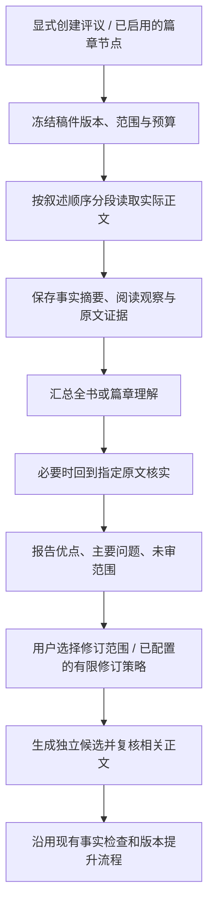

# Novel OS 阅读体验评议与定点修订方案

日期：2026-10-31（Asia/Shanghai）；实施更新：2026-11-01。状态：P0/P1（总体 M3）阅读评议已完成本地工程接入和虚构数据验证，见[M3 实施报告](../reports/2026-11-01-m3-reader-experience.md)。尚未部署、未进行真实模型/读者校准；P2/P3 定点修订与效果实验仍在后续范围。

总体实施顺序见[小说质量优化总体方案](2026-10-31-novel-quality-optimization-master-plan.md)。本文件是阅读评议子系统的详细规格；其中P0–P3对应总体M3/M4，不单独重建创作或审核流水线。

## 1. 目标与决定

目标是提高人物投入、因果可信、情绪体验、语言表现和持续阅读意愿。题材兑现是其中一个维度；协议通过、没有逻辑错误、模型评分高，都不能独立证明小说好读。

本方案采用三个决定：

1. 用**从实际正文提取的摘要＋原文局部评议＋全书综合**组织评价。摘要负责全局理解，原文负责验证语言、关系转变和具体问题。
2. 第一版是**非阻断、只读的阅读体验报告**。保留已有事实、连续性、商业合同、结局和发布检查；新评议不自动修改作品，也不增加一个必须拿高分才能交付的门。
3. 先证明评议有用，再接入**有范围、有预算、可比较的修订**，以真实目标读者的匿名试读检验改善。评价有效与改写有效是两项独立实验。

方法来源为 [LongStoryEval / NovelCritique 论文](https://aclanthology.org/2025.acl-long.799/)及[作者仓库](https://github.com/DingyiYang/LongStoryEval)，具体源审计见 [研究记录](../research/2026-10-31-longstoryeval-source-audit.md)。以下模块、预算、接口和产品决策均为 Novel OS 的适配提案，不冒充论文原有实现或效果。

## 2. 如何解释研究，而不误用研究

论文以已出版书籍及读者评分/评论研究长篇评价，整理剧情、人物、写作、世界、主题、情绪、投入和期待八个方面，并比较分段汇总、逐步更新评价、摘要评价。它报告汇总与摘要各有优势，但没有验证将反馈用于改写后能提高我们的小说质量。[论文 §3–5](https://aclanthology.org/2025.acl-long.799.pdf)

据此，本项目作以下限定：

- 评分相关性不等于评价准确率，更不等于续读率、付费率或质量提升幅度。
- 读者整体星级不能充当各维度独立、客观的真值；观察到相关性也不能推出创作上的因果权重。不能据某项相关性较低，决定降低语言或世界观质量。
- 通用出版物上的结果不能直接外推到中文连载、北美女频、狼人爱情或系统生成稿；需要目标域校准。
- 摘要可以保留事件，却可能抹平声音、潜台词和情绪台阶。因此摘要判断不能证明这些正文维度已经审完。
- 持久保存章节资料仍然必要；应避免把上一轮分数与结论反复喂给下一轮评价，造成判断锚定。事实增量与评价增量分开存储。
- 八个维度用于组织观察，不从论文推导统一权重、不要求每章同时完成八项、不用总分批准出版。
- 第一版不部署或微调 NovelCritique，不引入外部小说语料。代码、数据和权重的许可分别核实；公开可读不等于已获生产复用许可。

## 3. 本地现状与接入位置

核查对象为当前 `dev` 工作树，而非仅远端提交。工作树已有大量未提交的其他改动；本轮仅新增研究/设计文档并记录交接，不改写这些实现，也未验证服务运行状态。

| 现有能力 | 实际用途与边界 | 本方案如何使用 |
| --- | --- | --- |
| `core/pipeline_runner.py::_run_chapter` | 规划、写作、编辑、连续性、文风、商业交付检查、评议与稿件提升；部分失败已有有界修订 | 保留现有执行与事实门；新功能不叠加每章八次评审 |
| `core/long_form_quality.py::evaluate_progress` | 章节合同、里程碑、近期合同重复和 Final 存在性检查 | 继续使用；不能把通过结果显示为全书文学质量通过 |
| `core/commercial_quality.py` | 商业合同与正文证据绑定、试读窗口/全书兑现报告 | 提供独立的合同兑现视图；不把声明的目标当作读者已经获得的体验 |
| `core/narrative_methods/{models,compiler,runtime,store}.py` | 冻结政策/模型、精确版本评议、证据校验、显式重试；当前限定英语和已批准试读窗口，报告无稿件提升权 | 复用约束模式与底层工具；不静默扩展 v1 的语义或把旧记录当全书报告 |
| `core/quality/evidence.py`、`core/artifacts.py` | 原文哈希、位置与引用的确定性校验、不可变稿件版本 | 作为评议证据与快照的基础；引用存在不证明观点正确 |
| `api/project_reader.py`、`core/safe_project_io.py` | 只读正文选择、canonical 优先、安全文件读取；打开阅读器不提升稿件 | 提取可复用的只读快照入口，避免新建另一套旧格式回退规则 |
| `api/jobs.py::JobRunner` | 进程内任务登记与活动去重 | 仅作为工作线程入口；新增持久评议 manifest，不能只依赖此内存表恢复页面 |
| `core/pipeline_runtime.py` | 超时、暂停、检查点与真实活动信号 | 复用运行控制思路；新评议拥有独立任务身份和预算，不侵占创作运行的状态文件 |
| `core/usage_tracking.py`、`core/usage_costs.py` | 调用归属、可观测 token、人民币估算与缺失值 | 阅读评议计入正文费用并细分子项；沿用估算标签与未知用量状态 |
| `core/method_experiments/*` | 固定输入、完整样本导出、随机左右、英文编辑评审与耗时比较 | 复用实验基础；现有包提供大纲/事实，不能直接称为纯读者盲测，需新增独立的读者包 |

### 现有机制的具体缺口

现有方法评议主要看单章，不能证明跨章情绪变化或整本中段节奏。长期合同检查能确认事项有记录，不能代替连续阅读。完整流程也不能通过把各章分数平均，得出结局满意、关系可信或整书吸引力。

因此新增的是跨章节的阅读体验视角及其证据链，而不是另造一套发布权威。

## 4. 评价对象、输入与阅读范围

### 4.1 三种对象，不混用结论

| 对象 | 可以判断 | 不可声称 |
| --- | --- | --- |
| 骨架/设计 | 冲突潜力、因果安排、类型机制、预期兑现 | 文风已达标、人物已打动读者 |
| 已写连续篇章 | 局部语言、关系转变、重复、该范围的情绪与阅读期待 | 尚未写出的结局失败或通过 |
| 完整稿件 | 全书结构、长线兑现、结局体验、整体阅读意见 | 真实市场留存或商业成功 |

所有报告记录预期章节、实际可读章节、缺失章节、送审区间和所读版本。部分书稿使用 `partial`，不是“整书已评”。

### 4.2 独立的阅读包与合同包

**阅读包**只包含实际正文、理解所需的相邻正文、本书语言、明确叙述约束和目标读者。首次阅读不提供作者解释、设计表、已有评分或其他评审结论。避免“计划中已经建立信任”替正文补台阶。

**期待/合同包**在阅读观察形成后单独使用：读者可见的题名/简介/类型/受众，以及作者确认的创作要求。内部全骨架仅供设计兑现核对，不伪装成读者本来知道的信息。读者期待和作者私有合同分别报告。

这两个视角可以同属一个任务，但输入身份和结论必须分开记录。总评不把旧报告当新原文证据。

### 4.3 快照与兼容

- 新稿优先使用不可变 artifact revision；历史稿采用现有只读读取规则并建立 hash-bound 快照，不先迁移或提升历史数据。
- 原文提取同时保存原文件哈希、可读正文哈希、提取器版本、标题/状态块处理及映射。引用偏移明确针对哪个正文视图，不能混用原文件和清洗后的正文。
- 一个评议绑定整个有序快照。评议期间作者可继续修改；报告仍属于原快照，完成时重新比对当前版本并标记“历史版本/已过期”。
- canonical 定稿为空时不复活旧稿；损坏来源明确报错。只读 GET 不生成快照、不发模型请求、不写作品。
- 正文中的命令式文本和代码一律作为小说材料，不能控制评审工具或任务策略。

## 5. 推荐的处理流程

### 5.1 分段：保持读者经历的顺序

按章节/场景边界组段，保留倒叙、插叙和信息揭示顺序。工程预设可从约 8,000 个源文本 token/段开始，具体随模型输入预算和篇幅调整；这是拟议参数，不是论文结论。

每段提供必要的先前事实摘要，不提供先前评分或好坏结论。跨段边界可带少量相邻正文作为上下文，记录 `context_only`，避免重复统计。单章过长则按段落拆分，保存完整覆盖区间；不能截掉章末或默默省略材料。

预算计算包括系统提示、正文、历史事实摘要、输出预留和模型推理空间。超限则增加分段或返回可说明的预算不足，不先压缩/截断再声称全文已读。不能用 UTF-8 字节数代替模型 token 上限。

### 5.2 一次分段调用完成事实摘要和局部阅读观察

每段返回两个分离部分：

- **事实与变化**：实际发生的事件、关键选择及后果、关系状态、已揭示/未揭示信息；重要观察绑定来源。
- **阅读观察**：值得保留的表达、产生困惑或重复的位置、人物变化是否有铺垫、局部情绪/语言表现及其证据。

这是由正文建立的评议资料，不写入 canon，不把规划内容补作已发生事实。同一次调用的自我总结与自我评议不构成两个独立审者。

已有摘要只有在来自相同正文版本、相同提取规则且覆盖可核实的情况下可复用。Scribe 自报的 state update 或原骨架不能直接冒充正文摘要。

### 5.3 全局综合与回看

总评用有序事实摘要、每段阅读观察和证据目录形成篇章/全书判断。对跨章关系跳跃、反复觉醒、伏笔回报和结局满意度，明确引用前后位置。

摘要过多时建立分层汇总并保留来源目录；允许有损摘要，但要显示损失风险，不能称为无损全书上下文。摘要不能支持的细节标记 `not_reviewed` 或触发有预算的原文回看。

默认最多追加两次定点回看；一次可检查多个相关问题。只从高评分/低评分段落选样会形成偏差，因此基础分段读取应覆盖全部送审正文，回看只补证据不足。若另提供便宜的抽样模式，必须显示抽样区间及未覆盖部分，不能与完整模式同名比较。

回看产生新证据后，允许一次最终综合，保留初次判断与修正理由；同一任务综合调用总计最多两次。最终综合后仍未解决的疑点标记证据不足，不开启另一轮回看/综合循环。无需回看时，第一次综合即为最终报告。

### 5.4 不以平均分判断整体质量

全书问题可能跨越多章：每章单独成立，不代表关系转变可信或结尾充分。总评根据贯穿的变化和证据综合，不把章节评分平均为书籍分数。

初版界面不显示一个“总质量 92 分”。每维显示“主要优点 / 建议改善 / 存在分歧 / 证据不足 / 不适用”，附范围和来源。若实验确需 1–5 级量表，冻结锚点与有效维度，保留未知值，量表与模型版本不同的分数不可直接比较。

## 6. 面向用户的评议维度

下面是依据研究维度组织的本地验收问题，具体要求由本书读者与创作约定解释，不设统一套路数量。

| 维度 | 可执行的阅读问题 | 需要的正文证据 |
| --- | --- | --- |
| 情节与结构 | 转折由什么引起？中段是否只重复同一困境？结尾是否回应了主要承诺？ | 行动—反馈—后果的前后段落；伏笔与回收位置 |
| 人物与关系 | 欲望与限制是否影响选择？信任/爱/背叛的转变是否有台阶？ | 人物此前行为、触发、抵抗、选择和后续反应 |
| 语言与表达 | 视角是否稳定？角色声音是否有区别？关键时刻是否被场景化？ | 原文动作、对白、叙述与必要相邻段落 |
| 世界与设定 | 规则是否可理解并影响行动？能力与代价是否相容？ | 实际规则使用及结果；与确定性规则核查区分 |
| 主题 | 价值冲突是否通过选择发生？是否大量由旁白宣告？ | 有分歧的选择与代价；不强求教育意义 |
| 情绪体验 | 读者是否有理由在意？重大情绪是否有积累和余波？ | 关系细节、人物感知与实际反应；仅模拟意见 |
| 阅读投入 | 哪些位置令人困惑、想跳读或想继续？是否有阶段回报？ | 具体区间和造成体验变化的内容 |
| 期待兑现 | 本书向目标读者承诺的体验是否成立？类型是否影响关键情节？ | 读者可见承诺与正文表现，分开记录内部设计要求 |

静场、余波、观察章可以通过理解和情绪变化提供价值；不要求每章变身、反转、制造危机或推动所有人物。重复意象与重复无效情节需要区分。

## 7. 数据模型与边界（拟议）

新记录使用单独 schema，例如 `reader-experience.v1`，避免向既有严格字段集合塞入不兼容字段。

| 记录 | 必须包含 |
| --- | --- |
| `ReaderSnapshot` | project instance、来源类型、章节顺序、revision/hash、正文视图与原文映射、预期/实际覆盖 |
| `ReaderReviewPolicy` | rubric/prompt/模型/effort/语言版本、输入输出预算、总调用与时间/费用预算、分段策略、`advisory` 模式 |
| `ReadingUnit` | 正文区间、上下文区间、依赖 hash、事实摘要、观察、证据、完整回复位置和请求状态 |
| `ReaderReport` | 对象/范围、八维观察、保留项、最多五个优先问题、未审项、回看范围、成本、历史/当前状态 |
| `RevisionProposal` | 原报告与快照、选中问题、保留项、允许修改范围、候选版本、后续影响、前后比较 |

单条问题至少包含：`dimension`、`scope`、`observation`、`evidence[]`、`reader_impact`、`suggested_action`、`preserve`、`uncertainty`。证据保存章节、版本、哈希、Unicode code-point `[start,end)` 和短引文；前端 UTF-16 高亮需明确转换。

文本位置可验证，文学判断仍为模型意见；未校准的“confidence=0.95”不作为可靠性证明。跨章结论要有多处证据；没有找到某事的证据不等于它没有发生。

报告分别记录：任务是否完成、输入是否覆盖、引用是否有效、观点是否有人工反馈。不能合并成一个含义模糊的 `passed`。

缓存 key 绑定模型、配置、语言、rubric、源版本、段上下文和期望包。某章修改会使依赖它的摘要、后续上下文和总评失效；可复用的只有依赖未变的单元。历史结论完整保留并标记过期，不悄悄覆盖。

## 8. 异步、速度、成本与恢复

### 8.1 首版建议预算

设源文本共 `T` token，每段允许 `W` 个源 token，实际段数为 `G`；分层合并次数为 `M`，综合次数为 `S≤2`，原文回看次数为 `D≤2`，格式更正为 `R≤1`。

一次冷启动评议的模型调用上限为 **`G + M + S + D + R`**。实际 `G` 受章节边界、上下文与模型预算影响，不能只用 `ceil(T/W)` 承诺次数。

示意：约 80,000 token、实际 10 段、摘要能直接汇总时，基础 11 次；包括两次回看、第二次综合和一次格式更正，最坏 15 次。此数包含全文摘要成本；不是声称只读一份摘要就能低成本验证全文。缓存命中后按依赖只处理变化部分。

- 八维在一次段落/综合调用里组织，不拆成每维一个 agent。
- 默认并发 1，可配置至 2；在机器和供应商承载情况验证前不默认扩并发。依赖先前事实摘要的分段链保持串行；并发仅用于前置依赖已完成且上下文冻结的单元，例如独立原文回看，不能为提速省略前文依赖。
- 建议请求期限初值 300 秒，任务总期限 30 分钟，均在创建前按段数与配置核对；超出则缩小明确范围或显式提高预算，不静默延长。等待时间也计入总期限。
- 两次回看和一次格式更正共享任务总预算；无“分数未达标就继续调用”的循环。供应商/SDK 隐式重试也须纳入预算或关闭。
- 价格、汇率和模型配置在任务开始时冻结。token 不可观测时保持未知；预估费用与实际记录分开，不能把预估 token 伪装为用量。

以上是待试验调整的产品参数，尚无本机耗时或质量提升数据。首版独立评议不增加现有创作关键路径延迟；用户主动等待报告的时间需明确显示。

### 8.2 持久任务身份

拟议状态：`queued → reading → synthesizing → verifying → completed`，以及 `paused / interrupted / failed / budget_exhausted`。部分成果可用与任务终态分开显示。

manifest、输入快照、请求预留、完整回复和校验结果均持久化。页面刷新只读 manifest；重复创建请求用持久 idempotency key 返回同一任务，包括已结束任务，不能仅去重当前进程中的 running job。

服务重启后：已保存完整回复可继续本地解析；在途、未确认的调用标记 `interrupted`，不假称远端继续推理，也不自动重发。用户显式继续只处理缺失阶段，并保留原调用和费用记录。暂停先停止后续调度，等待本地 worker/进程退出再释放任务权；HTTP 取消不等于远端已停止计算。

拟议 API：

- `POST /api/projects/{id}/reader-reviews`：冻结范围/策略并创建任务，返回 202。
- `GET /api/projects/{id}/reader-reviews`：轻量报告和活动任务索引。
- `GET /api/projects/{id}/reader-reviews/{review_id}`：持久进度、覆盖与报告。
- `POST .../{review_id}/pause`、`POST .../{review_id}/resume`：显式控制；恢复不扩大原授权预算。
- `GET .../{review_id}/source`：访问报告绑定的原版本及高亮位置。

上述路径尚不存在。任务进度显示“已读 4/10 段、已保存四段结果、正在综合”等可验证事实，不用心跳模拟 token 或推理进度。

## 9. 评价如何真正改善生成

### P1：既有作品只读报告

用户选择完整作品或连续章范围，获得优点、主要问题与原文位置。首先验证报告能否指出有价值的问题；不因新评价失败改变创作任务状态、已选封面或交付可用性。

### P2：接入创作节点

新任务可选择在开篇小弧完成、重大关系/篇章转换及完稿时评议，边界来自本书设计，不硬编码每三章。普通章节继续走现有编辑与检查。异步评议完成前后续章节已经写出时，建议不能自动套用到旧快照之外；必须校验受影响版本。

把有效反馈转为下一阶段的具体指导，例如“上一段胜利没有资源后果，后续应让已确定的代价进入行动”，而不是重复抽象指令“更吸引人”。指导不得偷偷改变作者批准的骨架、身份、结局或长度。骨架自身需要改变时单独提出方案。

### P3：有限定点修订

用户选择问题和范围后生成候选；已明确开启的自动策略也须先冻结范围与预算。每个范围默认最多一轮修订、一轮效果复核，未解决则保留并报告，不无上限追分。

修订任务同时带入：问题证据、要保留的优点、目标体验、相关前后文、已确认事实与不能改动的设计。先修场景/因果，再做必要的语言润色。

效果复核要看修订正文及相邻范围，比较是否解决问题、是否损害人物声音/信息顺序、是否引入新矛盾。新评议无稿件提升权限；候选必须通过现有检查、版本与 promotion 流程。对已提升章节的改动需要明确历史修订策略，不能直接覆盖 Final。

独立 reader review 第一版不强制使用另一个模型，但同模型的新上下文只能标记“独立上下文模型评议”，不宣称真人独立反馈。测试可引入第二评审模型，以观察共享偏差；不能把多数模型投票当读者偏好真值。

## 10. 页面落地

保持已锁定的五个一级标签、浅蓝紫/白色圆角/无衬线风格。首版在“作品概览”增加紧凑的“阅读体验”区域，报告用独立详情或抽屉承载，不新增整页长表。

建议展示顺序：

1. 评议范围、当前/历史版本、状态、实际已读覆盖。
2. 值得保留的两三个优点。
3. 最多五个主要问题：位置 → 阅读影响 → 建议调整 → 查看原文。
4. 八维结果按需展开；缺少正文或不适用的项目清楚标记。
5. “选择问题制定修订方案”仅在相应阶段实现后启用。

章节列表仅显示有报告/建议/报告过期的小标记，不以模型分数给作品贴“差书”标签。阅读器可跳转到确切版本原文，不能只高亮当前稿中碰巧相同的文字。

费用仍归入“正文”，展开显示“创作、阅读评议、定点修订”子项，主分类与现有总计保持一致；新旧统计不可重复累加。报价缺失明示，不能显示为零。

## 11. 验证设计：两个问题分别回答

### A. 评议是否可靠、有用？

先选择 4–6 部有使用权限的现有作品，覆盖至少两种主要题材和不同表现；这是工程试点，不足以宣称适用所有小说。按整本划分调参集和保留集，不能把同一本的不同章节分到两侧。

比较两种冻结方案：摘要评议、摘要＋原文观察/回看。模型、范围、语言、输出预算及样本选择记录一致；对照组也记录生成摘要的成本。少量重复用于测稳定性，不要求日常生产反复五次评分。

人工分别检查：

- 优先问题是否真实、有来源、值得修改；特别统计误报和重要问题漏报。
- 证据有效率与结论正确性分开统计；确定性引用校验必须全部通过才能显示为已核实引用。
- 相同输入重复评价的分歧和排序变化。
- 在隔离副本里设置明确的因果缺失、关系跳跃、重复段落，观察能否定位；原作品不改动。这只能测检测能力，不能代替自然小说的审美评价。
- 完整输入处理量、调用数、人民币估算、耗时、超时与失败比例。

### B. 修订是否让小说更好读？

在未用于调整量表的材料上，固定原稿、模型与预算，比较现有编辑流程和新方案的实际成稿。匿名随机左右，完整保留失败、超长和缺章样本。

建立两份评审包：

- **读者包**：只给可阅读正文、必要前文和读者可见简介；先记录投入、困惑、跳读和续读意愿，再给偏好与理由。不显示大纲、改写目标、模型和既有评分。
- **编辑包**：另提供确认的事实、视角与约束，检查是否为追求效果损害逻辑或故事身份。

先用前几章及完整篇章筛选，再以完整短篇/整书确认结局与长线表现。中段片段的好评不能证明全书改善。邀请实际目标读者；英语编辑反馈与 40–60 岁北美女性读者反馈不能混为同一群体。

报告配对偏好、平局/不确定、分歧、问题位置、语言/人物/因果表现及全流程费用耗时；样本少时仅作为试点信号。若没有真实目标读者，本阶段明确待验证，不能用模拟分数代替。

发布前分别满足：工程正确性、评议可用性、修订有效性、成本可接受。文学判断不设一个模型总分阈值；具体实验接受门槛在试验前冻结，不根据结果事后调整。

## 12. 实施拆分与验收

| 阶段 | 交付 | 必要验收 | 范围判断 |
| --- | --- | --- | --- |
| P0 规范与离线验证 | rubric、输入快照契约、两种处理策略、盲测包与预算说明 | 来源/范围可追溯；旧稿不被修改；结论和证据分开 | 小至中 |
| P1 只读评议 MVP | 持久异步任务、分段结果/报告、原文定位、费用与恢复、概览入口 | 刷新/重启不丢任务；不得隐式重发；无模型调用的 GET；过期报告正确 | 中 |
| P2 节点接入 | 开篇/篇章/完稿可配置触发与冻结策略 | 不影响旧 run；预算不叠加失控；异步建议不污染已写事实 | 中 |
| P3 定点修订 | 选中问题→候选→比较→既有检查/提升 | 原版保留、影响范围重审、有限重试、真实盲评 | 中至大，独立交付 |

建议先交 P0/P1，验证报告找准问题后再进入 P2/P3。只做报告不会自动提升小说质量；最终收益需要修订与读者验证。当前尚不足以报精确开发天数。

拟议新增模块集中在 `core/reader_experience/`（模型、快照、分段/上下文、评价、存储/运行），API 为 `api/reader_reviews.py`。复用现有 evidence、artifact、安全读取、模型路由和 usage。必要共享逻辑提取为公共只读服务，不从 core 导入 API 私有函数，也不再增加一套兼容解析器。

关键测试包括：Unicode/重复引用定位、清洗映射、缺章与空 Final、超长分段覆盖、来源变更失效、倒叙顺序、无大纲泄漏、引用存在但观点不确定、进程重启与迟到结果、重复 POST、取消和总预算、模型用量缺失、历史报告/当前稿隔离、GET 零写入、ZIP/H5 输出不变。

当前分类 ID、骨架格式、H5/EPUB/ZIP 协议均不因评议升级而改变。旧任务缺少新配置默认关闭，不回放；既有小说只有显式创建评议才处理。真正启用模型实验或自动修订时另行确认具体范围、目的地和预算，不沿用其他小说的历史授权。

## 13. 当前交付与未做事项

本轮完成论文/公开实现研究、本地接入点核查和本方案。没有修改生产代码、启动付费模型实验、扫描或改写用户小说、下载外部小说数据集、部署模型、重启服务、提交或推送 Git。

下一项可直接实施的交付是 P0/P1：针对一部完整作品生成有覆盖说明、有原文证据、可恢复的阅读体验报告，并准备验证它是否值得采纳的盲评材料。
