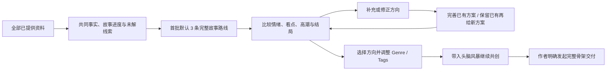

# 从资料分析到整书路线：前端 UI 设计方案

状态：**已批准，两个业务入口已实现并通过前端回归；未部署。** 实际页面与隔离浏览器验收见[前端报告](../reports/2026-11-11-source-routes-frontend.md)。下文保留设计阶段的现状分析和方案；早期原型不代表最终业务代码。后端合同见[后端方案](2026-11-11-source-story-routes-backend.md)，实际分析指令见[提示词评审稿](2026-11-11-source-story-routes-prompts.md)。

可交互原型：[打开独立设计稿](prototypes/source-story-routes/index.html)。直接以 `file://` 打开，无需服务器和网络。原型的全部故事、推荐目录与共创回复均为自建演示数据，不是读取真实作品得到的分析。

## 1. 设计目标与当前缺口

作者在资料分析完成后，需要能够回答三个问题：

1. 基于已经提供的全部故事，哪一条完整续写值得做？
2. 读者会因为哪些具体情绪、人物处境与场面持续期待，最终得到怎样的回报？
3. 我选定并调整方向后，如何直接进入共创，不再重新填写已经存在的构想？

当前 `SourcePlan` 只渲染 `continuation_plan.cards`，卡片没有选择行为。它们是一条路线内的连续剧情单元，不能加单选框就作为不同整书路线。`SourceBooks` 的入口仅携带资料 ID、分析版本、创作方式与封面选项；Workshop 仍从空构想、空题材选择开始。现有 `WorkshopStoryWorkspace` 的方案选择、故事地图、作者决定历史和骨架交付可以继续复用。

实现时必须同时调整产物结构、选择交接和首轮共创，不把这次工作限定为卡片改名。

## 2. 产品流程

涉及资料续写的新建入口统一经过相同的路线选择模块：资料库进入、Workshop 内选择资料、历史分析的显式补充设计。已经运行的作品和已经存在的讨论保持原冻结资料；不能在页面打开时替其切换新路线。

进入讨论只有一次明确的“带入头脑风暴”提交，不增加“确认分析—确认路线—确认推荐—确认开始讨论”的多层确认弹窗。路线选择和表单编辑属于创建草稿；提交补充意见只发起分析，不采用路线、不创建讨论。点击“带入头脑风暴”才建立可恢复的讨论和明确的作者选择记录。

### 新建头脑风暴时直接导入资料

完整路径为：**新建头脑风暴 → 导入文件或选择现有资料 → 当前创建页面内展示整书路线 → 按补充完善或继续获取新方案 → 选择路线并编辑题材 → 沿用同一创建草稿进入讨论。**

新建页保留标题、初始构想和题材区。作者选择“基于现有作品”并导入或选择资料后，在这些表单下方展开与资料库同一套路线模块。读取进度、共同承接点、路线详情、补充分析和版本历史都在当前流程完成；不要求先去资料库分析再返回，也不创建一个空讨论来承载分析。

沿用原故事推演、改编重写、借鉴创作三个来源模式。推演显示“共同承接点”；改编显示“本次保留与改写”；借鉴显示“借鉴机制与新故事方向”。后两者仍可查看原文读到哪里，但不暗示新书必须接着原作最后一章。已有模式选择保留，新增候选和交接均绑定该选择。

| 进入或离开资料分析时已有内容 | 保留规则 |
|---|---|
| 标题、作者构想、写作约束、目标语言 | 属于当前创建草稿；导入、重试、选路线和返回上一步均不清空，继续分析按其有效版本读取 |
| 明确选定的频道、Genre、Tags | 继续作为作者选择；路线推荐并列呈现，只有作者主动应用推荐才替换 |
| 已输入但尚未发送的意见 | 保留原文和未发送状态；不能暗中作为已提交要求传给模型或混入历史 |
| 已提交的补充、路线选择与各路线的修改意见 | 分别保留；切换路线不丢失其他路线草稿，生成新方案不等于选择新方案 |
| 当前选定资料与阅读结果 | 绑定明确资料版本；刷新、返回或同一操作重试继续该版本，不重复读取有效结果 |

两个入口只有容器不同：资料库可先选择方向再带到新建草稿；新建头脑风暴在已有草稿内完成方向选择。二者使用同一比较、意见、推荐、历史和交接模块。已有创建草稿始终沿用，不把“资料已读完”“新方案已生成”当成第二次新建会话的触发条件。对于已持久化的创建草稿，采用路线须检查其当前修订；若旧入口已经持久化了空讨论则复用该讨论，不再创建第二个。已进入实际讨论或运行中的任务不被新分析自动替换。

## 3. 信息层级与视觉方向

沿用 Novel OS 现有的深墨文字、纸白表面、低饱和紫色强调与圆角规则；这不是全站改版。把“文学方案的编辑工作台”作为视觉方向，内容主导，不使用运营仪表盘、虚构质量评分或无依据的情绪百分比。

### 页面首屏

顺序固定为：

1. 当前资料名称与分析版本。
2. 一句共同承接点，明确来源截止位置。
3. 首批默认 3 条同级、同宽的完整路线卡片；已生成更多方案时按批次浏览，不删除旧方案。
4. 推荐理由与选择入口。

资料路径、模型名字、哈希、请求重试等技术信息不占首屏；确有诊断需要时放到运行详情。封面可以作为资料识别缩略图，但不占据主要比较面积。阅读摘要默认折叠，随时可看。

### 每张卡片先展示什么

| 层级 | 展示内容 | 设计要求 |
|---|---|---|
| 第一眼 | 路线名、核心关系/冲突方向、一句话读者承诺 | 不只是一个情绪标签或营销口号 |
| 重点 | 第一幕如何抓人 | 具体承接场面、主角当下压力与行动；可与代表看点共用场面，不要求再堆一段重复长文 |
| 重点 | 读者会经历什么 | 表达期待与回报的变化；可以有安静、释然与余韵，不强制刺激升级 |
| 重点 | 值得期待的场面 | 用人物具体行动与选择说明看点；卡片默认展示少量代表场面，完整内容在详情 |
| 重点 | 结局回报 | 作者必须看得见整书走向是否闭环；不为作者隐藏终局“防剧透” |
| 辅助 | 推荐 Genre / Tags | 是建议，未替作者作决定；可修改 |
| 操作 | “看完整走向与情绪设计”“选这条路线” | 查看不会选择，推荐不会自动选择 |

候选卡片要能比较完整作品方向。不能把“第一个冲突”“第二个转折”“第三个高潮”拆成三条互斥选项，也不能仅改变标题或场景顺序。

桌面首屏控制内容密度：卡片首层展示有代表性的看点与一句终局回报，不将全部细纲堆进三列。完整信息始终可展开；视觉收起与后端省略是两件事。

## 4. 情绪、看点与钩子的呈现

### 情绪设计必须有发生原因

详情采用可阅读的因果条目，不以折线图伪装测量结果：

> **读者在期待什么 → 哪个具体场面及人物选择推动它 → 产生怎样的感受变化 → 得到什么回报，或留下什么尚待兑现的期待。**

例如原型路线 A 的前段：读者希望受伤的人得到交代；宁遥退回旧钥匙、继续自己的书店筹备；感受从心疼转为支持；她首先拿回生活的主动权。中段靠近与新的责任形成动摇，高潮承担责任，结局由她主动邀请。每一步均有事件承担情绪，而不是列出“虐、爽、甜”。

这只是原型叙事样例，不设为所有小说必须遵守的情绪顺序。不同 Genre、Tags、人物和原文可以给出不同结构，不规定每章情绪次数、固定高潮比例或统一结局。

### 看点与情绪关联，保留各自含义

- **看点**：读者期待亲眼经历的冲突、反转、人物对峙、关系变化或高价值场面。
- **情绪点**：读者为什么在意这个场面，以及它如何改变对人物和结果的期待。
- **回报**：前面积累的期待如何在人物处境、关系和结果上兑现。

一个场面可以同时承担多个作用，但界面不强制模型拆成重复的三份文字。关联关系由后端完整保存，页面按读者体验组织展示。

### 用“全书悬念与兑现”替代局部“章末钩子”

来源路线阶段展示长期悬念、人物关系期待、阶段揭示和最终回收；不提前要求每章悬念。详情包括：读者会持续追问的问题、推进或揭示的大致位置、最终怎样回收。情感关系和人物成长同样可以形成吸引点；结局应允许收束，不能每个回报后都强行添加新悬念。

作者商业主编版提示新增的“开局钩子”在界面呈现为“原作开局为什么吸引人”和“这条路线的第一幕”。前者置于共享来源理解的可展开区域，明确是基于原文的编辑判断；后者进入卡片代表场面及完整走向。不恢复逐章钩子清单，不要求用户阅读分析报告才能选路线。高张力的表现服从题材；界面不新增吸引力评分或“不可逆事件数量”进度。

## 5. 路线详情

桌面使用宽弹层，窄屏使用接近全屏的原生模态视图。详情分四个 tab：

| Tab | 内容 |
|---|---|
| 情绪与看点 | 读者期待、具体场面/人物选择、感受变化、阶段回报；默认打开 |
| 完整故事走向 | 具体承接第一幕、欲望与阻碍、关键抉择及代价、高潮破局与结局；同时说明这条路线的取舍 |
| 全书悬念与兑现 | 核心疑问、关系期待、揭示与兑现；不固定到章数 |
| 原文与新设想 | 原文已知事实、共同终点、资料空白；新增假设单独展示 |

四个 tab 仅影响阅读，不改变当前路线。底部提供“选这条路线，继续调整”；如果已经选中，则显示“继续调整这条路线”。Escape 和关闭按钮返回原卡片，焦点恢复到打开按钮。

推荐理由必须解释与原文情绪积累、未决选择和故事终局的关系，不使用“最优”“爆款概率最高”等未经验证的说法。推荐不是自动勾选。

## 6. Genre、Tags 和作者意见

选择路线后展开同页调整区，不要求跳转回空白新建向导。调整区包含：

- 读者方向：沿用现有男频/女频模型，推荐可改，不由主角性别机械推断。
- Genre：当前启用库中的一个条目。
- Tags：当前启用库中的 1–2 个条目。
- 原推荐理由：说明每个标签为这条故事贡献什么冲突、关系或读者回报。
- “我想保留或改变的地方”：可选作者输入，不必重新写完整构想。

生产数据以真实 ID、版本与快照绑定。库里只有一个 Genre 时，正常展示这个条目，不编造更多类型。原型中的 `Mystery` 只为演示切换，已经在原型说明中标注；不能将它硬编码到产品目录。

标签推荐与作者最终选择分别保留。作者改动后清楚显示“你已调整推荐”；不为改一个 Tag 重新读取全部资料，也不自动覆盖路线。作者在导入资料前已明确选择题材时，显示“你的选择”和“本路线推荐”，默认沿用前者；可用“采用这组推荐”显式替换。两者不同不作为分析失败，更不能让重新推荐清空作者选择。正式首轮共创读取实际选择，说明它对情绪与故事展开的影响；只有改变故事身份或无法兼容的重大前提才提出作者决定。

### 补充修正与继续出方案

在路线模块中始终提供 **“我想调整/补充的方向”** 多行文本框，首次分析尚在进行、尚未选择路线或已有多轮结果时均可编辑并保存草稿。作者不需要先选路线，也不必填写技术字段。示例提示文字：

> 例如：不要太快复合，希望女主的成长和事业更重要；路线 A 保留家庭冲突，但高潮要靠她自己的决定。也可以指出原文理解有误，或让模型再给两种不同结局。

两个动作并列且含义稳定：

| 操作 | 含义 | 未指定对象时 |
|---|---|---|
| **按补充完善方案** | 基于意见修订已有方案，保存为可比较的新版本；原版保留 | 对当前展示批次中适用的方案处理；可先选择“全部方案”或指定路线，不能暗中只修推荐项 |
| **保留已有，再给新方案** | 保留已存在方案，按新要求生成有实质差别的额外路线 | 默认增加 2 条；支持作者在文本中指定数量或差异方向，较多结果分批生成与展示 |

第一种操作需要有待完善方案；没有方案时按钮保留说明“先生成首批方案”，允许意见参与首批生成。第二种在首次生成前显示为“生成首批整书路线”，默认 3 条；作者可自行要求数量。默认数量是单次/单页建议，不是系统总数上限。请求较多时明确展示“本次请求 8 条，已完成 2 条”，而不是只给 2 条却宣称完成。已有请求处理中仍可编辑新草稿；重复点击恢复原请求，真正的新要求保留为下一次明确提交，不自动并发发出。

作者可选“针对全部方案”或具体路线作为范围；没有指定时按页面清楚展示的范围提交。已选创作路线和本次要修订的路线是两个独立状态。例如可以保留 A 为讨论起点，仅要求修改 B；不能因此偷偷选中 B。自然语言可以同时表达“完善 A，再提供两种新方向”，后端保留并执行兼容的两部分要求，界面分别显示“完善方案”和“新增方案”的进度，不强迫作者拆成多次输入。

反馈原文永久保留在本次分析记录中。可展开查看“本次按哪些意见调整”，展示作者原话及对应变化，重点比较**人物选择、情绪推进、期待场面、悬念兑现和结局**；不只显示标题或标签差异。新版始终标明来自哪条旧路线，新增方案与修订版本有不同标记，不能用覆盖原卡片掩盖变化。

作者指出“第 3 章不是这个意思”时，系统回看原文依据，保留原文和旧理解，结果用“已复核原文理解”展示；作者提出“我想在续写里改变这段设定”时，作为新的创作要求展示，不能伪装为原文。无需强制作者选技术类型；只有确实无法判断意思且会改变故事方向时，围绕具体差异给出简短澄清。一般创作留白不阻断其他可生成方案。

### 新旧要求与版本选择

提交反馈不等于采用新路线。新结果出来后可以对比、继续补充或选择；推荐结果不自动替换当前选择。历史中保留每次输入、旧/新方案、资料范围、生成状态与实际采用记录。只修改当前意见草稿不改变已提交要求；清空输入框也不能撤回已生效的作者要求，撤回须明确表达并保留记录。

新增要求已提交而新分析尚未完成时，旧方案仍可阅读，标记“依据上一轮要求生成，尚未纳入本次补充”。选择旧方案时，采用按钮明确表达“以此方案为基础，带上新要求进入讨论”，并显示新要求摘要。系统保留最新作者要求，首轮讨论负责调整与该旧方案不兼容的模型设想；不能把选择旧方案推断为撤回补充，也不能静默宣称旧方案已满足补充。

如果变化涉及原文件或资料版本，必须显示新的资料范围及承接点，不能只用“刷新”掩盖替换。新版本完成前保持旧版本可查；作者可以明确回到旧资料版本创作，但选择绑定旧版本并清楚显示范围，不把旧路线嫁接到新资料。仅补充创作意见不更换原文件版本；复核理解生成新理解版本，原文仍不可变。

### 编辑与切换规则

| 动作 | 行为 |
|---|---|
| 查看另一条路线 | 当前选择与草稿完全不变 |
| 改选另一条路线 | 切换当前方向，保留两条路线各自的题材与意见草稿；显式提示可返回继续 |
| 恢复推荐 | 只恢复当前路线的推荐题材；作者意见不清空 |
| 取消所有 Tags | 保留所有草稿，在字段附近提示至少选一个，主提交按钮暂不可用 |
| 选择第三个 Tag | 不静默替换已有 Tag，提示先取消一个；其余输入不变 |
| 切换资料或分析/路线版本 | 不能沿用原路线 ID；新版本重新选择，旧草稿按版本保留，不误绑定 |
| 推荐条目被停用 | 路线仍可查看，标明需更换该条目；不删除整份路线，也不自动切换未授权题材 |

## 7. 进入头脑风暴的准确语义

点击“带入头脑风暴”后传入结构化选择，不能把模型生成的整段路线伪装为作者原话，塞进 `premise` 或用户消息。界面应保持以下区分：

1. **资料事实与已知进度**：来自被选择的分析/证据版本。
2. **已选方向**：作者明确选择路线作为讨论起点的记录。
3. **待完善的模型设想**：路线内容、情绪设计、看点、高潮与结局，保留模型来源。
4. **我的实际题材选择**：用户提交时的频道/Genre/Tags，原推荐保留用于理解改动。
5. **我的修改意见**：用户真正输入的原文、明确作用范围及有效顺序，单独保存。分析阶段已提交的补充和当前创建草稿的有效约束一起带入；未发送草稿仍作为未发送草稿保留。

选择某路线并不意味着其所有新增假设都成为不可修改的硬事实，更不意味着它们已经发生在原文里。未选路线保留在资料设计历史中，不进入当前故事的要求清单。

首轮共创应直接在选定方向上继续：进一步设计人物的高代价选择、动人的关系变化、关键场面，以及高潮回报的前置铺垫。不要再次要求作者重选三条整书方案，不要求重新抄写构想。作者后续主动要求换方向时，才重新讨论。

已建立的讨论右侧/折叠区提供来源卡，展示当前原文范围、选中路线、实际题材和作者意见。讨论主区继续使用已有故事地图与决定历史。完整骨架按钮只在作者明确发起交付时执行；带入路线不会启动正文。

### 提交失败与重复点击

提交按钮进入清楚的进行状态。后端同一操作标识必须幂等。讨论已创建但首轮模型请求未完成时，页面展示“讨论已建立，正在展开所选方向”，刷新后继续打开该讨论；不能再次新建。

如果首轮失败，保留所选路线、题材、意见、请求与已收到回复。用户可“继续讨论”，不需要填写技术对账或重复选择资料。具体恢复、请求结果不明和协议纠正由后端设计负责；前端不能将未知当失败重发。

## 8. 页面状态矩阵

| 状态 | 显示与操作 | 必须保留 |
|---|---|---|
| 首次阅读中 | 已保存范围、当前步骤；未完成前不宣称已具备整书路线 | 原文件、已完成阅读 |
| 事实分析完成、尚无路线 | “基于全部资料生成整书路线”；阅读摘要可查 | 事实分析版本 |
| 路线生成中，无旧版本 | 显示当前阶段；不把半成品当可采用路线 | 已生成部分与原始回复 |
| 新版本生成中，有旧版本 | 上一版继续可查；标明尚未纳入新要求；可明确以旧方案加新要求进入讨论 | 旧路线、最新要求和选择草稿 |
| 新版本失败 | 上一版可用且保留上述新旧要求提示；“继续未完成的设计”不重复新建请求 | 所有旧版本、补充原文与已完成部分 |
| 补充尚未提交 | 文本自动保留为草稿；提交前不进入生成上下文，不显示已生效 | 原输入、选定作用范围和当前路线 |
| 补充处理中又编辑新意见 | 显示正在处理的原意见；新输入作为下一次草稿；重复原操作只恢复原请求 | 本次请求、下一次草稿及旧方案 |
| 修订完成或新增方案部分完成 | 显示修订/新增标记与变更；完整可用项逐个出现，未完成数量明确，不自动采用 | 旧版、完整新项、未完成请求及作者要求 |
| 资料理解已复核 | 展示依据与修订差异；不称为修改了原文；受影响旧路线标明需按新理解调整 | 原文件、旧理解、新理解及其路线来源 |
| 路线可选择 | 共同终点、路线比较、推荐理由、可编辑题材 | 明确版本身份 |
| 旧版单路线 | 标注“旧版单路线提案”；可沿用旧提案，或显式生成新路线 | 原 3–6 剧情单元，不冒充多条路线 |
| 容量不足以完成当前步骤 | 说明已保存、所需操作未执行；可以换可用连接再继续，不要求手工删资料 | 完整资料与所有检查点 |
| 原文确实存在重大歧义 | 展示确切争议与影响范围，必要时请作者决定；不把普通创作留白都当冲突 | 原文证据与其他可用设计 |
| 推荐条目失效 | 局部标明需选择可用题材；仍展示整书路线 | 路线、其他有效选择和意见 |
| 讨论已创建，首轮处理中/失败 | 打开同一讨论并显示真实状态，继续入口复用原操作 | 交接记录和已有回复 |
| 历史讨论/作品运行中 | 展示原冻结版本，不主动升级或改写 | 原讨论、骨架、任务和检查点 |

只展示真实完成的范围。`all_supplied_text_sent` 可以作为输入覆盖信息，不能改写成“模型已完全理解全部内容”或文学质量保证。原文预告、附录与正文章节分别显示，不能让补充材料悄悄推进续写起点。

## 9. 响应式、可访问性与阅读体验

- 桌面宽屏并排比较 2–3 条路线；中小屏改为纵向卡片，不用横滑隐藏唯一推荐或提交按钮。
- 正文优先 14–16 px，信息标签不承担核心叙事；内容较长可展开，不使用不可发现的多行截断。
- 已选状态由文案、控件状态与轮廓共同表达，不能只变颜色。推荐标记与已选标记分开。
- 固定底栏必须留出对应页面底部空间，不能挡住 Tags/意见或键盘焦点。移动端底栏提供已选方向与单一主按钮。
- 所有查看、选择与提交使用真实按钮；题材采用有 label 的表单；互斥路线由应用状态控制并明确 `aria-pressed` 或同等 radio 语义。
- 原生 dialog 管理焦点与 Escape；tab 使用方向键/Home/End，退出恢复焦点；长文本弹层可滚动。
- 错误提示在字段附近且通过 live region 宣告。减少动态效果，尊重 reduced-motion。不使用自动滚动迫使作者失去阅读位置。
- 用户输入按文本渲染，不能作为 HTML 插入；原型已经对作者文本转义。生产亦遵守现有内容渲染安全策略。

## 10. 前端模块与现有能力复用

| 位置 | 计划调整 |
|---|---|
| `web/src/api/sourceBooks.ts` | 新路线集、版本、状态与选择合同；保留旧 `ContinuationPlan` 类型 |
| `SourceBookDetails` | 依能力版本展示旧提案或新整书路线；展示准确资料覆盖 |
| 新路线展示模块 | 统一比较、详情、选择、推荐编辑、补充输入、修订/新增请求和历史；资料库和 Workshop 创建表单内共用 |
| `SourceBooks` / `SourceBookPicker` | 显式传入所选资料版本与路线版本；来源变化不得沿用失效路线 |
| `CreativeTypePicker` | 复用真实目录、选择规则、版本绑定；增加“推荐/已修改”的来源说明 |
| `sourceDraft` 或新的交接草稿模块 | 沿用创建草稿身份，保留标题/构想/约束/明确题材/未发送输入；按来源/理解/路线版本与反馈请求保存，不把模型提案串成作者文本 |
| `NovelWorkshop` / `WorkshopLibrary` | 新建页内导入/选择资料并内嵌路线模块；接收资料库结构化交接；采用时只创建或进入同一讨论，保留普通新建入口 |
| `WorkshopStoryWorkspace` | 展示已选方向/待完善设想/作者意见；沿用地图、决定历史与骨架交付 |

路由或 localStorage 不应作为可信的路线正文来源。交接只带稳定身份、明确选择和作者意见；服务端校验/冻结原方案。新旧合同必须有明确版本，不用字段是否为空推断作者授权。

## 11. 回归与验收计划

以下是待实施后的验收标准，不是本轮已执行的业务回归：

### 交互与状态

1. 路线列表显示多个整书方案；每条可查看自己的完整高潮与结局，不把局部章节卡当路线。
2. 推荐无默认采用；查看详情、切换 tab、收起原文信息均不修改选择。
3. 选择路线，修改频道/Genre/Tags，填写意见，切换再返回，草稿保持；零 Tags/第三 Tag 的错误不清空输入。
4. 来源或版本变化后不能引用旧路线；刷新可恢复正确版本的草稿，历史版本仍能浏览。
5. 新版本生成中/失败时上一版可用；旧版提案显示与沿用入口保留；首次未读完没有可误提交的整书路线。
6. 双击/超时重试只产生一个讨论；讨论建立后首轮失败仍打开相同讨论。
7. 从新建 Workshop 先填标题、构想、约束、Genre/Tags 和未发送意见，再导入资料；路线生成、失败恢复、返回、刷新和更换所选路线均不丢这些值，推荐不覆盖明确题材。全程不跳资料库、不创建空讨论。
8. 未选择创作路线即可补充并新增方案；针对 B 完善不更改已选 A。混合意见“修改 A，同时新增两条”能看到两类结果，原 A/B 版本保留。
9. “按补充完善方案”产生可追溯修订；“保留已有，再给新方案”增加不同完整故事，默认 2 条且不覆盖旧项。作者请求更多时显示总请求数和分批完成数，不将每页上限误作总上限。
10. 双击、超时、刷新恢复同一个反馈请求；处理中新增输入保留为新草稿，不被旧响应清空、不自动发送。异步旧结果返回不得覆盖较新的选择或要求。
11. 新要求提交后旧卡片显示尚未纳入；明确采用旧卡片会同时携带最新要求，不静默撤回。单纯查看旧版本不改变当前资料绑定。
12. 原文理解纠正保留证据及旧理解；创作改设定保留作者原话和范围而不改源文件。新资料版本到来时旧路线不能误绑，显式回选旧资料时仍显示其准确范围。

### 跨端交接

1. UI 选择的 route/version 与服务端冻结相同，完整情绪设计/看点/高潮/结局保留。
2. 用户修改后的题材进入首轮请求；原推荐不覆盖实际选择。
3. 用户意见保留原文；模型提案没有伪造成用户消息，未选路线不成为当前创作要求。
4. 首轮直接深化选中方向；“进入讨论”不启动正文，也不自动交付完整骨架。
5. 后续改动按作者明确选择更新，新旧来源、路线和讨论历史可追溯。
6. 资料库进入和新建 Workshop 内导入对同一输入得到相同的路线与交接语义；同一创建草稿最终只绑定一个讨论，后退再前进不生成第二个。
7. 分析阶段多轮补充、兼容的旧要求和最新明确修正完整进入首轮共创；未提交文字不冒充已提交要求，生成/修订请求不冒充采纳记录。

### 无回归与可访问性

1. 旧分析、旧讨论、已经采用骨架和运行任务的文件及冻结绑定不改变；页面读取不调用模型。
2. 无资料的普通新建、原故事推演、改编重写、历史资料沿用都保持清晰入口，不能让路线接口只服务资料页。
3. 1440/1024/768/390/320 px 下无横向溢出，底栏不挡内容；200% 缩放、键盘、读屏标签与对比度检查。
4. 浏览器端无未捕获异常；作者输入按文本显示；返回、刷新、多标签页和过期版本不丢失或错绑意见。

文学验收另需真实六章样例和长资料样例：作者能够解释各路线为何不同，指出期待的情绪与场面，且可以看到这些期待如何通向结局。不能用 schema 通过率代替这个评价。

## 12. 原型覆盖范围

当前独立原型已经包含：三路线比较、情绪/整书/兑现/来源四 tab、显式选择、题材编辑、每路线意见草稿、模拟交接、模拟意见保存、旧提案/首次未读完/新版本处理中/失败状态。它不保存到产品、不调用模型、不创建讨论、不启动生成，也不接入真实目录。

本次补充的**新建 Workshop 内导入全流程、两种继续分析动作、多轮补充记录和新旧版本差异比较**目前只有本设计与后端/提示词合同，尚未接入该原型。不能将已有“保存意见”的模拟交互当成分析重跑或新增路线已经完成。

原型只验证阅读层级和交互意图。后端来源覆盖、语义证据、请求恢复、历史兼容和真实模型输出质量必须按正式实施与回归计划验证。
