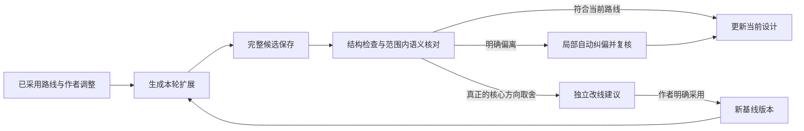

# 以选中路线为依据的头脑风暴开发方案

状态：2026-11-12 作者已批准完整实现，开发开始前先提交当前成果并推送、合并远端 dev。新增范围：主动提示可生成骨架；参考路线推荐可修改的篇幅及每章字数；已有篇幅方案支持修改总字数和每章字数。当前线上仍为 `748e53f`，本轮开发不部署、不重启、不改运行任务。

目标：作者采用整书路线后，系统沿该路线扩展人物动机、情绪场面、看点、因果、伏笔及分章；改变核心方向有明确授权和可追溯版本。保持资料完整、作者控制、恢复能力和可接受的核验成本。

**1. 当前问题与需要保留的能力**

现有系统已完整冻结 `selected_proposal`、原作证据和作者补充，并在讨论、骨架交付及创作 v5 中传递。原作事实、作者选择与模型假设已有区分；`SourceRequestSession` 提供完整回执、幂等和恢复；`next_step` 已统一讨论、篇幅确认、交付和恢复操作。

缺口在于：路线选择主要确认 direction 节点，后续沿路线深化仍依赖提示词；模型回复在 `_run_turn()` 中直接进入会话和 `record_round()`，没有验证新增设计是否改变路线核心。当前五节点故事地图是导航摘要，不能作为全部文学内容已保留的证明。最终情绪看点也没有贯穿路线、事件、章节、正文的落点关系。

本方案复用现有存储、决定记录、worker、质量角色及恢复机制；增加一个集中处理路线依据与候选晋级的模块，不建立第二份独立全书状态或第二条全书审稿流水线。

**2. 产品行为与采用范围**

新入口说明：

> 采用此路线的核心走向与情绪回报，进入头脑风暴展开细节。具体实现可以优化；改变核心方向会单独说明。

按钮：**采用此路线并展开**。这一次操作建立路线核心的采用依据，不再把同一组初始路线拿回来反复询问。

| 内容 | 默认处理 | 改变条件 |
| --- | --- | --- |
| 主角核心追求、核心冲突、关键抉择、关系走向、高潮解法、结局方向 | 作为当前路线核心保留 | 作者明确改动或采用明确的改线提议 |
| 核心情绪承诺、重要看点的戏剧作用、悬念与兑现关系 | 保留作用，可深化实现 | 取消、反转或削弱核心作用需要作者授权 |
| 作者明确点名保留的场面、人物身份、不可发生的事件 | 按原话与范围保护 | 作者后续明确修订 |
| 场景地点、动机铺垫、对白、兼容支线、伏笔位置、转场 | 模型主动展开 | 通过因果与路线一致性检查，无需逐项确认 |
| 未采纳备选、未知背景、现实资料判断 | 保持原有假设或待核实状态 | 不能因“继续”变成作者确认或客观事实 |

原作事实与创作承诺是独立维度。例如“新故事最终重建关系”可以是作者采用的创作目标，同时仍是模型设计的未来事件，不能说成原作已经发生。续写、改编、借鉴各自保留现有模式约束；改编模式下作者明确改写原文的要求记录为二创前提，不篡改原文证据。

不把整张路线卡的所有措辞机械锁死。源路线中明确标为可选、尚未决定或相互排斥的内容，不自动晋级为核心。路线自身存在不能兼容的重大选择时，只呈现相关的一次创作取舍。

**3. 领域对象与唯一依据**

| 对象 | 职责与权威 |
| --- | --- |
| 原始路线快照 | 保留选中版本、原作证据和原始设计，原 SHA 不修改 |
| 路线基线 RouteBaseline | 原路线中有效核心、情绪功能、明确场面锚点和后续授权改动的版本化投影 |
| 作者变更 AuthorDecision | 复用现有 decisions/actions 与原话，记录授权范围、替代关系；不复制为另一套决定账本 |
| 当前故事设计 | 复用有效的故事设计产物和 `story_state`；地图只作投影，不能替代完整产物 |
| 讨论候选 | 原始回复、拟新增设计、备选改线、引用和检查结果；保存不代表采用 |
| 路线检查回执 | 绑定具体候选、基线、作者依据与实际检查范围，不是模型自发的通过声明 |

基线项建议字段：宿主分配的稳定 `item_id`、类别、完整叙事含义、来源路线版本及字段位置、采用依据、保护范围、可调整实现、依赖项、当前修订、被替代关系。`origin` 与 `adoption` 分开：来自模型不妨碍作者采用为创作目标，作者采用也不会改变来源属性。

稳定 ID 由代码生成并贯穿修订，不让模型自造 ID/哈希；不能按新章节号重建。模型可提出新的局部设计键，由宿主验证后分配永久 ID。原文位置、完整字符串和版本校验保证可追溯，但文本引用存在不等于文学含义已被证明。

有效依据由“原始路线＋有证据的作者调整＋已通过检查的展开”组成。基线是物化投影和受控契约，不是与作者决定记录竞争的真相来源。派生视图可重建，原产物不可覆写。

作者明确改线的决定即时生效，派生设计协调完成是另一件事。两者分别记录修订：旧设计即使曾通过检查，也不能在与最新要求冲突时继续交付。协调失败保留旧产物和兼容部分，受影响的设计、篇幅与交付标为待协调，从已授权变化继续修订，不要求作者重复确认同一决定。

**4. 统一模块与接入位置**

建议增加 `core/route_development.py`，以少量接口封装分类、版本、证据范围、权限、变更分析和晋级判断：

```python
establish(selection, route_snapshot, author_history) -> BaselineRevision
prepare(session_snapshot, operation) -> DevelopmentContext
assess(candidate, baseline, author_scope, judgment) -> DevelopmentDecision
```

`assess` 的事实校验和决定计算可直接测试。语义判断作为依赖提供，不在多个调用方重复构造。网络请求、持久化和取消仍由现有 worker/请求执行模块负责。现有 `_locked()` 内提交通过结果，使用原有的会话版本与操作身份；模块不另造任务调度器。

| 接点 | 拟改职责 |
| --- | --- |
| `core/source_routes.py`、`core/source_route_prompts.py` | 新路线同一生成回复表达核心、情绪功能和可展开范围，避免额外抽取问答；原完整路线仍保留 |
| `api/workshop_source_handoff.py` | 资料库、新建导入、已有讨论改选路线共同建立版本化基线；保存采用范围 |
| `api/workshop_delivery.py:author_context`、`api/workshop_request.py` | 传完整路线、有效基线、作者调整、候选状态与实际操作范围 |
| `api/workshop.py:_run_turn` | 完整候选先落盘；路线检查通过后才将主设计晋级并更新故事地图、篇幅、交付建议 |
| `api/workshop_story_result.py`、`api/workshop_guidance.py` | 保留结构、引用和重大问题校验；路线遵循结果进入同一可用性判断 |
| `api/workshop_next_step.py` | 统一显示继续深化、改线选择、自动修订、恢复、篇幅与交付，前端不自建业务状态机 |
| `core/story_design.py`、`core/skeleton_review.py` | 路线设计项与骨架事件/章节的落点，复用现有交付审稿 |
| `core/creative_execution.py` | 新版本交接携带有效基线和落点，旧 v5 及其哈希保持兼容 |

无参考资料的新书也从作者明确采用的整书方向或作者完整骨架建立同类依据；没有选择路线的开放讨论仍可探索，不虚构一个已采用路线。CLI/导入骨架不强迫作者再走资料分析页面。

**4.1. 无参考资料的原创入口：逐步形成创作依据**

两个入口共用 Workshop、作者决定、候选检查、恢复、骨架交付和后续创作；区别在于初始依据如何形成。统一领域概念应为“创作基线”，选中参考路线建立的路线基线是其中一种。上述模块不能以 `source_context` 存在为启用条件，原文证据包是可选来源，作者原话、已采用提案和明确委托同样提供有范围的创作依据。

| 原创起点 | 首轮行为 | 初始保护范围 |
| --- | --- | --- |
| 一句话、题材或模糊灵感 | 提供少量有实质分歧的整书方向供探索，不先要求完整设定表 | 已明确的偏好与禁区；未定结局、人物关系保持开放 |
| 已有角色、冲突和部分情节 | 保留已有设定，围绕未定的大方向补足方案 | 作者明确设定与已采用选择，不把模型补白全部锁定 |
| 作者明确要求沿用的完整构想或骨架 | 直接深化动机、情绪场面、因果与伏笔，不强制重新选路线 | 作者要求保留的完整范围；文中标明的备选仍是备选 |

“探索方向 → 采用方向 → 深化细节 → 交付骨架”是可跳过已完成部分的创作进程，不是四个强制审批关卡。基线可以逐步充实；尚未决定的部分不虚构约束，模型主动提出新方向也不算违背一个不存在的路线。即使尚未选路线，作者已明确的要求始终有效；原设定与新候选的因果仍应检查。

例如作者只要求“女性创业故事，不靠婚恋解决经济困境”，这两项立即受保护，但结局、对手、核心关系仍可比较。选择某条路线后，才把该路线中明确采用的核心加入基线；一句“继续”不采用所有互斥备选。作者明确说“这部分由你决定”时，记录具体委托范围，允许模型在范围内推进，不强迫选择卡片，也不伪称为作者逐项确认。

原创提示词复用人物选择、代价、情绪看点和因果方法，按起点启用探索或深化规则；不加载无关的原著研读、最后正文节点和原文证据请求要求。前端无既定路线时显示“正在探索故事方向”和“已明确的要求”，采用后显示“当前创作方向”。已有完整构想直接进入深化。Genre/Tags 沿用作者选择，模型推荐不自动替换。

回归增加：无来源可正常创建和交付；模糊构想不被模型首个提案锁定；部分设定只保护明确范围；完整构想不反复要求重新选路线；委托仅在授权范围内生效；无原文时不索要原文证据 ID。以上仍为待 review 的统一设计，不表示新约束已实现。

**5. 每轮讨论流程**

1. 读取本轮快照：会话修订、当前基线、有效作者要求、当前设计及原始来源。
2. 解析操作范围：沿路线深化、仅解释/提问、比较备选、提出改线、执行明确改线。结构化操作优先；明确自然语言同样有效。
3. 模型生成主扩展与独立的可选改线建议。主扩展服务当前路线；备选不混入主扩展。
4. 完整回复及候选先保存，尚未显示为“已纳入当前方案”。
5. 宿主校验结构和引用，比较全部拟持久化设计字段，并将本轮完整新增叙事纳入作用域；不能只检查模型自报的 `changed_ids`。
6. 对需要并入当前设计的新增叙事，做一次短范围独立语义核对：完整核心承诺、本轮完整变化、相关作者要求和必要的原文/旧设计依据。
7. 通过后，在同一受控提交中更新现有设计、地图、相关篇幅有效性及下一步；未通过的候选保留，原有效设计继续存在。



图中的修复成功才可进入 E；重复无进展、技术失败或未完成判断停留在已保存候选，不能沿箭头假装通过。

发布绑定至少包含：会话及基线修订、有效设计哈希、候选哈希、作者操作、证据清单和策略版本。旧结果晚到、作者切换路线或暂停后，保存结果但不得覆盖更新后的设计。检查回执不能跨候选复用。

后续 `author_context` 同时携带宿主生成的候选状态和有效设计引用。完整历史中的未晋级回复、失败候选、改线备选不得被当作上一版有效方案，也不能单靠历史引文成为容量或骨架的采用依据。原文引用可证明来源，采用范围仍须独立判断。主内容完整而模型漏报变更标记时，由宿主 diff 纳入检查范围，不为了补标记额外请求重述整个故事。

普通“继续”“写得更精彩”“加强事业线”授权在原方向内展开，不授权改换结局。“把结局改为不复合”是明确改线，可记录原话并展示影响后执行，不要求重复确认。“看看不复合会怎样”只生成可比较备选。只有无法可靠区分执行与探索、且涉及核心方向时，才问一次简短选择题。

**6. 检查分级与避免过度审稿**

| 结果 | 判据 | 处理 |
| --- | --- | --- |
| 符合路线 | 核心承诺保持；新设计因果兼容 | 晋级主扩展 |
| 合法深化 | 场景形式变化，但选择、代价、关系变化和兑现功能保持 | 正常通过，不要求额外作者确认 |
| 明确偏离 | 有可定位的新旧设计冲突，且没有对应作者授权 | 只修该变化及必要依赖 |
| 建议改线 | 模型明确提出核心替换方案 | 单独展示；原路线可继续，不被建议自动阻断 |
| 判断不足 | 缺必要证据或语义不能确定 | 自动补取依据；保留候选和原设计，不伪装成作者分歧 |

否定判定必须说明：涉及哪项承诺、候选中的哪个具体事件或决定、冲突在哪里、对因果/情绪回报的影响。不能凭题材偏好、风格评价或“我觉得不够好”阻断。

本轮未提及一个继承项不等于删除它。继承项默认保持；只有本轮修改导致取消、反转或不可实现才判为冲突。讨论阶段“尚未展开”是正常进度，最终骨架阶段才要求必需承诺有具体落点。

检查对象不是全部历史对话，更不是每次重审 100 章。纯解释、排版、未采用备选以及相同已检查候选重放，不新增路线审稿请求。新的文学设计要晋级，仍需语义核对；不能承诺零额外调用同时可靠发现未声明的改线。

**7. 情绪点、看点与因果的保留方式**

复用既有 `expectation / scene / choice / cost / change / payoff`，不另造情绪分数或固定刺激次数。每个重要设计项保留完整的读者期待、人物压力、选择、代价、关系或局势变化、后续兑现，以及与前后事件的因果关系。

例如“人物主动承担现实损失，才重新获得接近对方的资格”，更换对峙地点可以是等效深化；只换成一段感人道歉、消失了损失和权力变化，就不是等效落实。作者明确保留的某场对峙不仅保护功能，也保护该具体场面。

路线项与章节是多对多关系：一个回报可以跨多章铺垫，一场高潮也可以承担多个承诺。状态严格区分：已继承、待展开、已安排到骨架、已有正文证据、已接受编辑检查。不能用“已安排”冒充读者已经获得情绪回报。

交付时检查关键功能是否落实为具体人物行动、代价与后果；只在表里列出承诺 ID 或写一句“本章很爽”不算覆盖。代码验证引用、章节存在和链条闭合；现有 Editor/Guardian 角色判断场面是否支持声称的作用。

**8. 自动纠偏、恢复与活性**

明确偏离时自动生成受限修订请求，分别列出允许修改的设计项和只读依赖。不能因为某章节受到影响，就获得改写所有相关章节的权限。只修改违规部分及其必要因果连接，完整原候选和已确认内容保留。

必要因果连接也必须在允许修改集合中。确需修改只读依赖时，先根据已有作者授权重新计算修改范围；涉及核心承诺变化才进入改线选择，不能由模型自行扩大写权限。

正常一轮为“生成＋一次范围核验”。出现明确偏离后做一次针对性修订及对应复核；重复的“基线＋候选＋同一问题”不再原地购买相同请求。后续继续从保存的候选和具体问题恢复，不能重建整套故事。这里只是防循环执行策略，不在用户界面增加修复额度表单。

未修复候选不能覆盖当前设计，整个讨论仍可查看、补充、调整或暂停。若影响核心方向的核验仍未完成，不允许把候选作为有效依据生成正式骨架；可以继续使用未受影响的原版本。技术故障使用已有恢复能力，不伪装成需要作者决定的剧情问题。

复用 `SourceRequestSession` 保存完成回复，避免重复付费。远端结果未知继续遵守现有结果查询/明确重执行合同，不因“自动纠偏”无条件重发。换模型从新请求开始使用当前设置，不改写原回执或冻结旧任务的模型配置。

**9. 小上下文与 100 章设计**

完整原文、原路线、作者要求和历史产物始终保存。摘要、向量检索与相关性排序只能帮助找证据，不能取代被声称已核验的原文。

新增路线核验使用：全部有效核心承诺、本轮完整新增设计、此次涉及的完整作者要求、可定位的必要因果依赖。原文引用超出当前范围时显式补取。没有读到的内容只能标为未检查，不能自动通过。

小上下文下按因果单元和证据原文分页，保留每页来源、顺序、实际范围和跨页约束。修改后的候选使其依赖检查失效；其他无关检查复用。独立片段不能拆开共同决定结局的两项条件，且不能仅因模型没有报告依赖就认定独立。

现有 SourceEvidenceCoordinator 的存储、完整性验证、分页和恢复可复用。新增路线核验不直接复制其“候选一变化就重遍所有原文”的完整循环。若一个不可拆的核心要求、候选及证据无法共同容纳，保留全部材料，显示真实容量原因和换连接/恢复入口；不截断、不降格为低质量摘要，也不声称所有小上下文模型都能完成任意规模任务。

100 章骨架按既有章节批次生成和保存，路线项通过稳定事件/场景关联到章节。重新分章只改变归属，不重建情绪承诺 ID，不改变原路线。改变高潮时补查它的铺垫和后续关系；最终合并覆盖记录，查遗漏及跨章不兼容。把核验并入现有交付审稿，不新增 100 轮独立路线评审。

局部通过标记相加不代表全书语义通过。既有交付审稿仍需检验跨批次的核心选择、人物知情状态、铺垫与兑现链，读取相连两端的实际细纲或正文证据。缺少任何必要一端，保持该关系未核验，不能以摘要或覆盖计数代替。

调用统计同时展示逻辑步骤和实际模型请求。一次逻辑核验可能因完整证据分页产生多次请求，不能隐藏成本。测试 20、60、100 章及多个实际输入容量档位，记录总请求量、输入输出量、耗时分位数、重复修订率和无效阻断率；不预先宣称未经测量的提速比例。

**10. 前端设计**

资料库、新建头脑风暴导入使用同一选择说明和按钮。既有讨论切换路线展示“保留什么、改变什么、哪些已确认设计受影响”，不会悄悄切换。

工作台顶部常驻：`当前路线：先离婚，再重新爱 · 沿用作者第 N 次调整`。可展开原路线、当前核心及调整依据。日常界面不显示哈希、技术对账或模型内部字段。

复用现有页面：

- 本轮决定：只展示真实核心取舍；可选改线建议不阻断原路线继续。
- 故事全貌：区分沿用的核心、本轮新增、尚待展开及备选方案。
- 情绪与看点：展示期待、行动选择、代价、关系变化和兑现落点，可展开，不强迫作者逐项审批。
- 待定事项：区分“需要你决定”和“模型待完善/现实资料待核实”，不把全部未确认事项当成作者待办。
- 讨论记录：保留原话、候选、未采用建议及版本；失败候选明确不属于当前方案。

`next_step` 统一提供按钮：沿路线继续完善；查看可选改线；自动修订进度与暂停；恢复未完成步骤；完善/选择篇幅；生成骨架。任何禁用按钮都显示原因和可执行下一步，不能回到“没有重大分歧却只能输入文字”的死路。

纯解释或查看备选不使篇幅失效。只有生效的设计变化影响场景、章节或容量依赖，才让相关估算过期；不能每聊一句就重新确认整份篇幅。

**11. 提示词方案**

保留作者已批准的商业小说研读主提示词。新路线生成补充结构化采用范围，头脑风暴增加下列合同；模型自报遵循仍需后台核对。

```text
你正在基于作者已采用的整书路线深化设计。
effective_route 包含当前路线核心、必须保留的情绪功能、作者明确保留的场面，以及后续已授权调整。

主动补足人物动机、冲突升级、场景、伏笔和因果桥梁。普通深化不得删除或反转路线核心，
不得用抽象的“情绪更强”替代原有具体选择、代价、关系变化与兑现。

区分原作事实、创作承诺和模型假设。采用路线中的新事件，不代表该事件已经发生在原作中。
作者最新明确要求只授权其涉及范围的变化，其余兼容要求继续有效。
“继续”“更精彩”“加强事业线”不等于允许改变关系终局或结局。

若认为核心方向需要变化，单独给出改线建议：保留什么、改变什么、理由、影响哪些情绪回报。
未获采用时，主扩展仍沿当前路线。作者明确要求改变核心时按其范围执行，不重复要求同一确认。
不要重新询问已采用的初始路线，不把普通专业细节变成选择题。

本轮没展开的继承项继续保留。已授权变化需说明铺垫、高潮和后果如何同步调整。
主扩展和探索性备选分开返回，引用宿主提供的设计项ID；不得伪造作者批准、引用或校验通过状态。
用户可见说明应以具体故事如何变好为中心；内部变更和证据记录按本轮合同输出。
```

独立核验提示词的目标为“找可定位的路线冲突”，不是重新构思另一套更优故事：完整比较候选新增叙事与有效核心，识别未声明改线；允许戏剧功能等效的场景变化；区分未展开与取消；无证据不得判冲突。核验结果只返回具体依据与影响，不能修改路线或代替作者决定。

**12. 旧任务与运行中任务迁移**

GET 不迁移、不发模型请求。普通写操作在空闲版本边界准备派生记录，保存迁移来源、版本和状态；中断可恢复，重复执行幂等。

| 类型 | 兼容处理 |
| --- | --- |
| 新选择的路线 | 清晰展示新采用范围；同一次选择建立基线 |
| 旧路线讨论 | 原路线＋后续明确作者决定＋已确认骨架形成兼容基线；只保护已有证据支持的核心范围 |
| 历史范围不明的内容 | 保留可编辑设想，不追认为作者已批准；可提供一次“以当前方案继续深化”的清晰范围操作，不能强制重走全部问答 |
| 正在进行的旧 turn | 按启动时合同完成、保存；下一次安全写操作启用新协议，旧回复不套新输出合同重跑 |
| 已有骨架与交付检查点 | 原字节、版本和回执保留；派生关联不重写正文，只有实际受影响的新修订阶段需要重新检查 |
| 已启动小说 | 继续原 handoff；新合同不热替换运行中输入，不改已晋级章节。需要升级时经明确修订操作在安全检查点单独处理 |
| 来源库已移除 | 使用讨论内已经冻结的完整路线与证据，不重新要求上传 |

旧 `direction_selected_details_proposed` 只证明旧采用范围，不能因新代码上线扩大为“作者批准所有场面”。尤其不能拿最早路线覆盖后续明确修改。旧 source/policy/handoff 哈希及历史 operation ID 不变；新派生协议拥有独立版本。v5 解码保持严格兼容，新交付才使用携带路线契约的新版本。

**13. 回归与上线准入**

| 验证类别 | 必须覆盖 |
| --- | --- |
| 入口一致 | 资料库、新建导入、已有讨论换路线、直接作者骨架遵循共同规则 |
| 权限 | “继续”不改核心；明确改线只改授权范围；探索问题不视为采用；控制指令不作为作者原话 |
| 隐蔽漂移 | 不申报 changed_ids，或保留路线原句却在新场景写相反结局，仍能发现 |
| 合法深化 | 更换地点、合理拆并场景、增加兼容支线，不被误挡 |
| 情绪质量 | 人物代价、权力变化、重要兑现消失不能仅靠标签/ID判通过；明确场面锚点不会被抽象化替代 |
| 证据 | 只认本轮绑定原文；跨任务、错版本、伪造引用/回执不能晋级；缺证据不判已核验 |
| 恢复与并发 | 重复提交、暂停晚到回复、模型切换、作者同时改线不覆盖新状态；完成回执复用 |
| 状态权威 | 明确改线后修订失败不能回退交付冲突旧稿；失败候选不能从历史文本重新变成当前路线 |
| 小上下文 | 无损还原全部分片；早期条件与后期结局共同验证；不可拆输入不能通过截断达标 |
| 长篇 | 20/60/100章；重分章承诺不丢、局部修复依赖完整、无关检查复用 |
| 迁移 | 原讨论/正文/骨架/检查点字节保持；不扩大旧授权、不重发运行中的请求 |
| UI | 每种业务状态有真实下一步；未选改线建议不锁死主流程；显示进度不冒充文学质量通过 |

接口与存储测试使用确定性替身证明权限、版本及完整性；另建立人工标注的路线偏离、合法等效深化、授权改线和情绪削弱样本，评估真实模型的漏检和误阻断。通过测试套件不等于文学判断绝对正确。

准入应包含：保护文件零意外变更、旧合同兼容、受控核心修改必须有授权、未通过候选不晋级、相同完成请求不重复购买、已采用必需承诺无结构性孤项、前端操作闭环，以及人工评测和请求成本报告。实际准入阈值在样本评审后明确，不编造当前准确率。

**14. 实施顺序与交付范围**

第一步落实领域合同和共同入口，配套权限/兼容回归；第二步接入候选保存、检查、晋级及恢复；第三步完成路线状态、情绪看点和改线 UI；第四步把覆盖映射接到篇幅、100章骨架及现有审稿；第五步对旧任务副本完成迁移与恢复演练，测量实际模型质量与成本。

这些是开发依赖顺序，不代表只上线一半流程。共同入口、工作台、骨架交接、恢复和迁移全部通过后才进行完整灰度发布。初始影子评测不修改当前设计，也不得显示“已强制保护”；正式启用后才显示相关状态。部署单独获得本轮授权，检查活动任务、备份并验证数据保全。

代码可以严格保证版本、结构化采用权限、已完成回执复用及未通过候选不晋级。文学含义的等价性、隐含因果和情绪效果仍有语义误判风险；本方案将其变为有证据、可恢复、可评估的约束，不能宣传百分之百不会偏离。
