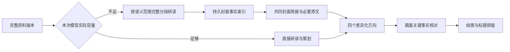

# 长篇封面资料架构与分卷能力核查

日期：2026-11-14。状态：作者已批准完整实施封面容量优化与多卷/系列篇幅编辑；实施前先将现有代码提交到 dev，完成后仍不得部署或重启。以下现状来自实施前只读核查；当时运行镜像为 `library-320450b42ec4`，工作分支为 `codex/library-query-model`。新实现与测试结果另行记录，不能将本提案当成已完成报告。

## 1. 当前封面方案实际依据

默认 poster studio 从项目 `outputs/input/prompt.md` 冻结完整创作骨架，以及显式声明的依赖资料。它不是默认阅读已经完成的全部正文章节，也不是仅使用最初选择的参考路线。

| 输入 | 当前用途 |
| --- | --- |
| 冻结骨架与逐章设计 | 人物、关系、世界、主要冲突、情绪承诺和视觉意象 |
| 正式书名、作者、Genre | 出版标识与题材方向 |
| 冻结 Genre/Tags 知识的封面视图 | 核心读者承诺与封面表达指导 |
| 作者当前要求及兼容的历史要求 | 希望保留、改变或避免的视觉内容 |
| 可选参考图及使用模式 | 视觉借鉴或改编参考；图片内容不能自动成为新书事实 |
| 输出合同与排版能力 | 共同故事简报、四个不同封面方向、绘图提示词和排版方案 |

当前调用一次性注入完整文本，要求一次返回四个方向。后续绘图主要使用方向中的绘图提示词；标题通过独立排版处理，画面本身要求无文字、2:3 竖版。允许宣传摆拍、象征构图与蒙太奇，不要求画面精确复刻某章场景。

需要明确的缺口：`api/poster_studio.py` 构造的 `metadata.language` 当前为空，市场与受众来自封面偏好，并未完整、显式承接小说创作配置。信息可能出现在骨架文本中，但不能把这一点当作可靠的正式字段传递。

相关实现：[源选择](../../core/cover_sources.py)、[当前入口](../../api/poster_studio.py)、[规划与容量检查](../../core/cover_poster_planner.py)、[题材视图](../../core/creative_types.py)。

## 2. 103 章现场故障

任务 `fac096deaf31` 的封面任务 `poster-task-cc97614897c6401598c503c4760a6028` 在本地容量检查失败，未向模型发送请求。

| 项目 | UTF-8 字节 |
| --- | ---: |
| 源骨架：1 个文档，含 103 章设计 | 314,231 |
| 其余系统指令、合同、知识、元数据及序列化等 | 59,946 |
| 实际文字请求 | 374,177 |
| 格式纠正预留：2 × 64,000 + 4,096 | 132,096 |
| 合计 | 506,273 |
| 应用上限 | 384,000 |

初始请求实际可用空间只有 251,904 字节。当前格式纠正会再次携带原请求和完整错误回复，因此预留与首次规划耦合。这是应用层工作流设计导致的失败，不能据此判断上游模型上下文不足；也不能简单归因于章数或网络。

此次带 `adaptation_reference` 图片，按当前路由会使用 `cover_review` 视觉连接，而非无图时的封面文本策划连接。小说正文模型、封面文本策划模型、视觉模型是不同配置。上述文字计量不包含实际图片的视觉输入成本。

仅提高 384,000 上限不能解决增长问题；仅去除纠正预留可能让这次文字检查通过，但仍不能证明实际模型可以接收文本、图片及输出。源加载器本身另有默认 16 MiB 上限，必须区分存储、传输和模型容量。

## 3. 分卷和系列的真实支持范围

| 形式 | 目前能力 |
| --- | --- |
| 单本连续长篇 | 支持，连续章号；增加章数不自动分卷 |
| 单本多卷 `multi_volume` | 支持；卷范围连续、完整覆盖全书，章号全书连续 |
| 多本系列 `series_installment` | 支持当前分册创作；保留系列身份、系列名、册序和计划册数，每册分别启动 |
| 系列当前册内再分卷 | 数据合同允许；当前分册也有 `volumes` |
| 嵌套子系列与跨册总控 | 未发现父子系列模型、完整系列管理、跨册自动执行与全部前册事实自动继承 |

普通新建和参考路线入口共用组织形式字段，规划、卷末审稿及导出仍有分卷实现。真实成品 `ac3f15f6efff` 是 60 章、3 卷，范围为 1–20、21–45、46–60；卷信息已进入 EPUB 与 H5 交付数据。`fac096deaf31` 的 103 章成品是 `standalone_long`，不是多卷。

现有缺口：新版 `story_first` 场景容量推荐和可编辑篇幅方案只覆盖连续单本；选择多卷或系列会清空该设置，使用原篇幅流程。应补齐这一共享流程，而非再实现另一套分卷引擎。

建议继续使用“系列 → 当前书籍 → 卷 → 章”的现有身份体系。单本多卷仍是一部书，不因此产生新的书籍/计费身份；系列各册保持独立书籍身份。未来如需真正的子系列，应另做层级管理与跨册事实合同，不把简单分卷名称包装成已实现能力。

容量范围也要诚实：当前新建界面章节上限 511，H5 合同最多 512 个 EPUB spine 项，常规含一篇 Introduction 时可容纳 511 个正文章节项；另有 EPUB 16 MiB、600 条目、单 JSON/XHTML 4 MiB 等限制。封面支持更大资料量不等于整套出版系统已支持无限章节。不要为了适配封面强迫作者拆书或改变组织形式。

相关实现：[共用创建字段](../../web/src/components/WorkshopCreationFields.tsx)、[组织形式合同](../../core/narrative_format.py)、[篇幅流程](../../api/workshop_capacity.py)、[长篇审核](../../core/long_form_quality.py)、[H5 合同](../../core/h5_contract.py)。

## 4. 统一封面资料 Module

建立一个共享 `CoverContextCompiler` Module，使入口只需提供资料版本、封面范围与作者要求；容量适配、完整范围处理、缓存、原文回取和检查点保存在其 Implementation 内。项目入口及其他可用封面入口通过同一 Interface 接入，不按任务 ID 或章节数增加分支。

建议 Interface：

```text
prepare(source_revision, cover_scope, author_requirements) -> dossier_revision
compose(dossier_revision, intent, model_capabilities) -> context_packet
```

模型调用、来源存储、执行检查点使用可注入 Adapter。短资料和长资料共享产物合同；内部按实际容量选择执行方式。Interface 明确：不可修改来源；中断可恢复；包中声明实际范围；不足的容量不会触发静默截断；失败不会冒充已完成。

### 4.1 完整来源和可复用资料分开

保存三层数据：

1. **不可变来源**：完整骨架、已采纳修订、正式创作配置、作者要求及必要依赖，均保留原字节和版本。
2. **封面事实索引**：身份、年龄及时间阶段、关系及其变化、世界设定、核心冲突、读者情绪承诺、代表性意象、禁用表达、剧透限制。每项保留来源范围、未知状态及权威类别。
3. **本次封面简报**：按当前全书/分册/卷范围与作者意图，从索引编译出的派生视图。需要的原文可随时回取，简报不取代完整资料。

原文事实、作者采纳设定、未采纳模型提案、画面艺术选择必须区分。不同阶段的年龄、敌对/亲密关系和身份知情状态不能合并成一个无时间限定的值。保留否定、条件和不确定性，不能把“没有私生子”压缩成“私生子”。

正式语言、受众、发行市场、Genre/Tags 从有效创作配置显式传入；历史任务尊重原配置，不能套用新任务默认值。小说正文语言、策划展示语言和封面文字语言分别表达。

默认沿用当前已采纳骨架作为设计依据。存在有来源绑定的正式修订时纳入其对应版本；不得用早期参考路线覆盖之后的作者决定。若用户要求按最终正文重新校准，则使用已确认正文事实或另行建立该范围的阅读记录，不能仅凭骨架声称读过全稿。全文校准不应成为每次改封面的强制前置步骤。

### 4.2 容量决定路径，不由章数决定



- 小资料保留直接路径；长资料在大容量模型上可直接处理时，也不强制拆分。
- 需要拆分时按文档、章节设计和语义范围处理，不能简单取前 N 章。保留边界上下文及完整覆盖记录；重叠范围去重但不丢限定信息。
- 复用现有 `segment_snapshot`、源身份校验、完整范围校验、有限并行和检查点执行基础设施；不复活旧封面流程的逐段独立审稿、全局证据再审和多轮语义裁决。
- 每次保存独立结果；大索引采用分层目录和来源回取，不能不断“摘要的摘要”后把最末摘要当成完整真相。
- 所有资料范围完成前，不显示整书资料准备完成；中断只续未完成范围。首次长篇研读会增加调用，但可有限并行且后续复用，不承诺首次一定比一次成功的大上下文调用更快。
- 修改构图、颜色或参考图不重读全书；修改来源只更新变化范围及依赖结果。重复点按钮复用同一操作身份。

### 4.3 每一种调用都受同一容量策略管理

统一检查文本 UTF-8 字节、实际传输封装、模型输入/输出容量、图片成本和供应商能力；支持计数器时实际计数，否则明确标注估算及能力未知。不能将 UTF-8 字节当成精确 token 数，也不能把未配置上下文检查称为已验证。

分段、合并、方向生成、原文回查及修正都使用同一策略，防止上游拆小后在汇总阶段再次溢出。当前用户选择的可用连接用于新请求，能力变化只影响尚未发送请求的编排，已发出请求的内容和回执保持不变。不自动更换模型。

对于极小模型，如果连最小任务合同和一组不可分割关键约束都不能容纳，应说明具体不兼容项；不得删约束来伪造成功。封面质量不能对任意模型能力作绝对承诺。

### 4.4 参考图、四方向和纠正去除重复成本

- 参考图可单独做紧凑视觉分析，保存可见事实、推断、可继承风格和禁用元素；按图片内容与策略版本缓存，再与书籍事实合并。视觉精确还原有需要时仍可局部回看原图，不能只依赖有损文字描述。
- 四个方向共用一份情绪与故事简报，优先一次紧凑调用。仅输出容量不够时拆分方向；拆分使用共同方向矩阵，避免各自输出同一种构图。
- 差异体现在关系权力、读者期待、象征物、视觉焦点和构图，不只是换衣服或背景色。保留作者要求的情绪点与看点。
- 格式纠正只携带候选、必要合同和错误字段；限制允许更改的范围，比较纠正前后内容。若需要改变故事含义或补充事实，转入有来源的局部修订，不能假借格式纠正创造事实。
- 首次请求无需为再次复制整书预留 132,096 字节，但每个实际请求仍独立做完整预算。四个方向任一失败可以局部重做，不抹除其他已保存方向。

## 5. 质量保障与可验证承诺

“原文没有被截断”“资料范围全部处理”“模型理解正确”是三件事。代码能验证前两项，不能仅凭覆盖率证明第三项。

必须做到：

- 原始资料和历史产物不丢失，可追溯到具体版本与范围。
- 未处理的资料、未解决的关键冲突不能伪装成已通过。
- 最终画面依赖的身份、年龄阶段、核心关系、世界条件、作者硬约束和剧透界限，回查对应原文及必要因果相邻范围。
- 作者显式约束不受“最多 24 条”之类摘要展示上限裁剪。范围过大时分组验证全部适用约束，各方向共用验证结果。
- 来源 ID 和内容绑定由代码产生，模型不生成哈希或复述长引文来证明来源。
- 对无事实依据的发色、衣服、灯光等允许作为艺术选择；不要求有文学原文逐字证明。关系和人物身份变化则不能冒充艺术选择。
- 关键事实复核只围绕实际候选画面，四方向共享一次批量核对；发现问题只修相应方向及依赖，不循环重审 103 章。无关的小说文学质量不在封面工作流中重新裁决。

模型仍可能误读，因此验收要包含人工标注的关键事实案例与实际方案评审。不能以“使用结构化摘要”宣称质量必然不变，也不能靠放松事实要求提高通过率。

## 6. 分卷、系列与前端

封面范围使用现有书籍、分册和卷身份。默认整本书封面；未来提供卷封面时，明确使用该卷的情绪核心、人物阶段和剧透范围，同时继承全书身份及世界约束。系列可继承作者采纳的字体、标志与视觉家族规则，但不得冻结会随时间变化的年龄、关系和服装。

不为容量适配自动创建卷、拆书或重编号。单本多卷篇幅推荐应接入现有共享容量流程：支持全书、每卷和每章目标编辑，改数字后重新评估分配并保留重要场面，不自动删除剧情。系列界面明确这些数字属于当前分册。

封面界面展示真实阶段：资料准备、整理人物与情绪看点、设计四个方向、可生成图片；显示“基于第 N 版骨架/指定正文版本”和实际处理范围。失败明确落在哪一步、保存了什么、能否继续；不要求作者填写技术对账。详细来源可折叠查看，不将底层协议字段放进主要创作流程。

## 7. 历史兼容、恢复与验收

旧小说、骨架、已通过检查点、封面方案、候选图及已选封面全部保持。新封面任务生成独立派生资料版本；读取旧项目不触发迁移、付费调用或自动重绘。旧失败任务从验证过的来源继续，新旧入口统一接入，无任务 ID 特例。

网络请求结果未知与本地容量拒绝必须区分：已保存完整结果优先复用；未知远端结果先按原请求身份恢复，不能自动当作失败重发。本次容量故障没有发出模型请求，实施后可以从保留来源进入新编排，不需要重新创作小说。

建议验收矩阵：

| 类别 | 验收内容 |
| --- | --- |
| 真实回放 | 103 章骨架及参考图的只读副本，保留原任务全部字节；容量拒绝不发请求 |
| 规模 | 30/103/300/500 章资料；1000 章为封面资料层压力测试，不宣称现有出版已支持 |
| 小上下文 | 不同输入、输出、传输与图片限制；直接、分段、汇总、回查和修正均不能越界 |
| 关键事实 | 最后一段反转、否定、别名、身份秘密、人物成长、跨卷关系变化及作者禁用要求 |
| 来源权威 | 旧路线与采纳骨架冲突、作者修订、参考图含不属于新书的人物、未提供结局保持未知 |
| 恢复 | 中断、重启、重复操作、未知远端结果、来源变更、换模型后未发送请求重新预算 |
| 缓存 | 改构图零次重读全书；局部资料变化只更新关联派生结果；缓存不能跨书/跨版本串用 |
| 修正 | 只改 JSON 结构不改变故事含义；需要事实变化时有来源回取；四方向分别恢复 |
| 组织形式 | 连续单本、多卷、系列分册及册内分卷；保持书籍身份、章号、交付与旧成品有效 |

性能记录冷启动和复用路径的调用次数、最大输入/输出、实际耗时、峰值内存、参考图成本及失败恢复开销。用真实基准给结果，不提前承诺固定秒数或倍率。

建议实施顺序：先统一容量与封面资料 Module；再接四方向、参考图、局部修正与前端；完成旧任务副本回放及质量/性能回归；分卷篇幅推荐作为独立但共享现有结构的工作项。部署与恢复现有封面任务留到后续明确实施授权，不在本次设计核查中执行。
