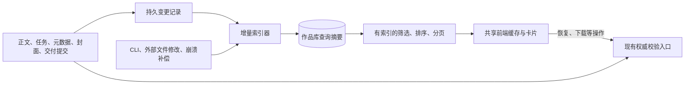

# 作品库性能与查询架构优化方案

状态：作者已批准，阶段 A–D 在 `codex/library-query-model` 实施。明确仅开发和隔离测试，暂不部署/重启，不操作现有任务；阶段 E 的执行 worker 迁移后续单独实施。本节基线是实施前的只读测量，未完成的验收目标不能当作实测成绩。

## 1. 实测基线与判断

测量环境为现有 5174 服务，代码发布为 `e93c1e4`；测量期间有小说恢复作业在后台运行。

| 项目 | 当前观测 |
| --- | --- |
| 数据规模 | 21 本作品、662 个章节状态；全部 story_state 约 9.43 MB |
| 直接请求作品库 | 7.067 s、5.745 s；独立阈值探针 7.342 s |
| 健康接口 | 7–20 ms，独立探针 15 ms |
| 作品库 JSON | 83,052 字节 |
| 浏览器首次作品库请求 | 9.383 s，其中首字节等待 9.382 s |
| 浏览器后续整库轮询 | 6.225 / 7.168 / 6.249 / 6.828 s |
| 页面 DOMContentLoaded | 165 ms；图片请求到约 9.939 s 才开始 |
| 浏览器封面资源 | 17 张，合计 36,428,691 字节；采样视口 2120×1161 |
| 封面展示与原图 | 展示 124×186，原图 1024×1536；已有 lazy loading |
| 后端资源快照 | CPU 96.69%，内存约 249.9 MiB |

这些是有限现场样本，不是 p95，也不是独立的冷/热缓存对照。浏览器首次导航使用隔离上下文，服务端缓存未清空。没有暂停后台任务做对照，不能把全部 CPU 占用归因于作品库。当前证据足以确认：主要首屏等待在后端列表计算，图片体积是额外的带宽/解码成本，不能用图片压缩解释全部 9 秒等待。

可重复探针：`venv/bin/python output/library-performance-audit-20261114/measure_library.py`。以 1 秒作为初步诊断阈值，现场执行退出码 1，输出 `passed=false`。浏览器资源时序保存在同目录 `browser-timing.txt`。采样完成后已关闭新增的测试标签页。

## 2. 代码中的结构原因

1. `api/services.py:list_projects()` 串行枚举整库，先把所有作品加载、汇总完，再排序返回。`_load()` 解析整个 StoryState，`_hydrate_chapter_progress()` 为统计字数和完成情况读取章节正文。
2. `api/project_artifact_summary.py:final_chapter_texts()` 仍在每次列表请求中校验每本书的 revision journal/heads、读取并哈希 Final blob；旧书还读取 final/revised/draft 文件。已有优化把“一章扫一次 journal”改为“一本扫一次”，但没有移出 HTTP 路径。artifact 读取还使用会创建目录/锁文件的独占锁。
3. `project_task_summary()` 扫描历史 run manifest，并进入请求恢复投影。现有快速路径只覆盖部分历史已完成请求；某些状态仍可触发执行级 authority 构造。卡片展示不应依赖这种恢复计算。
4. 封面摘要每次扫描 cover sets、设计方向、分析和多类任务历史。交付摘要即使命中 LRU，也在缓存前后遍历所有绑定来源文件；失效时还会读取来源和 ZIP。当前 208 项交付来源、约 182.94 MB ZIP 构成潜在冷路径开销，不代表每次热请求都读取这些 ZIP。
5. 前端首次等待 `api.projects()` 完成才渲染卡片；没有跨路由共享缓存或后端分页。任一本运行就持续拉整库：一次请求完成后等 2.5 秒再拉，并非每 2.5 秒叠加并发请求。
6. 封面已有懒加载、固定比例与 immutable 原图缓存，但卡片直接使用原图。命令面板仅在打开时另拉整库；Sidebar 没有额外作品请求，模型设置请求也没有串行阻塞列表。

## 3. 目标架构

作品库使用持久化、可重建的查询摘要。小说正文、正典、提交回执、模型请求记录继续由现有文件与执行流程管理。

建立一个 `LibraryCatalog` module，集中封装摘要版本、作用域、查询、分页与变化游标。调用方只使用 `query`、`changes`、`navigation` 三类 interface；SQLite adapter 与后台文件重建逻辑置于 implementation 内。列表、命令面板和统计共享该模型，避免各自创建文件扫描捷径。

第一阶段沿用现有 SQLite，增加独立 projection 表。现有 `api/db.py` 明确数据库是可重建查询层，但其 Project/Chapter 表主要按裸 project_id 标识，不能直接当成完整的租户安全作品目录；`ingest_project()` 也会深读正文，不能放进 GET 请求。

## 4. 数据与状态合同

### 查询摘要

身份必须包含存储作用域、workspace、project_id，并绑定已有 project_instance_id 与删除/重建代次。单独使用 slug 会串库；单独使用 instance_id 也不能区分保留同一 ID 的数据副本。旧书缺少实例 ID 时在查询目录中分配 legacy identity/epoch，不调用 `ensure_project_instance_id()`，不修改原故事身份文件；未来正常业务初始化正式 ID 时再校对关联。GET 和索引回填均不创建 canonical 文件。

| 摘要域 | 内容与版本依据 |
| --- | --- |
| 基础信息 | 标题、作者、语言、Genre/Tags、来源简述、创建/启动/更新时间、metadata revision |
| 章节汇总 | 计划章数、已写章数、已晋级章数、正文规模、计数单位和策略版本；绑定实际有效 stage/head/revision |
| 任务 | 最新 run ID、保存阶段/结果、当前 operation 状态、阶段摘要、状态版本 |
| 封面 | 当前选定图、列表缩略图、最新行动状态、cover revision；不带全部候选和设计历史 |
| 交付 | 当前包版本、上次已验证版本与时间、有效/过期/待核验/异常；不带全部来源列表 |
| 索引健康 | schema/version、源版本、observed_at、freshness、错误范围、tombstone/epoch |

状态必须区分“保存的运行结果”和“当前恢复作业”。例如原 run.json 为 paused，但新 job 正在恢复核验时，卡片显示“正在恢复核验”；上次暂停原因归入历史，不作为当前作业失败。作业是否活跃必须有当前 owner/lease 或当前进程的有效记录，不能把磁盘 running 字样永久当成活跃。

摘要字段使用 `fresh / stale / rebuilding / unavailable` 等明确新鲜度。历史可用卡片可以继续展示并标注同步状态；未知不能显示成已完成或已通过核验。一书损坏只影响该卡片，不中断整库。

### 字数与内容质量

章节保存或晋级时对实际正文计算一次规模，缓存按 stage/head/revision + 计数策略版本寻址；后续只有有效正文改变才重算该章，再增量更新整书汇总。保留现有 Final 优先、无 Final 时 revised/draft 回退的进度语义；旧文件依据其来源标记 observed 状态，不能把“有文本”当成“质量门通过”。草稿/修订稿保存、人工编辑、恢复历史版本和 promotion 都是更新点。不能在每次列表 GET 中重新 split 全书。

当前 `len(text.split())` 不适合中文“字数”；新摘要明确区分中文字符和英文词，不改写正文，也不改历史出版校验的计数规则。计数策略升级仅重建显示投影，不使已批准的正文/出版成果失效。

列表不能成为下载、恢复、删除或晋级的授权依据。真正操作仍读取当前权威状态、校验版本与文件内容。模型上下文、关键情节、正文和质量门不因列表优化被压缩或省略。

## 5. 更新、补偿与一致性

1. 在元数据提交、稿件保存/编辑/恢复、章节 promotion、run 保存/作业生命周期、封面选择、交付完成/失效等现有提交点发出细粒度变更。章数变化只更新章节域，封面变化只更新封面/交付域，普通 heartbeat 不重建全书。
2. 先完成权威提交，再发布其版本。已有不可变提交 journal 是重放依据；通知至少一次投递，索引更新必须幂等。迟到的旧版本不能覆盖新摘要。
3. 文件与 SQLite 没有跨存储原子事务。无 journal 的入口需要持久更新意图及提交后确认；崩溃遗留意图由后台对照权威状态完成。进程内 callback 不是唯一正确性保障，也不声称 exactly-once。
4. 后台 reconciler 合并同一作品同一域的重复变更，限制并发、重试和单轮扫描预算。优先活跃/近期变更作品，同时保留公平扫描份额，避免旧书永久饥饿；索引失败保留最后可用卡片和诊断，不清空书库。重建使用无写入的文件快照读取接口，不调用会 mkdir/O_CREAT 的现有读写型构造器。
5. 对 CLI、导入、人工文件调整及通知丢失做启动/周期补偿。文件 watcher 可缩短延迟，不能替代补偿；深层校验在后台分批进行。GET 不同步扫描文件树，也不在缺索引时回退到 `_load()`。
6. 受控写入提供写后可见：返回 operation/source version，直接更新可验证的小摘要或持久失效标记。前端拿到旧版本时不能覆盖本次操作。外部文件改动采用有界最终一致性并展示 observed_at；实际下载/恢复仍校验当前文件。
7. 删除写入持久 tombstone/epoch，索引写入提交前再次比较 epoch。删除中的任务、重建中的任务、复制到另一库以及同名重建都不能把旧卡片复活。

已有测试要求“下一次 GET 立即看到外部 artifact head 修改”和“卡片状态等于实时下载校验”。实施时必须明确调整为：受控变更立即失效/可见，外部变更后台发现，真实操作保持即时权威检查；增加这些替代断言，不能只删掉旧测试。

## 6. 查询与前端协议

建议新增版本化的 `/api/library` 查询，默认每页 20 项、上限 50。参数为 `q/status/cover/sort/cursor/limit`。响应含 `items/next_cursor/total/filtered_total/collection_revision/changes_cursor/observed_at/catalog_status`；总数和筛选均从摘要表产生，不依赖深读项目。

排序保持“有启动任务优先、启动时间倒序”，再以稳定项目身份打破平局。SQL 必须先筛选/排序/分页，再取卡片字段。索引覆盖 workspace、存储作用域、状态与排序键；搜索只查询轻量元数据，不扫描小说正文。

游标绑定查询条件、租户作用域、稳定排序键与集合版本。只有增删、排序或筛选成员变化才改变集合版本；心跳/进度变化更新单卡版本。集合变化使旧游标失效时，前端保留已展示数据并重新校对，不能悄悄漏书或重复书。

过渡期保留单进程 JobRunner，通过一次批量运行态快照覆盖保存状态。该覆盖必须参与筛选、总数计算，不能分页后才把 paused 改成 running，导致“运行中”筛选漏书。最终作业登记持久化后可统一在查询层完成。

同一次查询的 items、counts、filter、cursor 和 ETag 共用不可变的运行态快照。对外视图版本包含 catalog revision、job registry boot epoch 与 job revision；作业状态改变同样产生 changes，影响筛选成员时使相应游标失效。卡片内容变化与成员变化分开计数。进程重启导致旧内存变更历史丢失时返回 reset_required，不能错误返回 304 或继续旧游标。版本和快照均限定在授权作用域。

`/api/library/changes?after=...` 提供有界增量与删除 tombstone；游标过期返回 reset_required。状态变化影响当前筛选时重新校对成员关系。命令面板使用同一摘要的轻量 navigation 查询，仅返回 id/title/genre，并能搜到未加载分页中的作品。

前端使用一个共享查询资源层：查询键包含租户/库根/筛选/排序/游标；合并同键在途请求，跨路由保留列表和滚动位置。首次加载、后台刷新、首次失败、旧数据刷新失败分开呈现。支持 AbortSignal、超时、搜索防抖和响应版本检查。

状态刷新使用一个增量请求或可见项的批量状态请求；隐藏标签页停止周期请求，重新可见时合并校对，失败退避。全部任务终态后仍低频检查集合变化，不能仅靠当前页是否有运行任务决定是否发现外部新任务。第一阶段不依赖 SSE；以后可以用 SSE 提醒变更，但断线补偿仍走同一 changes cursor。

删除、恢复、单本交付变化只更新关联条目与相关查询。删除墓碑和请求代次覆盖晚到响应，修复旧列表把已删卡片重新插入的竞争。列表 ETag 从投影版本和查询条件生成，不通过重读正文/ZIP计算；缓存作用域不能跨用户或 workspace。

## 7. 缩略图与视觉呈现

- 基于已有封面生成 160/256/384px 衍生图；按原图 digest、尺寸、格式及转换策略版本寻址，保留 immutable 缓存。
- 图片保存后或后台回填生成，GET 列表不现场解码原图、不调用图片模型。暂缺衍生图时文字卡片照常显示，并使用占位封面。
- `srcset/sizes` 对应实际 74/124px 和设备像素比；补 `decoding="async"`，保留当前 2:3 占位及懒加载。原始图片继续留给工作室和交付。
- 首屏动画限制总时长，返回列表/后台刷新不重播整库入场。现有 stagger 为每项 45ms、动画 450ms；21 项最后一项理论完成约 1.35 秒，这是源码推算。
- 分页先控制 DOM 规模。是否再引入虚拟列表由大量可见卡片的渲染测量决定，当前首要问题是后端等待。

## 8. 创作执行与 Web 资源隔离

现有 JobRunner 在 API 进程内跑后台线程，全书校验会与 Web 读取竞争 CPU/GIL。仅增加 Web 进程数会使进程内作业状态、取消和互斥不一致，不能作为独立措施上线。

后续将 CPU 密集核验及索引重建移到受限 worker 进程，并建立持久作业登记：owner、lease/fencing epoch、heartbeat、取消请求、请求回执绑定、退出状态。fencing 必须在真实 canonical 提交入口检查，不能只写在作业表。继续使用已有项目执行锁、幂等操作 ID 和模型请求恢复协议；租约丢失不能被解释为远端模型请求失败并自动重发。

先把查询投影切出来，再迁移执行位置。旧线程作业必须正常结束或通过正常暂停保存后再切换；重启后的 running 残留通过明确恢复状态处理。worker 并发、内存和磁盘预算受控，避免“并行优化”反过来拖垮作品库。

既有全书来源核验按章重复扫描全部 promotion 记录，也应在后续性能子项中改为“一次锁定一致快照内完整核验，再批量使用”，在安全单元之间增加取消检查。快照版本变化必须重新取得一致视图，不能通过少检查几章提速。

## 9. 迁移与交付顺序

| 阶段 | 交付物 | 放行条件 |
| --- | --- | --- |
| A | 性能探针、读模型 schema、版本/新鲜度/租户合同 | 明确列表禁止深读及操作仍须权威校验 |
| B | 持久摘要、增量计数、提交事件/补偿、旧书后台回填 | 影子投影与权威状态逐字段比对；坏书不拖整库 |
| C | 分页/changes/navigation 接口与共享前端缓存 | 受控更新写后可见；翻页筛选、删除迟到响应、多标签通过 |
| D | 缩略图与有限动画 | 首屏封面体积达标，旧封面/原图/交付不变 |
| E | 持久作业状态、worker 隔离和批量完整性快照 | 暂停/恢复、未知模型结果、并行任务及重启回归通过 |

影子索引只在后台构建/比对，不能让每个在线 GET 同时执行新旧两条重查询。旧书先建基本卡片，深层汇总分批回填；不等待全库完成才开放页面。灰度切换使用配置开关；回滚只切换查询入口/软件，不覆盖小说数据，不删除旧分析、讨论或运行检查点。

## 10. 验收标准

以下是拟定目标，尚未实现或跑出这些成绩。使用同一台机器，在空闲和创作负载下分别报告 p50/p95、首屏卡片时间、读文件次数/字节、CPU和长任务。

| 指标 | 拟定目标 |
| --- | --- |
| 20 项列表 API，已有持久索引 | 空闲 p95 ≤200ms；创作负载下 p95 ≤500ms |
| 冷浏览器首屏可操作卡片 | 本地环境 ≤1s；弱网另设带宽与延迟场景 |
| 返回作品库的已缓存卡片 | ≤100ms 可见，后台校对不阻塞 |
| 受控状态变化展示延迟 | ≤2s；受控删除/失效标记提交后即生效 |
| 外部变更发现 | 健康扫描器负载范围内，已纳管变更的发现并标记 stale 目标 ≤30s；深层完整审计周期另行测量并公开 |
| 单张卡片封面 | 典型 256px 衍生图 ≤60KB；首屏封面总量目标 ≤1MB |
| 列表深层读取 | 0 次正文、ZIP、全书 recovery authority、封面历史加载 |

测试矩阵覆盖 21/200/1000 本、每本 100+ 章、大量修订历史、服务重启/冷缓存、并行创作、损坏单书、缺索引、CLI 外部更新、索引更新崩溃/重放/乱序、删除中断、跨 workspace 同名、根目录切换及复制实例。用调用拦截器让深读函数一旦在列表路径执行就失败，配合实际负载测试；不能只依靠某次 wall-time 偶然过线。

发现变更和完成全部核验是两个时刻：后者允许排队并显示 rebuilding，不承诺任意深层文件变化都在 30 秒内核验完成。另须验证草稿进度不丢失、运行态变化不会命中过期 304，以及重启后的旧 changes cursor 能正确重新同步。

下载和恢复测试必须仍拒绝：过期来源、篡改 ZIP、未知协议、错误分类、失配请求回执，以及未确认的远端执行结果。对照前后正文、封面原图、已通过大纲、历史讨论和检查点哈希，确保性能优化没有改变创作内容。

已有列表性能、任务、封面、交付回归应迁移到明确的新合同；本轮测量没有运行或宣称这份未来方案的测试已通过。
