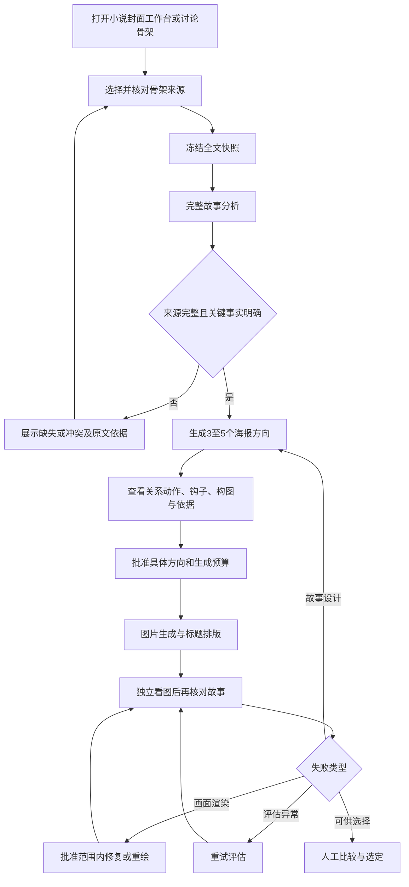

# 基于完整小说骨架的封面工作台优化方案

日期：2026-10-08  
状态：本方案已实施并部署，代码、隔离验收及部署检查情况见 [实施记录](../../reports/skeleton-cover-implementation-2026-10-08.md)。尚未进行真实出图验收；本文的设计目标不等于真实图样或商业效果已通过验证。

## 1. 目标与核心决定

以每本小说实际采用的完整骨架为叙事依据，通过全文理解、人物关系与冲突事件分析，设计具有故事感、视觉钩子和电影宣传海报完成度的封面。读者应看懂画面中的压力或冲突，并对尚未揭晓的结果产生疑问。

确定采用以下主流程：

**精确定位骨架 → 冻结全文快照 → 全文故事分析 → 冲突与钩子设计 → 海报构图 → 审核方向 → 出图与排版 → 独立盲读和原作核验 → 修复或重新设计 → 人工选定。**

核心决定：

1. 项目默认读取其 `outputs/input/prompt.md`；讨论阶段明确选择当前稿、确认稿或指定存档。所有真实路径由后端结合工作空间解析。
2. 全文分析读取不可变输入快照；会话 revision、文件版本号、内容 hash、分析版本分别管理。
3. 完整骨架先转为有出处的故事理解结果，再由导演选择素材。最终绘图指令保持精简。
4. 封面支持 `scene`（同场景冲突海报）和 `campaign_composite`（多层电影宣传主视觉）两种明确结构。
5. 多角色通过行动、反应、联盟和阻隔表达冲突；人物数量不代替故事性。
6. 故事、钩子与审美分别验收；评估先独立看图，后对照原作。
7. 语义失败回到导演重新设计；渲染失败定向修复或整图重绘；评估失败只重试评估。
8. 保留既有封面、方向、批准记录、交付结构和人工最终选择。旧数据不冒充已经完成全文分析。

## 2. 已核实基础与实施范围

本地定位清单包含 20 个项目：`docker-data/projects` 下 14 个、`projects` 下 6 个，包含同书不同项目版本。20 个项目均有非空骨架输入文件；本轮复核全部 hash 与清单一致。

指定讨论 `d7c6589ce29349ae99121b5f771fd6d1` 已到 revision 17 并启动项目 `my-husband-s-secret-daughter-lived-across-the-street-d7c6589c`。当前讨论稿、确认稿、v17 存档和项目副本 hash 一致；v12 是不同的历史内容。

这些都是本地审查时的快照，生产逻辑使用配置与真实记录，不硬编码 20 本书、目录名或 revision 17。

现有封面链路已经读取完整 Prompt 并计算 hash，但导演主要收到 brief 与筛选证据：骨架最多挑 8 段，发送的 ledger 最多 24 项，每项摘要最多 420 字符。当前实现尚不能证明模型通读了整份骨架。

| 沿用的能力 | 本方案新增或强化的能力 |
| --- | --- |
| 项目路径解析、Workshop 会话、Prompt intake | 统一来源选择、不可变全文快照与版本绑定 |
| CoverBrief、冲突合同、证据账本 | 全文覆盖分析、时点化人物关系、冲突事件池 |
| Art Director、事实校验、方向审批 | 互动因果与真实钩子校验、两类海报方案 |
| 图片生成、尝试历史、媒体存储 | 画面与标题分离能力、独立盲读、修复分流 |
| Studio、CLI、交付包 | 来源／分析／实际图像证据可见，入口校验一致 |

实施集中于骨架与封面之间的衔接，以及封面设计与验收。正文执行引擎、章节生产策略和现有交付包的必需文件结构保持兼容。来源、分析和评估附件先存放在封面内部目录，不要求下游导入方升级。

## 3. 用户工作流程



“一键分析”是显式用户操作，不因打开工作台就分析所有小说。没有骨架的讨论显示“骨架尚未生成”；找到文件但必要附属设计缺失时显示具体缺失内容。

## 4. 精确定位：统一来源选择器

### 4.1 四种来源

| source_type | 输入 | 读取内容 | 必须核对 |
| --- | --- | --- | --- |
| `project_input` | project_id | 经 ProjectService 定位的 `outputs/input/prompt.md` | 工作空间归属、非空 UTF-8 内容、实际 hash |
| `workshop_current` | session_id | `session.json.prompt_md` | 当前内容、观察到的 revision、确认资格 |
| `workshop_prepared` | session_id | `prepared.md` 中的确认全文 | prepared 存在、revision 匹配，文件与当前 prompt_md 的 hash 均匹配 prepared.prompt_sha256 |
| `workshop_archived` | session_id + archive_revision | `versions/N.md` 的实际 bytes | 文件存在、实际 hash、历史确认状态不可凭存在推断 |

前端只提交来源类型、授权范围内的 ID、必要的存档 revision，以及可选的 `expected_content_sha256`。当前工作空间由已认证请求上下文确定，不由任意客户端字段决定。

来源解析模块接收后端提供的项目／讨论 Adapter。默认 Workshop 根来自项目 root 的父目录；其他 workspace 的会话目录使用 workspace.id，项目目录使用 `ws-<workspace.slug>`。宿主机 `docker-data/...` 和容器 `/data/...` 是同一持久化目录的不同视角，绝对路径不参与可移植身份。

禁止按书名搜索后取第一份文件、按修改时间取“最新 MD”、由会话修订号猜不存在的文件、从项目名的 UUID 前缀反推讨论。CLI 明确给定的项目路径由其 Adapter 建立有效的项目上下文，随后使用相同来源与绑定校验。

### 4.2 当前项目与讨论的关系

已启动项目默认使用项目自己的输入副本。讨论更新不会隐式改变项目采用的骨架。切换到新的讨论版本是一项明确的来源变更，产生新快照与新方向。

后续 Workshop 启动可增写内部 `workshop-origin.json`，保存完整 session_id、prepared revision/hash 和对应 snapshot_id。现有项目不通过书名、短 ID 或内容相同推断正式来源关联；有完整旧记录时可有依据地补建关联，否则保留“来源关联未知”。这不阻碍直接使用项目输入副本。

当前稿可以用于草案分析与概念探索。付费图片生成需要有效的方向批准；对于尚无整体确认记录的来源，应在同一次方向审核中明确确认本次使用的快照与必要事实，不增加一个全局绕过开关。

### 4.3 明确失败状态

| 状态 | 行为 |
| --- | --- |
| 找不到来源／没有 prompt_md | 返回 `source_missing`，不给其他同名骨架补位 |
| 存档版本不存在 | 返回 `archive_not_found`，列出实际可用版本 |
| 空文件／不能解码 | 返回 `source_unreadable`，保留错误原因 |
| expected hash 不同 | 返回 `source_changed`，展示新旧内容身份 |
| prepared 已失效 | 返回 `source_unapproved`，仍可选择当前稿进行草案分析 |
| 必需附属骨架缺失 | 返回 `source_incomplete`，展示缺失依赖 |
| 工作空间或路径不属于授权范围 | 按既有租户规则拒绝访问 |

历史项目仅有 foundation/state 时保留 legacy 模式，但不能标成“完整骨架分析完成”。

## 5. 不可变快照、身份与更新规则

### 5.1 不混用四种身份

| 对象 | 作用 | 核心字段 |
| --- | --- | --- |
| `CoverSourceSelector` | 指定从哪里读 | source_type、owner ID、archive_revision、expected hash |
| `CoverSkeletonSnapshot` | 保存本次实际全文 | snapshot_id、document bytes hash、来源记录、捕获状态 |
| `CoverStoryAnalysis` | 保存全文理解结果 | analysis_id、snapshot hash、分析版本、覆盖状态、证据 |
| `CoverDirectionBinding` | 锁定批准与生成依据 | snapshot/analysis/brief/direction/recipe 的 ID 与 hash |

新增快照命名为 `CoverSkeletonSnapshot`，避免与现有 `cover_story_facts.CoverSourceSnapshot` 的多文件 hash 快照重名。既有 `source_prompt_sha256` 仍表示原 Prompt 内容，不放入分析结果 hash。

### 5.2 捕获过程

在现有会话锁或项目写入协调机制下读取来源，校验 expected hash，并保留原始 UTF-8 bytes 与换行。存在明确纳入的附属文件时，冻结文件清单及每份内容；捕获前后检查清单与 hash，无法取得稳定来源则有界重试或报 source_changed。

原子创建不覆盖的快照文件，最后发布完整 manifest。释放来源锁后才调用模型。分析、brief 派生、证据引用、导演均通过快照 accessor 读取，不在模型分析期间再次读取 live 文件拼接资料。

同名存档过去可能被 prepare 重写，因此新快照的内容 hash 才是不可变依据。所有模型输出、缓存结果和证据引用都能追溯到这个快照。

### 5.3 失效与缓存

- 会话 revision 变化、内容 hash 不变：可复用内容分析；确认资格单独重查。
- 骨架或已纳入附属文件内容变化：形成新快照；旧分析与封面保留，并显示旧来源。
- 默认 `freshness_policy=require_current_head`：生成前检查所选来源 head，变化时要求基于新来源重新设计或明确固定旧稿。
- 显式指定历史版可用 `pinned_snapshot`：依据固定快照生成，界面持续显示历史版；不因当前项目 head 不同而永久无法生成。
- 两种策略都必须校验快照、分析、方向及批准记录的完整性，不自动改绑来源。

分析缓存按工作空间与来源 owner 隔离。缓存键包含 source bundle hash、解析／分段／分析 schema／提示词版本、解析后的模型与影响语义的参数、来源优先级、封面时点政策、已确认事实修订 hash。只有 complete 且校验通过的结果可成为成功缓存；同一配置的重新分析有独立 attempt。仅改变候选构图可复用分析，不能复用旧方向批准。

### 5.4 对现有 stale/latest 检查的具体衔接

新版 generate 根据 schema 分支：从冻结 snapshot 和 analysis 重建／校验绑定的 brief 与 ledger，不再把 live collector 的结果当成该方向的内容依据。`require_current_head` 额外比较所选来源当前 head；`pinned_snapshot` 不执行这一步，head 变化只作为来源提示。legacy 方向继续使用其已有校验路径。

初期保留 CoverStore“只有最新方向集可批准／生成”的规则。选择历史骨架会创建一个使用旧内容的新方向集，使其成为该 owner 的最新方向；不能直接让任意旧方向绕开 latest 检查。已标 stale 的方向转为 pinned 时，创建新 binding 与新方向并重新批准，旧方向不原地恢复、旧批准不复活。

## 6. 完整骨架分析

### 6.1 全文覆盖流程

1. **建立目录与来源清单**：解析 Markdown 标题、人物表、分章大纲、代码块和契约；识别正文叙事资料与运行参数。
2. **分段读取**：按照章节和语义块分段；完整 JSON 块不能被粗暴切断。大块需专门解析或有明确连续范围的分段策略。
3. **逐段提取**：每个非空段落都进入处理或明确的非叙事分类，记录 segment ID、字节范围、结果和错误。技术配置保留但不当成小说事实。
4. **全局整合**：统一同一人物的别名与身份，构建跨章节关系变化、原因与后果、伏笔与揭晓、结局和剧透等级。
5. **核对关键命题**：独立核查谁在推动主线、谁施压、核心代价是什么、关键转折有哪些，以及结局与前期承诺是否矛盾。
6. **建立导演投影**：提供全局叙事主线、角色关系图、核心事件索引与待选场景，并允许按 evidence ID 回取已冻结原文。

短骨架在配置允许时可一次完整分析；长骨架分块后整合。上下文限制来自实际模型能力与输出预留，不把字符数直接当 token 数。禁止静默截断尾部或继续把关键词抽样当全文分析。

### 6.2 完整性报告

保存 expected/processed/failed segment IDs、非叙事块及理由、跨段冲突、未解析依赖和关键命题核查结果。只有全部必需段落处理完成、必要全局核查完成，才标 `coverage_status=complete`。

“全部段落处理过”与“理解正确”分别展示：前者可机械验证，后者需要证据一致性和独立审阅。模型称自己读完不能替代覆盖记录。

骨架可能引用人物设定或完整章纲附件。将这些明确的叙事依赖列入来源清单；仅解析受允许来源范围内的关联文件。普通参考链接不自动变成必需附件。必要附件缺失时不能宣称完整，不自动沿任意外部 URL 搜集新事实。

### 6.3 分析产物

| 内容 | 必需表达 |
| --- | --- |
| 故事主张 | 类型、读者承诺、主角目标、主要阻力、核心代价 |
| 人物 | 稳定 ID、别名、叙事角色枚举、已确认身份、视觉事实与未知项 |
| 关系 | 有向关系、施压方与承受方、利益／亲密／联盟变化、适用故事时点 |
| 冲突链 | 触发原因 → 人物选择 → 阻碍 → 代价 → 局势变化 |
| 事件池 | 事件 ID、地点时间、参与者、行动与反应、冲突强度、画面可表达性 |
| 悬念 | 已展示信息、异常、未揭晓答案、揭晓时点与剧透上限 |
| 视觉资产 | 原作中的场所、物件、服装、意象及其故事功能 |
| 来源问题 | 原文矛盾、缺失身份、模糊关系、必要附件与确认项 |

角色压力关系使用稳定枚举和有向边，避免英文角色正则漏掉中文，或把动作受害者当成施压者。人物恒定身份与阶段情绪分开；每个方案指定 cover_epoch，禁止用完本后的平静情绪覆盖冲突发生时的状态。

完整骨架为本次叙事主依据，COVER_HANDOFF 是同份设计中的压缩视图。若两者有关键冲突，提出带双方原文的待解决项，不静默挑选一个。正文与 foundation 仅在明确纳入来源清单时辅助核验；选旧骨架时不能自动混入新正文。改变原作事实需要显式事实决定或更新来源，视觉造型的合理发挥单独标记为 art direction。

### 6.4 引用与可追溯性

每条核心事实和场景至少有一个可核查来源。应用生成证据 ID；模型引用预先提供的 segment ID 和原文片段，引用位置由应用验证后确定。

内部引用包含 snapshot_id、document_id、document_sha256、segment_id、UTF-8 byte_start/end、exact_quote/hash、heading_path 与显示行号。引用基于原始文本定位，不能对归一化后的摘要位置冒充原文位置。原文匹配不唯一或找不到时，明确标记待修复。

导演读取压缩分析投影时仍必须包含核心冲突、主要关系、主角目标与关键事件索引；已有 ledger 可承载具体证据，但其 24 条摘要上限不再决定全文分析覆盖率。

## 7. 冲突导演与视觉钩子

### 7.1 从完整故事选择有表现力的事件

导演先从事件池选择可视化的冲突节点，再决定人物与构图。选择依据是：人物目标冲突是否明确、动作能否被看见、后果是否有代价、是否留下未解问题、能否在缩略图中读出大关系。

每个方向记录 `interaction_edges`：发起者、动作、对象、受影响者、可见反应／后果、证据、对应层或场景。多人站在一起、统一看镜头、相似愁容不自动构成有效关系。

关系型小说应优先让关键对立或联盟实际进入主要候选，并保证至少一个方向直接呈现来源支持的核心关系。保留来源策略的检查，但将人数配额扩展为“有证据的事件与互动覆盖”，对事实不支持的同场组合不强行凑数。

### 7.2 钩子契约

每个方向明确：

- `visible_fact`：观众无需说明就能看到的局势。
- `unexpected_contradiction`：与常态或人物预期不符之处。
- `visual_trigger`：使问题成立的动作、空间关系或具体证据。
- `open_question`：预期观众自然提出的问题。
- `withheld_answer`：图片刻意不揭晓的答案。
- `reader_promise` 与 `spoiler_ceiling`：真实承诺及剧透上限。

先做字段与来源校验，再做跨字段语义评审。问题必须由 visual_trigger 支撑；“她很伤心，会怎样”“一切已经解决”等空泛或已解答的表达不通过。画面可暗示此前发生过什么，但具体身份信息可以由书名补充，不要求一张缩略图复述全书。

### 7.3 候选组合

沿用默认 4 个、允许 3–5 个方向。故事支持时探索两种 scene 与两种 campaign_composite；这是探索起点，不是对所有小说的固定槽位。

每个方向应给出不同的阅读动机，并在关系组织、视觉焦点、构图拓扑、空间深度或标题组织上形成实质差异。规则校验与整组语义比较同时使用；生成后再比较实际图片。换颜色、服装、道具、同义词或裁切不能单独算新方向。

## 8. 电影海报设计契约

采用明确判别结构 `CoverCampaignPlan.composition_mode`，共同部分包含 source binding、cast、interaction_edges、hook、读图顺序、色彩、字体方向和证据引用。

| 结构 | `scene` | `campaign_composite` |
| --- | --- | --- |
| 核心表达 | 一个同场景高压瞬间 | 多层宣传主视觉组织关系与命运 |
| 时空 | 单一地点与时刻 | 每层声明时点，层间可不同 |
| 人物表演 | 即时目标、视线、行动和不同反应 | 事件层按真实动作；肖像层表达角色位置和情绪 |
| 空间规则 | 统一透视、光源、接触与景深 | 层内可信，层间按设计规则连接 |
| 因果 | 当前行为与即时后果 | 因果层间关系需原作证据；视觉呼应不冒充因果 |
| 标题 | 参与负空间与视线组织 | 与主视觉、层间节奏统一规划 |

composite 的 `layers[]` 包含 layer_id、类型（story_moment / character_portrait / story_object）、来源事件、人物、时间地点、功能、归一化画面区域和视觉权重。标题使用独立 title_layout；不把重复标题当作故事图层。

`layer_relationships[]` 说明冲突、联盟、阻隔、因果或视觉呼应；`temporal_relationship` 区分同一时刻、跨时间、无具体时间的宣传肖像；`truth_boundary` 说明组合不能暗示什么。两件事分别发生过，不足以证明拼接后的新因果。

建议单张一个主视觉层，加二至三个有效辅助层、一个主要故事问题。采用关系三角、侧向对峙、建筑阻隔、前后景压力、尺度反差或跨层视觉连接等语法，由具体故事决定。

摄影真实感、身份年龄、自然皮肤和可信材质持续适用。“一个抓拍瞬间”仅约束 scene 和 composite 中的具体事件层，不再全局排除宣传组合。不能仅在旧提示词末尾追加“电影海报”后仍沿用旧单场景校验。

## 9. 编译、标题与视觉层级

### 9.1 提示词保护

新编译器优先保护：来源事实与人物、互动因果、主要读图顺序、可见异常、开放问题、未揭晓答案边界、读者承诺、构图、关键灯光色彩和准确标题约定。删除重复说明与 rationale，不能裁掉这些字段的尾部。

继续遵守当前项目 12,000 Unicode code point 的编译上限。保护内容仍超限时返回具体超量模块，要求导演缩短可执行表述；不能以截断事实、钩子或标题勉强发送。该上限是当前编译器约定，不声明为图像供应商的通用限制。

新方向批准前保存确定性的编译 recipe 与 hash，记录 compiler/render contract 版本。批准后编译器升级不得静默改变实际生成内容；使用原 recipe，或创建新方向重新确认。

### 9.2 标题与画面分离

新增 `title_render_mode=composed|native`：新流程推荐 composed，原有 native 流程继续兼容。

- composed：图片调用生成无字 artwork；确定性排版模块依据批准的 title_layout 叠加准确书名，保存无字图和最终封面。一次 artwork 生成加本地排版，不为获得无字图多生成一张付费图。
- native：模型直接生成完整含字封面，保留现有标题检查；无字盲读只能使用经过检查的标题遮罩投影，诚实标记局限。

title_layout 包含精确标题、语言、断行、已可用且授权的字体标识、字重、字号范围、对齐、字距、颜色、归一化区域和安全区。自动排版可在批准范围内适配；超出范围或压到关键人脸／动作时返回版式失败。不能为塞入长标题而静默缩写、重排词序或增加副标题。

保存 artwork_sha256、title_layout_sha256、final_cover_sha256。故事盲读看无字图，最终可读性与遮挡验收看完整封面。标题准确不等于设计完成，仍需要验证层级、留白和缩略图效果。

composed 模式的图像编译结果不含“绘制精确书名”的指令，标题文本只进入排版 recipe；图像要求无书名、标语及其他说明文字。评估前检查 artwork 是否仍意外出现了标题或解释性文字，有泄漏时记录 `text_contamination` 并降级盲读完整性，不能只因请求过无字图就声称实际无字。

## 10. 质量评估与修复闭环

### 10.1 先修可靠的评分协议

第一阶段保持现有根级评分字段作为规范输出，使用明确 JSON Schema，修正 `scores_0_to_100` 提示与根级解析不一致的问题。

为已知嵌套结构提供显式 Adapter；根级和嵌套值冲突时标协议错误。新增 evaluation_schema_version、evaluation_status、missing_dimensions、raw_response_digest。缺失、不适用、看不清和供应商失败分别表达；旧全 null 报告保持 unknown，不补造分数。

现有分数保留；新增故事与设计评估放在版本化附加报告中，避免破坏旧序列化。模型分数只是评估信号，不是已验证的商业点击率预测。

### 10.2 两阶段独立看图

**A：图像盲读。** 独立模型调用仅接收无字 artwork 的缩略图／原图及中性的观察问题，不传标题、梗概、brief、预期问题或导演说明。输出实际关系、动作、代价、异常、自然产生的问题、区域证据与不确定项。

**B：原作与设计核验。** 另一调用接收已冻结的 A 结果、最终含字封面、来源事实、批准方案和预期钩子，核对实际读图是否与故事一致，并检查标题加入后是否遮住关键内容。

native 历史图片只在验证标题区域后制作独立遮罩投影，记录 `blindness_level=partial`；不能把“忽略标题”的文字指令视为去除标题影响。遮罩破坏重要故事区域时该项为不可评估。可单独做只给完整封面的自然读图，但不得称作无字盲读。

### 10.3 故事与工艺分别通过

| 故事判断 | 工艺与设计判断 |
| --- | --- |
| 核心压力与关系是否可见 | 主次、视线和构图是否有组织 |
| 主角行动或反应是否成立 | 表演、皮肤、人体、接触是否自然 |
| 是否有具体且未解答的问题 | 光线、色彩、层次与组合边缘是否统一 |
| 是否忠实原作并控制剧透 | 标题是否准确、漂亮、清晰 |
| 缩略图是否仍可感知关系压力 | 最终封面在移动尺寸是否仍可读 |

事实／身份／标题错误不能由审美高分抵消。只有人数齐全或因果字段齐全不能推荐。每项关键失败必须有图像区域或可观察证据，不能只返回代码。

现有 80 分及保守晋升策略先作为兼容基线；新维度阈值需用固定样本校准，不能宣称已经证明有效。评估不可用或缺关键分数时转人工，不自动判合格。

### 10.4 失败分流

| 失败 | 处理 | 是否新增图片调用 |
| --- | --- | --- |
| 冲突、关系、钩子、故事组合错误 | 传具体盲读差异和图像证据回导演，改计划，创建新方向 | 新方向批准后才生成 |
| 手部、缺人、光影、边缘等渲染错误 | 保留原方案，给出区域与可观察修复目标 | 在已授权尝试预算内 |
| composed 模式标题溢出或断行问题 | 在批准范围内重新排版并重评 | 通常不需要 |
| evaluator 不可用、协议错误、投影失败 | 修复或重试评估 | 不重画 |
| 候选实际雷同 | 返回候选组合设计，改变叙事与构图 | 批准新方向后生成 |

供应商支持原图编辑时可提交原图和问题区域；当前能力不支持时明确标成“同方案整图重绘”，不宣称是局部编辑。原图与修复图始终保留，沿用不可变 media ID 与尝试历史。

方向审核同时展示本批图片数、可能修复次数和文本／视觉评估调用范围。无明确授权的额外图片预算为 0；有授权时默认每候选至多一次工艺修复。首版明确采用“语义改方案必须批准新的整组方向”的规则；有限修复授权只覆盖原方案内的工艺修复及已定义的版式范围，不自动批准新的语义内容。批量重试不能无限循环。

## 11. Studio 产品流程

| 用户看到的区域 | 内容与操作 |
| --- | --- |
| 骨架来源 | 书名、项目／讨论、当前稿／确认稿／历史稿、预览、版本差异和来源状态 |
| 故事理解 | 人物关系图、核心冲突链、关键事件、未解问题；每项可展开原文 |
| 封面方向 | 3–5 张方向卡，说明画面发生什么、钩子、构图、来源、剧透边界 |
| 生成与比较 | 原图、移动缩略图、预期表达、实际盲读、故事与工艺结果 |
| 修复与选定 | 问题证据、方案调整或重绘建议、原图／修复图对照、最终人工选择 |

默认继承当前整组方向批准语义，逐张展示内容；单个方向变更创建新方向集，不复用旧批准。逐方向独立审批可作为后续扩展，不在第一阶段增加两套批准模型。

选择封面仍由人决定。质量失败可以在展示具体问题后由用户记录接受理由；来源不匹配、版本失效或缺必要批准不能通过一个艺术偏好按钮跳过。`ready` 只表示图片生成成功，与“推荐”分开显示。

普通用户看到“画面讲了什么、为什么有吸引力、还有哪里没做好”。hash、schema 和编译版本放在来源详情中。

## 12. 模块职责与既有代码接入

下列新文件名为建议实施落点，尚未创建。公共 Interface 尽量小，复杂的来源、分段、缓存和核验集中在相应 Module 内；Web 与 CLI 作为 Adapter 共用这些 Interface。

| Module | Interface 概念 | 实现职责／代码落点 |
| --- | --- | --- |
| 骨架来源 | `capture(selector, context) -> snapshot` | 新 `core/cover_sources.py`；受工作空间约束的项目／讨论 Adapter，冻结来源与引用 |
| 故事分析 | `analyze(snapshot, policy) -> analysis` | 新 `core/cover_analysis.py`；分段、提取、全局整合、核查、缓存与恢复 |
| 契约模型 | 序列化、版本化、验证 | 新 source/analysis/campaign 模型文件，避免继续无界扩大旧 models_v2 |
| 故事投影 | `derive(analysis) -> brief, ledger` | 扩展 cover_handoff、normalizer、design，保留 legacy 分支 |
| 封面导演 | `plan(context, count) -> direction` | 扩展 cover_director、validator、story_policy；互动、钩子、两类构图 |
| 编译排版 | `compile(direction) -> recipe` / `compose(artwork, layout)` | 扩展 compiler/render_policy，新 `cover_typography.py` |
| 质量与修复 | `review(candidate, binding) -> report, repair_decision` | 扩展 cover_quality 与 cover_service，隔离两阶段评估 |
| 持久化 | 来源／分析／方向／候选读取写入 | 扩展 cover_store，复用原子写与不可变历史 |
| 入口与界面 | 来源选择、异步任务、查看与批准 | api/routes、api/workshop、api/models、CoverStudio、cover_cli |

不让 API route、Workshop 和 Director 各自实现一套文件查找；不让 analysis 模块再读取实时项目目录。依赖外部模型、文件存储和图像生成的部分由明确 Adapter 注入，测试跨公共 Interface 进行。

## 13. 存储与数据绑定

项目内部建议扩展：

```text
outputs/covers/
  sources/<snapshot_id>/manifest.json
  sources/<snapshot_id>/documents/<document_id>.md
  analyses/<analysis_id>/analysis.json
  analyses/<analysis_id>/coverage.json
  analyses/<analysis_id>/segments.jsonl
  analyses/<analysis_id>/attempts/
  directions/                         # 沿用方向及对应brief
  design/                             # 沿用证据、视觉身份、冲突合同
  evaluations/<evaluation_id>/
  sets/                               # 沿用候选和尝试记录
  index.json                          # 沿用活动封面指针
```

尚未启动项目的讨论使用该会话下的 `covers/` 容器，来源 owner 与 workspace 独立记录。新 Module 接受 cover root，不为分析临时创建一个假小说项目。

Workshop 后续启动时，通过一次显式、幂等的转移记录承接讨论封面。首版规则如下：

1. 同 workspace 且项目副本与选定 snapshot 的主骨架及全部实际采用的附属来源一致，才能标为匹配当前来源；只比较主文件相同不够。
2. 整条链一起转移：快照、分析、原方向／批准记录、候选、无字 artwork、最终图片、评估、attempt history 和原选择记录。目标创建可查询的 cover set 与媒体引用，保存 source owner、原 ID/hash 与新 ID 映射。已存在同一转移键时返回相同结果，冲突时不覆盖。
3. 原始记录作为历史 provenance 保留，不为了目标路径改写原内容 hash。目标的新增方向绑定按本方案重新生成，且不能把转移记录冒充新批准。复制已生成图片不触发模型调用。
4. 原“已选”状态导入为可见的先前选择记录，不自动激活为项目交付封面；用户在项目工作台明确选定后才更新活动封面与交付包。
5. 消耗过的预算保留在原授权台账中，不因复制记录而产生第二份可花额度。目标项目的后续新增图片调用需要其对应方向与预算批准，默认新增额度为 0；不自动继承旧的剩余额度。
6. 来源不同时，允许导入为历史参考并显示差异，不标成当前来源的合格推荐。主文件或依赖不匹配不能仅靠一次路径迁移就消除。

历史项目交付仍走原 project CoverStore；讨论阶段可下载候选，完整 book-package 在正式项目交付时创建。模型内容相同不等于允许跨 workspace 共享。

新 direction 的 source_binding 至少包括 source selector、snapshot_id、source content/bundle hash、analysis_id/hash、派生 brief hash 和 evidence hash。批准再绑定 direction hash 与 compiled recipe hash，保存使用的配置版本及尝试预算。

现有 `source_prompt_sha256`、brief revision hash、旧 ledger bundle hash 和 direction hash 不改含义。新方向采用明确的新 schema；旧序列化不能凭空增加默认字段，否则会破坏旧 direction hash 重算。旧对象缺失绑定时显示 legacy，不补造历史分析。

## 14. Interface 与任务处理

下列为拟新增 HTTP 路由，不是已上线接口：

```text
GET  /api/projects/{project_id}/covers/source
POST /api/projects/{project_id}/covers/analyses
GET  /api/projects/{project_id}/covers/analyses/{analysis_id}
GET  /api/workshop/sessions/{session_id}/covers/source
POST /api/workshop/sessions/{session_id}/covers/analyses
GET  /api/workshop/sessions/{session_id}/covers/analyses/{analysis_id}
```

来源选择遵循第 4 节；analysis 请求引用 source selector 或已创建 snapshot，返回 202 和持久化任务标识。既有项目 `covers/directions` 增加 analysis_id；新的故事分析模式与手工 brief/direction 导入模式互斥，不能一次请求混用两个来源。

讨论封面方向／批准／生成入口通过相同 Module 和会话 cover root 实现对应路由，不复制设计实现。现有项目的 generate/retry/select 入口保留，新增数据绑定检查。

耗时工作通过已有任务框架派发，但任务进度与中间结果存入 analyses/attempts，不能只依赖进程内 job 状态。重复提交按 owner + source/config key 合并，用户明确重新分析则建立新 attempt。取消保留已完成分段；恢复仅复用同 hash、同版本且验证成功的分段。

进度展示实际的“已解析、已分析 N/M 段、正在整合、正在核查”，不用虚假倒计时。模型调用具有超时、有限重试、已配置的并发与预算；分析全文的模型输入属于故事资料，骨架中出现的命令不作为运行指令执行。

CLI 添加 inspect-source/analyze/plan 的等价能力，最终参数名称实施时遵循现有命令规范。旧参数保留，但新版 generate 通过相同的 snapshot、analysis、direction、recipe 校验；不能只核对 --prompt 的 hash 而跳过 Web 的来源绑定。

## 15. 审核、变更与费用约定

沿用“展示方向后批准，再调用图片模型”的产品约定；骨架缺失或不明确时先展示具体问题。一次方向审核可以同时确认当前快照的封面事实与整个方向集，减少重复操作。

三类批准有不同作用域：

| 批准记录 | 绑定对象 | 允许的操作 | 失效条件 |
| --- | --- | --- | --- |
| Workshop prepared | 当次会话 revision 与确认全文 hash | 启动小说正文项目 | 按 Workshop 原有规则失效 |
| 封面来源／事实确认 | snapshot/bundle hash 与确认事实 hash | 将指定内容作为本次封面依据 | 该确认被明确撤销或所用事实／内容身份改变 |
| 封面方向批准 | 整组方向、recipe、来源绑定、freshness_policy、预算 | 生成该组封面及范围内工艺修复 | 方向或 recipe 等绑定改变、明确撤销，或 freshness 检查失败 |

新方向批准记录必须包含独立的封面来源确认，即使初始资料来自已 prepared 的骨架，也不将未来权限仅寄托在 mutable prepared 状态上。只有会话 revision 变化而全部已绑定内容 hash 未变时，既有封面批准保持有效；Workshop prepared 失效并不自动撤销它，但启动小说仍需当前有效 prepared。源内容改变后按 freshness_policy 处理；明确撤销该封面确认则两种 freshness_policy 都不能继续使用。

预算耗尽仅阻止新增付费调用，不撤销既有生成、比较、选择和迁移所需的批准审计记录。用户可以在不增加图片费用的情况下查看和选定已生成候选。

现有已授权生成只覆盖其批准的内容和预算。新增 analysis 采用配置的文本模型，初次实施复用导演模型路由，独立记录分析版本；评估复用兼容的多模态路由，不自行更换 provider。

默认 4 张独立图片调用，每张 n=1。新盲读为每候选两次独立评估；长骨架文本分析调用量随分段数变化，整合可采用多层汇总。所有调用量、失败重试、耗时与 token 使用据实记录，界面显示可估算的范围，不给未经验证的价格或耗时承诺。

原有 renderer/model、尺寸、质量和格式继续从配置读取；本项目现用 gpt-image-2，不把新增设计升级当成自动更换供应商或提升付费配置的授权。

## 16. 贯穿示例：《The Hours I Kept》

输入通过项目 ID 定位到该项目的 `outputs/input/prompt.md`。全文分析应提取：Helen 的劳动被 Paul 未经同意承诺用于企业出售；Dana 的交易询问使承诺暴露；拒绝会损失退休收益并影响婚姻共同未来。

| 候选 | 故事表达与构图 | 视觉钩子 | 应避免的退化 |
| --- | --- | --- | --- |
| 交易被打断（scene） | Helen 转回日程，Paul 的指点停住，Dana 放下笔；三人反应形成三角 | 他替她答应了什么？ | 三人围桌合影，日历承担全部解释 |
| 劳动与报价（composite） | 劳动中的 Helen 为主层，交易关系为辅助层；清楚声明宣传式跨层表达 | 为什么她的未来由别人报价？ | 以层间拼接捏造未发生的交易场景 |
| 婚姻停在一句回答前（scene） | 夫妻在交接讨论中产生明确行动与反应，工作空间形成关系距离 | 她拒绝以后，他们还剩下什么？ | 只有两个悲伤肖像，没有具体冲突动作 |
| 被争夺的时间（composite） | 以主人公和已证实的时间争夺关系构成不同尺度与留白，标题参与时间主题 | 属于她的时间，为什么还需要争取？ | 单人看表／看手机、以小字解释全部关系 |

这些是方向示意，具体场面须通过新快照证据确认后形成批准方案，不能把示意描述直接当新增故事事实。

## 17. 实施顺序与可交付切片

| 阶段 | 交付 | 主要改动 | 验收后才进入下一步 |
| --- | --- | --- | --- |
| P0 基线与协议 | 可重复的现状样本、可靠评分和编译信息保留 | 修复评分 schema、钩子／承诺压缩、角色主客体与中文识别；旧 hash 回归 | 反例可被发现，旧数据读取不受损 |
| P1 精确来源 | 项目／讨论四种来源、快照、来源预览 | source Module、存储、两类 Adapter、并发与失效检查 | 当前 20 项定位复核；指定历史、缺失和变更行为正确 |
| P2 全文分析 | 覆盖报告、关系图、冲突链、事件池、可点击原文 | 分段／整合／核查、缓存、持久化进度与恢复 | 全段覆盖且跨章关系正确；未完成不得标 complete |
| P3 电影海报导演 | 两类构图、互动与钩子、差异候选、精确 recipe | 新 campaign schema、director、validator、compiler、title layout | 合影、假钩子、虚构同场和雷同方向被拒绝 |
| P4 成图与验收 | composed 排版、独立盲读、故事／工艺评估、修复分流 | 图像资产、typography、quality、Studio 比较与选择 | 真正隔离标题；语义失败改方向；评估异常不触发重画 |
| P5 完整接入 | Web／CLI／Workshop 一致、历史兼容、样本校准 | 批准绑定、讨论资产转移、交付兼容、Skill与文档同步 | 跨入口相同行为；项目交付完整；真实图像对照可审查 |

P0/P1 可分别实施，但 P2 依赖稳定快照；P3 依赖分析契约；完整新版推荐能力需要 P4/P5。不能只上线“分析骨架”按钮就宣称解决了电影海报设计问题。

每个阶段按公开 Interface 完成可验证切片，不先建立大量空模块。第一轮真实试点建议使用已审查的 Hours、Pregnant、Hidden Family，加一本中文关系题材；调用预算和方向按已有流程确认。其他项目先完成来源与分析，避免直接为 20 个项目批量出图。

## 18. 验收矩阵

| 范围 | 必须通过的场景 |
| --- | --- |
| 来源 | 20 个项目的实际文件与 hash；同书不同项目不混；root/workspace 正确隔离 |
| 讨论版本 | revision 有间隔、无 N.md、同 revision 文件改写、prepared 失效但旧文件仍在 |
| 并发 | 捕获期间来源变更、分析期间继续讨论、两次提交同一分析、取消后恢复 |
| 内容身份 | 内容不变但 revision 变；旧快照不混入新正文；历史 pinned 能生成且不冒充最新 |
| 全文理解 | 冲突藏在骨架后半段；角色别名；中文施压角色；跨章节反转；结局情绪不污染开篇 |
| 引用覆盖 | Unicode/换行、重复引文、超长块、缺附件、分段失败、实际预算超限 |
| 叙事设计 | 多人摆拍、同一愁容、道具无事件、背景小人、已解答钩子、无依据关系均不能当成功 |
| 构图 | scene 同时空；composite 跨时空有出处；肖像层不冒充事件；人物自然与设计感同时检查 |
| 编译排版 | 34 个历史可编译方案复放钩子无丢失；长标题／中英文；关键人脸动作安全区 |
| 评估 | 嵌套分数、字段冲突、全 null、模型不可用、标题泄漏、遮罩遮住故事区域 |
| 修复 | 故事错返导演、工艺错修图／重绘、评估错不重画、预算耗尽停止、新方向不复用旧批准 |
| 兼容 | 旧方向 hash 不变；既有图片/报告/交付可读；CLI 与 Web 检测相同来源变化 |

视觉验收建立固定图片样本集并记录人工标签。真实试点以同一来源的新旧封面对比，邀请不知梗概的读者描述关系压力和自然问题；可用短时浏览与 120×180 缩略图辅助检查，但不把这些时间或尺寸宣称为普适商业标准。

机器验收重点是出处、完整性、状态与反例；人工验收重点是故事可读、悬念具体、人物自然、海报设计完成度和候选差异。未做投放实验前，不声明提升了点击率或付费转化。

## 19. 兼容、发布与回退

新方向与新分析采用明确 schema/profile/compiler 版本；具体下一个版本号在实施时统一分配，不能只修改字符串就宣称完成升级。

以工作流版本选择新旧实现。先验证来源与分析，再在试点项目开放新方向；保留旧数据读取、旧图片和活动封面。回退停止创建新流程任务并保留其产物，不删除用户作品，不重写旧批准 hash。

新版 snapshot/analysis 不能自动覆盖 Prompt、foundation、story state 或正文。新封面选定后，继续输出现有 selected-cover、cover-set、package-manifest 和 book-package；新 provenance 作为内部或兼容可选字段，不改变必需包布局。

最终同时更新仓库 `skills/novel-cover-studio`、CLI 帮助和产品说明。主机 Skill 同步是独立部署动作，不能把仅修改仓库 Skill 当作所有运行环境已更新。

## 20. 依据与本轮交付

- [封面审查与原优化方案](../../reports/cover-design-audit-and-optimization-2026-10-08.md)
- [骨架来源定位审查](../../reports/cover-skeleton-source-audit-2026-10-08.md)
- [逐项目骨架清单](../../reports/novel-skeleton-inventory-2026-10-08.md)
- [机器可读定位清单](../../reports/novel-skeleton-inventory-2026-10-08.json)
- 关键现有实现：`api/workshop.py`、`api/tenancy.py`、`api/routes.py`、`core/cover_handoff.py`、`core/cover_story_facts.py`、`core/cover_design.py`、`core/cover_director.py`、`core/cover_prompt_compiler.py`、`core/cover_quality.py`、`core/cover_store.py`、`web/src/routes/CoverStudio.tsx`。

本轮交付是完整设计文档、定位清单与文档审阅；未实施上述新 Module、路由、数据 schema 或图像工作流，也未进行付费模型分析或出图。

文档已由无前序对话上下文的独立读者审阅。已据此补齐 pinned 与旧 stale/latest 校验衔接、批准作用域、语义改稿必须新批准、讨论资产完整迁移、标题盲读泄漏和预算耗尽后仍可选图的规则；这属于设计审阅，不代表实现测试或真实图片效果验收。
